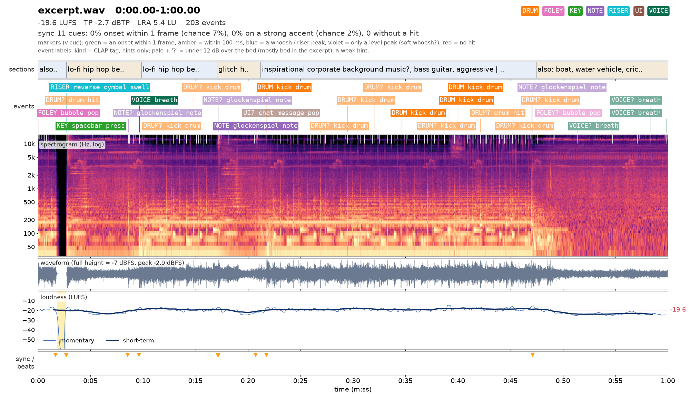
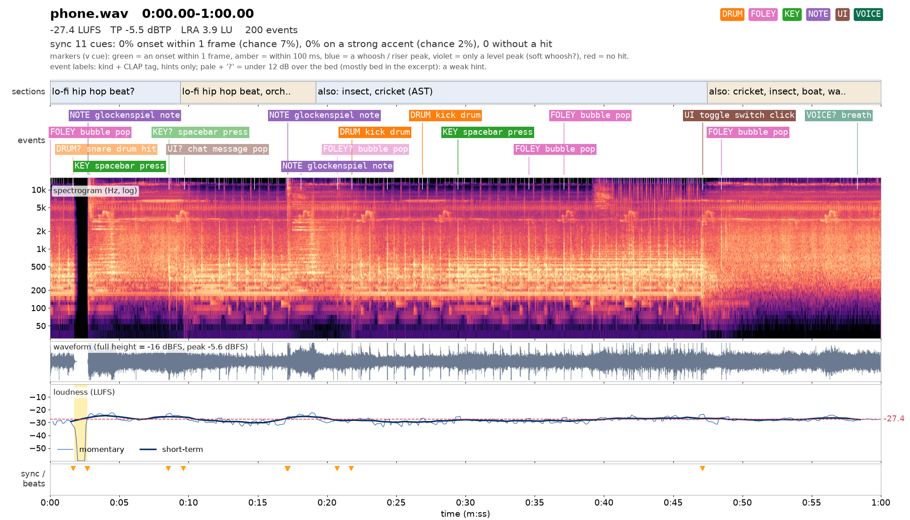
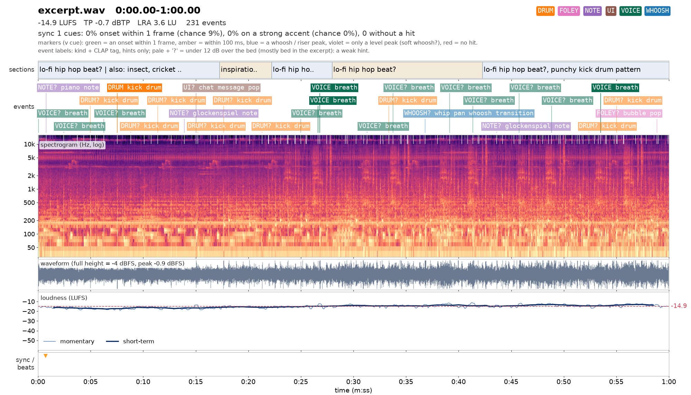

# Audio round 11: recorded sound, sequenced score, mix

The procedural WebAudio voices have been replaced by **real recordings** for every effect, bed and stinger.
The adaptive score is now **played on recorded percussion** (frame drum, djembe, shaker, taiko, a deep
drum, a bowed cello drone) by a humanised sequencer, through a **recorded church impulse response**. Every
public engine method keeps its procedural voice as a fallback, used until (or if never) its sample decodes.

## What earshot heard

All numbers below come from earshot 0.2 (CLAP + AST + realness model, local CPU), run on audio captured
from the real game in headless Chromium (`tools/capture-audio.mjs`: the master output through
MediaRecorder, while the script plays rounds with cash-outs, falls, mute/unmute, tab hide/show and a rapid
RUN after a result).

| Check | Before (procedural engine) | After |
| --- | --- | --- |
| Realness of a gameplay capture | **likely code-synthesized**, p_real 0.12 (7 of 7 windows synthetic) | **real or pro-produced**, p_real 0.90 (0 of 15 windows synthetic, lowest 0.65) |
| Shipped files (`realness_many`) | — | 37 of 43 real or pro-produced, 6 uncertain, **0 code-synthesized** |
| Game cues answered by a sound (timeline sync) | — | 11 / 11 within 100 ms, median offset 29 ms |
| Music present (AudioSet "Music") | — | 0.61 over 60 s of rounds; 0.71 over a run through every tier; beat grid found at 94 BPM (the tier-0 tempo) |
| Loudness / peak (60 s of rounds) | — | −19.6 LUFS integrated, true peak −2.7 dBTP, LRA 5.4 LU |
| `critique` against 7 professional launch films | — | 21 of 22 metrics in range (92 %). The one miss is integrated loudness (films are mastered to about −14 LUFS; a game with volume sliders should not be) |
| Phone-speaker simulation (high-pass at 300 Hz ×2, low-pass at 9 kHz, mono) | — | 200 of 203 events still detected; every cue still within 100 ms (median 29 ms); short-term loudness −24.6 LUFS at its loudest |

How the mix got there (each step was measured by re-capturing and re-running earshot):

1. First capture: music was detected in **20 %** of windows, and the breathing was the loudest accent. A
   probe showed the score was running but at about −38 LUFS. Fix: percussion +8 dB, drone +8, riser
   strings +7, breathing −11, and a soft shaker groove from 1× so tier 0 is music rather than a heartbeat.
2. Second capture: music in **17 %**; the cicada bed (3–5 kHz, read as "crickets at night" / "kettle
   whistling") and a constant drone filled the spectrum, and loudness was flat (LRA 2.5). Fix: beds −5 dB,
   cicadas −13 dB, music bus +3 dB, a lower idle drone. The run through every tier then read as music
   (AudioSet 0.71) and the critique called it "launch-grade" (20 of 22). True peak was −0.7 dBTP, so a
   −1.9 dB output trim follows the limiter (the WebAudio compressor has no look-ahead).
3. Third capture: the cash-out and escape barely registered (2.6 dB over the bed, then nothing). Fix:
   gold, sparkle and swell +5 to +8 dB, every escape lands on a struck taiko, and boom and gong +4 to +5 dB.
4. Fourth capture (the coordinator's brief): while running, the ambience bus now ducks **10 dB at 1×,
   rising to 14 dB from 10×**, and closes from 16 kHz to 6–4.5 kHz. The cicada bed carries its own −9 dB
   high shelf at 3.2 kHz. Result: cash-outs land 8.6 dB (and more) over the bed, the fall 8.5 dB over
   it, and every cue gets an onset.

Sheets (open them; they're annotated spectrograms with events, loudness and cue markers):

* `sheet-rounds.png`: final mix, 60 s with two escapes (1.46× and 1.60×), a run to 4.94× and its fall.
* `sheet-rounds-phone.png`: the same through the phone-speaker simulation.
* `sheet-tiers.png` and `sheet-tiers-phone.png`: a single run from 1× to about 40×, through every tier. This is
  the **mix-pass-2** capture: it was made before step 3's stinger lift, the −1.9 dB trim and the ambience duck.
  The seeded capture did not reach the high tiers again in later passes, because the game rebuilds its world
  for about 30 s per round on SwiftShader.





## Sizes

| Group | Loads | Sounds | Opus/WebM | AAC/M4A (iOS fallback) | Budget |
| --- | --- | --- | --- | --- | --- |
| core (steps, impacts, falls, cash-out, UI) | with the page (decoded on the first gesture) | 24 | **751 KB** | 1,163 KB | 1.5 MB |
| beds (jungle, cicadas, river, waterfall, wind, gusts) | after the first gesture | 6 | 585 KB | 870 KB | 2.5 MB with music |
| music (percussion, drone, strings, boom, gong, IR) | after the first gesture | 13 | 300 KB | 524 KB | (885 KB used) |

Mono 48 kbps Opus for one-shots and stereo 40–64 kbps for beds. Every file carries a content hash in
`public/audio/manifest.json` (`?v=<hash>`, so `/audio/*` is served immutable). On iOS: WebM Opus is used
when `canPlayType` says yes (Safari 17+), and a WebM that fails to decode retries as M4A. Slices are snapped
onto their onsets after decoding, which absorbs AAC priming delay.

## Every sound, its source and licence

85 recordings (54 CC0, 31 CC BY), all from Freesound via Openverse. There are no Jamendo stems: the only
CC-licensed tribal track was a 9-minute full mix, not stems, so the score is sequenced from one-shots. The
verbatim attribution lines are in `public/audio/CREDITS.txt`, which ships with the game, and every file is
listed in `THIRD_PARTY_NOTICES.md` (a generated section). p_real is earshot's realness for the shipped file.

| Sound | Group | Variants | Opus / AAC | p_real | Source recordings (title, creator, licence) |
| --- | --- | --- | --- | --- | --- |
| `step_stone` | core | 8 | 24 / 40 KB | 0.82 | [Footsteps Stone (9).wav](https://freesound.org/people/Wdomino/sounds/517134), Wdomino, CC0<br>[Footsteps Stone (7).wav](https://freesound.org/people/Wdomino/sounds/517136), Wdomino, CC0<br>[Footsteps Stone sequence.wav](https://freesound.org/people/Wdomino/sounds/517141), Wdomino, CC0<br>[Footsteps Stone (5).wav](https://freesound.org/people/Wdomino/sounds/517125), Wdomino, CC0<br>[Footsteps Stone (11).wav](https://freesound.org/people/Wdomino/sounds/517124), Wdomino, CC0 |
| `step_wood` | core | 7 | 24 / 38 KB | 0.92 | [footsteps - wood & stairs 02.wav](https://freesound.org/people/Anthousai/sounds/398781), Anthousai, CC0<br>[Footstep - wood - parquet - flooring - squeak - RUNNING.wav](https://freesound.org/people/ValentinPetiteau/sounds/557200), ValentinPetiteau, CC0 |
| `step_gravel` | core | 7 | 23 / 36 KB | 0.85 | [Footstep gravel sneakers](https://freesound.org/people/xkeril/sounds/639085), xkeril, CC0<br>[Footsteps Gravel Running-Stop](https://freesound.org/people/KikeVilaplana/sounds/436525), KikeVilaplana, CC0 |
| `step_wet` | core | 7 | 29 / 38 KB | 0.97 | [puddlewalk.wav](https://freesound.org/people/j1987/sounds/106395), j1987, CC0<br>[MUDDY AND WET FOOTSTEPS.wav](https://freesound.org/people/Alex_hears_things/sounds/376809), Alex_hears_things, CC0 |
| `breath` | core | 1 | 44 / 69 KB | 0.99 | [heavy breathing while running](https://freesound.org/people/florianreichelt/sounds/456037), florianreichelt, CC0 |
| `pant` | core | 1 | 10 / 11 KB | 0.97 | [Men Pant.wav](https://freesound.org/people/nicklas3799/sounds/467369), nicklas3799, CC BY 4.0 |
| `bed_jungle` | beds | 1 | 147 / 200 KB | 0.91 | [Bukit_Dinding_rainforest_jungle_01.wav](https://freesound.org/people/wanna73/sounds/20291), wanna73, CC BY 3.0 |
| `bed_insects` | beds | 1 | 128 / 165 KB | 0.98 | [Cicadas euroblues.wav](https://freesound.org/people/euroblues/sounds/20064), euroblues, CC0 |
| `bed_waterfall` | beds | 1 | 92 / 154 KB | 0.69 (uncertain) | [waterfall](https://freesound.org/people/LXX.70/sounds/165108), LXX.70, CC0 |
| `bed_river` | beds | 1 | 92 / 154 KB | 0.81 | [River, stream, creek, sound of waves, moving water](https://freesound.org/people/kentspublicdomain/sounds/325182), kentspublicdomain, CC0 |
| `bed_wind` | beds | 1 | 78 / 129 KB | 0.78 | [Braddons Lookout Wind Gusts #1.m4a](https://freesound.org/people/guyburns/sounds/474894), guyburns, CC0 |
| `gust` | beds | 3 | 49 / 69 KB | 0.90 | [Wind gust](https://freesound.org/people/wintuh/sounds/471854), wintuh, CC0<br>[Braddons Lookout Wind Gusts #2.m4a](https://freesound.org/people/guyburns/sounds/474895), guyburns, CC0 |
| `impact` | core | 6 | 23 / 37 KB | 0.92 | [Laying Down Large Stone on Pile of Large Stones 1.wav](https://freesound.org/people/F.M.Audio/sounds/570534), F.M.Audio, CC BY 4.0<br>[two large cobblestone blocks](https://freesound.org/people/jobel0092/sounds/268055), jobel0092, CC0<br>[Kicking Large Stones Down Shoreline on Stony Beach 5.wav](https://freesound.org/people/F.M.Audio/sounds/574445), F.M.Audio, CC BY 4.0<br>[Pushing Large Stones Down Shoreline on Stony Beach 1.wav](https://freesound.org/people/F.M.Audio/sounds/574450), F.M.Audio, CC BY 4.0 |
| `slam` | core | 3 | 13 / 22 KB | 0.97 | [impact-stone-heavy.wav](https://freesound.org/people/kasparsj/sounds/513694), kasparsj, CC0<br>[Stone dropping to ground_northern87](https://freesound.org/people/northern87/sounds/369981), northern87, CC0 |
| `grind` | core | 3 | 28 / 44 KB | 0.94 | [large stone rubs grinds on stone](https://freesound.org/people/Garuda1982/sounds/560304), Garuda1982, CC BY 4.0<br>[stone_on_stone.aif](https://freesound.org/people/thanvannispen/sounds/29986), thanvannispen, CC BY 4.0<br>[stone door close.wav](https://freesound.org/people/patchytherat/sounds/530987), patchytherat, CC0 |
| `rumble` | core | 3 | 102 / 161 KB | 0.92 | [Large Earthquake](https://freesound.org/people/LoafDV/sounds/148002), LoafDV, CC BY 4.0<br>[earthquake.aif](https://freesound.org/people/dingus23/sounds/275809), dingus23, CC BY 4.0 |
| `rockfall` | core | 5 | 114 / 172 KB | 0.96 | [rockfall 07.flac](https://freesound.org/people/tim.kahn/sounds/49622), tim.kahn, CC BY 4.0<br>[LandslideSeriousExtraCred.mp3](https://freesound.org/people/tayingalive/sounds/442552), tayingalive, CC BY 4.0<br>[Rockslide 2.wav](https://freesound.org/people/juskiddink/sounds/79783), juskiddink, CC BY 4.0 |
| `crumble` | core | 3 | 59 / 90 KB | 0.97 | [Breaking A Wall Down (With A Hammer)](https://freesound.org/people/scampsie/sounds/417091), scampsie, CC BY 3.0 |
| `splash_big` | core | 3 | 37 / 66 KB | 0.98 | [Splash, Jumping, H.wav](https://freesound.org/people/InspectorJ/sounds/352102), InspectorJ, CC BY 4.0<br>[Splash, Jumping, D.wav](https://freesound.org/people/InspectorJ/sounds/352098), InspectorJ, CC BY 4.0<br>[Splash, Jumping, C.wav](https://freesound.org/people/InspectorJ/sounds/352099), InspectorJ, CC BY 4.0 |
| `splash_small` | core | 2 | 8 / 18 KB | 0.99 | [Splash](https://freesound.org/people/swordofkings128/sounds/398032), swordofkings128, CC0<br>[Splash-eau-goudron1.wav](https://freesound.org/people/rombart/sounds/186748), rombart, CC0 |
| `debris` | core | 5 | 47 / 70 KB | 0.95 | [Gravel Stone Dirt Debris Falling Small 1 3](https://freesound.org/people/Sheyvan/sounds/569736), Sheyvan, CC0<br>[Gravel Stone Dirt Debris Falling Small 1 4](https://freesound.org/people/Sheyvan/sounds/569737), Sheyvan, CC0<br>[Gravel Stone Dirt Debris Falling Small 1 6](https://freesound.org/people/Sheyvan/sounds/569739), Sheyvan, CC0<br>[Gravel Stone Dirt Debris Falling Small 1 13](https://freesound.org/people/Sheyvan/sounds/569746), Sheyvan, CC0<br>[Gravel Stone Dirt Debris Falling Small 1 12](https://freesound.org/people/Sheyvan/sounds/569745), Sheyvan, CC0 |
| `dust` | core | 3 | 39 / 51 KB | 0.96 | [sand pour on sand FF662.aif](https://freesound.org/people/martinimeniscus/sounds/199332), martinimeniscus, CC0<br>[sand pour on slate FF670.aif](https://freesound.org/people/martinimeniscus/sounds/199331), martinimeniscus, CC0 |
| `whoosh` | core | 4 | 15 / 23 KB | 0.84 | [13th Whoosh Swing Sound](https://freesound.org/people/qubodup/sounds/60000), qubodup, CC0<br>[Swipe Whoosh](https://freesound.org/people/qubodup/sounds/60007), qubodup, CC0<br>[Swosh swoosh whoosh air sound, free, high quality](https://freesound.org/people/qubodup/sounds/60026), qubodup, CC0<br>[Deep Whoosh #1](https://freesound.org/people/Kinoton/sounds/351256), Kinoton, CC0 |
| `coins` | core | 4 | 16 / 38 KB | 0.72 (uncertain) | [Coins Being Dropped-Assorted](https://freesound.org/people/TheWoodlandNomad/sounds/363090), TheWoodlandNomad, CC0<br>[20080928.coins.05.wav](https://freesound.org/people/dobroide/sounds/60769), dobroide, CC BY 4.0 |
| `sparkle` | core | 2 | 37 / 45 KB | 0.80 | [GLEAM-GLOW-SFX-CHIME.wav](https://freesound.org/people/newagesoup/sounds/351408), newagesoup, CC0<br>[Glimmer.wav](https://freesound.org/people/opticaillusions/sounds/521873), opticaillusions, CC0 |
| `swell` | core | 1 | 26 / 43 KB | 0.92 | [Movie Swell 2](https://freesound.org/people/jordivburgel/sounds/218524), jordivburgel, CC0 |
| `ui_tap` | core | 5 | 13 / 22 KB | 0.96 | [Fireplace Granite Drum.WAV](https://freesound.org/people/RayGunV/sounds/628971), RayGunV, CC BY 4.0<br>[patting stone wall.wav](https://freesound.org/people/vestibule-door/sounds/669723), vestibule-door, CC0 |
| `ui_tick` | core | 2 | 5 / 6 KB | 0.91 | [Wooden Click](https://freesound.org/people/BenjaminNelan/sounds/321083), BenjaminNelan, CC0<br>[Wooden hit short soft](https://freesound.org/people/jorickhoofd/sounds/161595), jorickhoofd, CC BY 4.0 |
| `ui_slide` | core | 2 | 13 / 19 KB | 0.91 | [concrete1.mp3](https://freesound.org/people/Faceonmars/sounds/106258), Faceonmars, CC0 |
| `ui_toggle` | core | 1 | 2 / 3 KB | 0.46 (uncertain) | [Switch click 4.wav](https://freesound.org/people/deleted_user_2104797/sounds/164549), deleted_user_2104797, CC0 |
| `m_taiko` | music | 3 | 14 / 22 KB | 0.81 | [TAIKO DRUM 001.wav](https://freesound.org/people/sandyrb/sounds/82712), sandyrb, CC BY 4.0<br>[Taiko Drumloop 002 [With Ending] (120)](https://freesound.org/people/Xinematix/sounds/491278), Xinematix, CC0<br>[Taiko Drumloop 003 [With Ending Variation] (120)](https://freesound.org/people/Xinematix/sounds/491279), Xinematix, CC0 |
| `m_taiko_hi` | music | 3 | 10 / 17 KB | 0.87 | [123-Taiko-Open.wav](https://freesound.org/people/klemmy/sounds/203344), klemmy, CC BY 3.0<br>[Taiko Drumloop 002 [With Ending] (120)](https://freesound.org/people/Xinematix/sounds/491278), Xinematix, CC0<br>[Taiko Drumloop 003 [With Ending Variation] (120)](https://freesound.org/people/Xinematix/sounds/491279), Xinematix, CC0 |
| `m_frame` | music | 3 | 13 / 22 KB | 0.94 | [Shaman Hand Frame Drum 04_02](https://freesound.org/people/Jagadamba/sounds/257160), Jagadamba, CC BY 4.0<br>[Shaman Hand Frame Drum 04_03](https://freesound.org/people/Jagadamba/sounds/257159), Jagadamba, CC BY 4.0<br>[Shaman Hand Frame Drum 03](https://freesound.org/people/Jagadamba/sounds/257158), Jagadamba, CC BY 4.0 |
| `m_pulse` | music | 4 | 10 / 12 KB | 0.95 | [detuned frame drum bass.WAV](https://freesound.org/people/HarpDave/sounds/518943), HarpDave, CC0 |
| `m_shaker` | music | 5 | 9 / 22 KB | 0.76 (uncertain) | [Egg Shaker 1](https://freesound.org/people/kramsttop/sounds/170905), kramsttop, CC BY 3.0<br>[Egg SHaker 2](https://freesound.org/people/kramsttop/sounds/170911), kramsttop, CC BY 3.0<br>[Shaker Riff.wav](https://freesound.org/people/HUMANOISEMAKER/sounds/148935), HUMANOISEMAKER, CC0 |
| `m_djembe_bass` | music | 2 | 8 / 13 KB | 0.97 | [African Djembe Drum - 1.wav](https://freesound.org/people/SpaceJoe/sounds/505396), SpaceJoe, CC0 |
| `m_djembe_tone` | music | 3 | 8 / 13 KB | 0.68 (uncertain) | [Djembe Hit 2 Center.wav](https://freesound.org/people/carlmartin/sounds/158959), carlmartin, CC0<br>[Djembe Hit 5 Center.wav](https://freesound.org/people/carlmartin/sounds/158962), carlmartin, CC0<br>[120-Djembe-Mute.wav](https://freesound.org/people/klemmy/sounds/203347), klemmy, CC BY 3.0 |
| `m_djembe_slap` | music | 3 | 8 / 11 KB | 0.72 (uncertain) | [Djembe Hit 6 Rim.wav](https://freesound.org/people/carlmartin/sounds/158968), carlmartin, CC0<br>[Djembe Hit 6 Hi Rim.wav](https://freesound.org/people/carlmartin/sounds/158969), carlmartin, CC0<br>[121-Djembe-Slap.wav](https://freesound.org/people/klemmy/sounds/203350), klemmy, CC BY 3.0 |
| `m_boom` | music | 2 | 41 / 76 KB | 0.87 | [cinematic boom 130730_06.wav](https://freesound.org/people/klankbeeld/sounds/195790), klankbeeld, CC BY 4.0<br>[[Boom] Reverbed Kick 09](https://freesound.org/people/waveplaySFX/sounds/353391), waveplaySFX, CC BY 4.0 |
| `m_gong` | music | 1 | 58 / 97 KB | 0.96 | [low gong bash](https://freesound.org/people/hiddenpersuader/sounds/155460), hiddenpersuader, CC0 |
| `m_drone` | music | 1 | 67 / 100 KB | 0.97 | [Low cello bass note](https://freesound.org/people/aarrnnoo/sounds/516188), aarrnnoo, CC BY 4.0 |
| `m_strings` | music | 1 | 16 / 27 KB | 0.95 | [Low cello bass note](https://freesound.org/people/aarrnnoo/sounds/516188), aarrnnoo, CC BY 4.0 |
| `ir_room` | music | 1 | 38 / 90 KB | 0.95 | [Impulse Response Church](https://freesound.org/people/jmuehlhans/sounds/220752), jmuehlhans, CC0 |


## Where each sound plays

* **Footsteps** (`step_stone`, `step_wood`, `step_gravel`, `step_wet`; 7–8 takes each). Every footstep event
  from `runner.ts` picks a fresh take, never the last one, with ±70–80 cents of pitch, ±2 dB and a slight
  left/right pan. Strength sets level and brightness (soft steps are duller). Wood comes from the world;
  stone is refined by section into gravel (ruins, tunnel, stairs) or wet stone (cliff, gorge), but only
  when the game reports the section (see *Integration*). At a hard sprint the push-off sometimes kicks grit.
* **Breathing** (`breath` loop) from 2× (the sprint tier), louder with the multiplier on screen and
  silent at any result. **`pant`** after every escape.
* **Beds**: jungle by day (birds and insects), cicadas, river, waterfall, wind (speed-driven), and random
  wind **gusts**. They crossfade by section through `setSection()` and duck under the score while running.
* **Danger**: `rumble` (tremor), `grind` (gate slab lets go; one take is a real stone door), `slam` (the
  slab or the biggest boulder lands; layered with a boom, debris and dust), `impact` (stone hits, with
  debris above half strength and dust above three-quarters), `rockfall`, `crumble` (chasm), `splash_big`
  and `splash_small` (split at size 0.55, with a few drops after a big one), `debris`, `dust`, `whoosh`.
* **Escape and cash-out**: on the press, `coins` plus `sparkle`, immediately and before the server
  answers. On the escape, `swell`, gold, sparkle, a taiko and `pant`; from 2× a stronger taiko, from 5× the
  boom, from 10× a taiko call with a second sparkle and coins, from 25× a bright gong (the low gong at 1.5×
  speed). It is sized by the **cash-out multiplier** only.
* **Fall**: the score stops dead, then a boom and the low gong, longer and lower from 10×. The drone sags in
  pitch, and the kind-specific sound plays (grind, crumble, or rockfall plus rumble).
* **Milestones and tiers**: a struck taiko, a boom from 10×, and a sparkle that climbs with each mark, with
  the score ducked under it. `tier_up` (from the FX round) queues a taiko and boom accent on the **next
  downbeat**, the bar where the new layer fades in, so it is part of the score rather than a separate ding.
* **UI**: stone taps (`ui_tap`: press, bet, deny), soft wood ticks (`ui_tick`: stepper, a very quiet
  hover), a short stone slide for panel open/close, and a small switch for toggle.
* **Score** (`score.ts`): four layers, crossfaded over a bar on the tier of the multiplier on screen:
  1. pulse (deep drum heartbeat, frame-drum backbeat with ghost notes, soft shaker);
  2. hands from 2× (sixteenth-note shaker, one of three djembe patterns picked per bar);
  3. taiko from 5× (big and small taiko, a fill on bar 4 of each phrase);
  4. drive from 10× (syncopated taiko, slaps, a boom each phrase; from 25× the fill doubles into sixteenths).

  Tempo is 94 → 116 BPM, changing on bar lines only. The playing is humanised: swing on the off-sixteenths,
  ±4–9 ms of timing jitter (the big drums looser), dropped sixteenths, ghost notes, flams on the taiko,
  random takes, ±25–40 cents and ±1.5–2.5 dB per hit. Under it all sits a bowed cello drone, and recorded
  cello an octave up carries the tension riser. Between rounds there is a sparse frame drum over the drone
  and the jungle.

## Pipeline (reproducible)

```
NODE_USE_ENV_PROXY=1 node tools/fetch-audio.mjs search      # 35 queries, each run once; responses cached in .cache/audio/search
node tools/fetch-audio.mjs candidates 12                    # ≤ 12 usable results per query, each ≤ 2.5 MB → .cache/audio/candidates
#   earshot rank (one description per query) → pick; earshot find → trims    (scripts: see "Method")
node tools/fetch-audio.mjs lock                             # copy each pick's Openverse record into tools/audio-sources.json
node tools/fetch-audio.mjs picks                            # the chosen files → .cache/audio/picks
node tools/build-audio.mjs                                  # trim, fade, loop, BS.1770 normalise, limit, encode, manifest, CREDITS, notices
URL=http://localhost:5196 node tools/capture-audio.mjs out  # gameplay capture + cue list for earshot
```

* Rules are enforced in code: licence `cc0` / `by` / `pdm` and source `freesound` / `jamendo` are filtered
  in the query and checked again on every pick. Credits are copied from the Openverse record, never typed.
  The downloads live only in the gitignored `.cache/audio/` and are read only by ffmpeg.
* Loudness: one-shots are normalised to −16 LUFS on their loudest 400 ms; beds and the drone to −24 LUFS
  integrated (K-weighting computed in the build). A 1.5 ms look-ahead limiter may take up to 4 dB off
  transient peaks under a −1 dBFS ceiling. A gentle −2 dB shelf at 7 kHz tames phone-speaker fizz.
* The mix (relative levels, pitch and level variation, voice priorities and per-sound caps) is in
  `src/audio/catalog.ts`.

## Runtime and edge cases

* `samples.ts`: decode once, then a voice pool (12 voices on low-end devices, 20 on phones and 4-core
  machines, 32 otherwise). A sound over its own cap renews its oldest voice; a full pool steals the
  lowest-priority voice nearest its end and never a more important one, and ornaments are dropped
  before slams or the cash-out. Loops (beds, drone, breath) live outside the pool.
* Fallback: `sample()` returns false until a sound is decoded, and then the procedural voice plays. The
  synth beds, pad and riser fade out only once their recorded replacements are running.
* Mute and volume go through the existing master, music and sfx gains. On tab hide the existing
  suspend/resume applies, and the sequencer skips ahead after a stall instead of bursting. The first gesture
  creates and resumes the context (iOS); core decodes then, and beds and score load right after.
* A rapid RUN after a result: `lead` fades the previous stinger out in about 0.1 s, resets the duck and
  restarts the grid. Many impacts at once: the existing crowd scaling plus the pool and per-sound caps.
  Verified by unit tests and the capture (no page errors, at most 11 pool voices at the end).
* Reduced motion leaves audio unchanged.
* `audio.sfx(name, strength)` and `WorldSounds.event(name, strength)` accept `dust_burst`,
  `stones_skitter`, `tier_up` and the generic names in `select.ts`. Unknown names do nothing.
* **Honesty**:
  - Everything live (score tier, ambience duck, riser, breathing, tier accents) reads only the multiplier
    passed to `climb()`.
  - The escape stinger is sized by `outcome(cashoutMult)`; nothing about the fall plays after a cash-out.
  - The fall stinger is sized by the settled crash, which is public by then.
  - The cash-out sound plays on the press, after the request is sent. Money never waits on audio.

## Still weak (honest list)

* **The score is percussion plus one drone note.** There is no harmonic movement, and the old synth chord
  changes are gone when samples are loaded. It reads as music (AudioSet 0.61–0.71, beat at 94 BPM), but a
  human composer's stems would be better. Jamendo had none under the allowed licences.
* **The riser** is a 2.5 s loop of cello pitched up an octave. It is real, but short and audibly repetitive
  if you listen for it. The scary-strings crescendos on Freesound read as code-synthesized (p_real 0.2–0.45)
  and were rejected.
* **6 files read "uncertain" for realness** (none synthetic):
  - `bed_waterfall` 0.69: broadband noise always reads this way.
  - `coins` 0.72.
  - `m_djembe_tone` 0.68 and `m_djembe_slap` 0.72: very short, close-miked hits.
  - `m_shaker` 0.76.
  - `ui_toggle` 0.46: a single 0.1 s plastic switch. It is the weakest asset; swap it for a wood click if it
    sounds cheap.
* **The booms** (`m_boom`, designed trailer booms) read 0.87 as a file, but 0.39–0.49 for each source on
  its own. They are produced sound design, not field recordings.
* **The gameplay mix sits at −19.6 LUFS integrated**, with a true peak of −2.7 dBTP. That is comfortable
  next to other apps, but quieter than launch films; the earshot critique suggests +5 dB.
* **Gravel and wet-stone footsteps and the section bed crossfade need one line in game code** (below).
  Without it, stone steps get 15 % gravel and the beds stay on the default jungle-and-river mix.
* The tier sheet predates the final stinger and ambience changes (see above).
* No human has listened. earshot hears loudness, timing and "is this the kind of sound" well; it cannot
  judge taste. A blind listen on a phone and on headphones is the next step.

## Integration requests (outside src/audio; not done here)

1. `src/render/game.ts`, in `footstep()`: call `this.sounds.setSection?.(this.track.sectionAt(this.s)?.type)`
   (and add `setSection?(type: string | null | undefined): void` to `WorldSounds`). This enables gravel and
   wet-stone steps and the waterfall and river crossfade by section.
2. Optional: an "Ambience" volume in Settings, if players want the jungle louder or quieter. The beds are
   currently on the sfx slider.

## Method (scripts used, in the scratchpad, not shipped)

`rank.py` ran `api.rank` with one description per query plus `realness_many` on the ranked files.
`find.py` ran `api.find` for trims, with event/texture kinds and realness on the best trim. `gen_sources.py`
turned the trims into `tools/audio-sources.json`; skipped trims were mid-file head cuts, and the few fixed
trims were set from measured envelopes. `analyze.py` ran `measure`, `timeline`, `sheet`, `realness`,
`describe` and `critique` on the captures. Rank results per query are summarised in the sound table; the
picks were the best-z candidates that also read real, with CC0 preferred on near ties.
