# Motion audit — review/motion/base-df9304e

World 7, quality high, 1280×720, 30 fps time-stepped. Frame numbers count from the sequence start (frame 0 = the world built, setup shot).
Each row is a run of consecutive flagged frames (same check); the peak frame and value are given. Sheets show the frame each new kind of flag was first seen.

| sequence | frames | judder | joint | slide | pop | frozen | framing | camera | staged |
|---|---|---|---|---|---|---|---|---|---|
| start | 0–228 | 3 | 0 | 2 | 3 | 0 | 0 | 0 |  |
| log | 78–363 | 3 | 1 | 0 | 9 | 0 | 0 | 0 | placed true, fired {"log":1} |
| beam | 78–363 | 3 | 0 | 2 | 8 | 0 | 0 | 0 | placed true, fired {"beam":1} |
| pillar | 78–363 | 3 | 4 | 0 | 7 | 0 | 0 | 0 | placed true, fired {"pillar":1} |
| blocks | 78–363 | 3 | 0 | 4 | 6 | 0 | 0 | 0 | placed true, fired {"blocks":1} |
| corner | 78–363 | 4 | 0 | 2 | 6 | 0 | 0 | 0 |  |
| cash1.5 | 166–496 | 4 | 0 | 1 | 15 | 0 | 0 | 1 | mult 1.49 |
| cash5 | 739–1069 | 2 | 6 | 1 | 8 | 1 | 0 | 9 | mult 4.99 |
| cash20 | 1400–1730 | 1 | 13 | 1 | 11 | 2 | 0 | 1 | mult 20.01 |
| cash60 | 1938–2268 | 2 | 7 | 2 | 9 | 2 | 1 | 9 | mult 61.96 |
| fall_start | 20–270 | 0 | 2 | 0 | 1 | 0 | 0 | 1 | kind gate |
| chasm0 | 526–796 | 0 | 10 | 0 | 10 | 0 | 0 | 1 | kind chasm, clip fall_chasm, mult 3 |
| chasm1 | 526–796 | 0 | 8 | 0 | 5 | 0 | 0 | 1 | kind chasm, clip fall_chasm_b, mult 3 |
| gate0 | 526–796 | 0 | 1 | 1 | 7 | 1 | 0 | 4 | kind gate, clip fall_gate, mult 3 |
| gate1 | 526–796 | 0 | 5 | 1 | 2 | 0 | 0 | 4 | kind gate, clip fall_gate_b, mult 3 |
| rock0 | 526–796 | 0 | 0 | 1 | 2 | 1 | 0 | 6 | kind rockfall, clip fall_rock, mult 3 |
| rock1 | 526–796 | 0 | 5 | 1 | 3 | 0 | 0 | 6 | kind rockfall, clip fall_rock_b, mult 3 |

## start

Timeline: 0–44 setup/idle · 45–76 lead/ready · 77–107 run/start · 108–228 run/run

Gait judder (J / J of the joint's curve low-passed at 4× stride / excess; stride 2.23 Hz): spine 0.18/0.16/+0.02, chest 0.17/0.18/-0.00, neck 0.16/0.17/-0.01, head 0.14/0.18/-0.04, shoulderL 0.26/0.22/+0.03, shoulderR 0.26/0.22/+0.04, upper_armL 0.25/0.22/+0.04, upper_armR 0.25/0.22/+0.04, forearmL 0.25/0.23/+0.03, forearmR 0.25/0.23/+0.03, handL 0.25/0.23/+0.02, handR 0.25/0.23/+0.02, thighL 0.51/0.34/+0.17, thighR 0.46/0.34/+0.12, shinL 0.52/0.56/-0.04, shinR 0.46/0.53/-0.08, footL 0.65/0.75/-0.10, footR 0.65/0.60/+0.06, toeL 0.93/0.73/+0.20, toeR 0.79/0.70/+0.09

| frames | check | peak | clip at peak |
|---|---|---|---|
| 104 | pop: shinR snaps | f104: 27°/frame between 8° and 0° | run/start |
| 109 | slide: footL slides | f109: 6.2 cm/frame while planted | run/run |
| 112 | judder: toeL judders in the gait | f112: J 0.93 vs 0.73 for its own curve low-passed at 4× stride (2.23 Hz): excess 0.20 (limit 0.1); worst frames f112, f202, f125, f215, f189, f136 | run/run |
| 121 | slide: footL slides | f121: 3.6 cm/frame while planted | run/run |
| 149 | pop: head jumps | f149: 6 cm in one frame between 2 and 2 cm | run/run |
| 169 | judder: thighR judders in the gait | f169: J 0.46 vs 0.34 for its own curve low-passed at 4× stride (2.23 Hz): excess 0.12 (limit 0.1); worst frames f169, f156, f182, f143, f195, f170 | run/run |
| 181 | pop: head jumps | f181: 6 cm in one frame between 2 and 2 cm | run/run |
| 227 | judder: thighL judders in the gait | f227: J 0.51 vs 0.34 for its own curve low-passed at 4× stride (2.23 Hz): excess 0.17 (limit 0.1); worst frames f227, f137, f214, f124, f150, f111 | run/run |

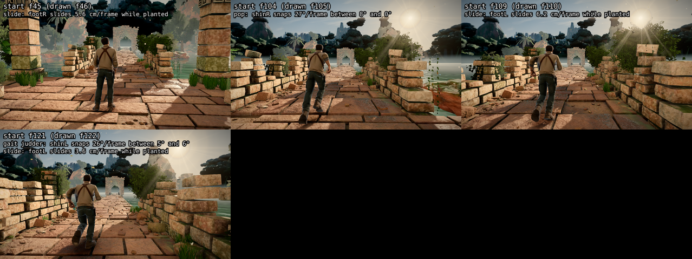

## log

Timeline: 78–93 run/start · 94–208 run/run · 209–230 run/jump_log · 231–285 run/run · 286–309 run/slide · 310–363 run/run

Gait judder (J / J of the joint's curve low-passed at 4× stride / excess; stride 2.35 Hz): spine 0.18/0.18/-0.00, chest 0.17/0.16/+0.01, neck 0.17/0.14/+0.03, head 0.14/0.12/+0.03, shoulderL 0.26/0.21/+0.04, shoulderR 0.26/0.24/+0.02, upper_armL 0.25/0.23/+0.02, upper_armR 0.25/0.23/+0.03, forearmL 0.25/0.23/+0.03, forearmR 0.25/0.22/+0.03, handL 0.25/0.20/+0.05, handR 0.25/0.26/-0.01, thighL 0.50/0.33/+0.16, thighR 0.47/0.35/+0.12, shinL 0.50/0.50/+0.00, shinR 0.47/0.49/-0.03, footL 0.64/0.68/-0.04, footR 0.67/0.66/+0.01, toeL 0.90/0.74/+0.17, toeR 0.79/0.71/+0.08

| frames | check | peak | clip at peak |
|---|---|---|---|
| 90 | pop: shinR snaps | f90: 27°/frame between 8° and 0° | run/start |
| 135 | pop: head jumps | f135: 6 cm in one frame between 2 and 2 cm | run/run |
| 142 | judder: thighR judders in the gait | f142: J 0.47 vs 0.35 for its own curve low-passed at 4× stride (2.35 Hz): excess 0.12 (limit 0.1); worst frames f142, f155, f129, f168, f141, f128 | run/run |
| 167 | pop: head jumps | f167: 6 cm in one frame between 2 and 2 cm | run/run |
| 200 | judder: thighL judders in the gait | f200: J 0.50 vs 0.33 for its own curve low-passed at 4× stride (2.35 Hz): excess 0.16 (limit 0.1); worst frames f200, f97, f110, f123, f109, f187 | run/run |
| 201 | judder: toeL judders in the gait | f201: J 0.90 vs 0.74 for its own curve low-passed at 4× stride (2.35 Hz): excess 0.17 (limit 0.1); worst frames f201, f202, f188, f98, f99, f175 | run/run |
| 214 | pop: hips jump | f214: 16 cm/frame² relative to the ground | run/jump_log |
| 215 | joint: footL swing | f215: 61° (limit 60°) | run/jump_log |
| 229 | pop: shinR snaps | f229: 28°/frame between 4° and 1° | run/jump_log |
| 231 | pop: handL jumps | f231: 18 cm in one frame between 5 and 2 cm | run/run |
| 263 | pop: head jumps | f263: 6 cm in one frame between 2 and 2 cm | run/run |
| 290 | pop: hips jump | f290: 11 cm/frame² relative to the ground | run/slide |
| 313 | pop: head jumps | f313: 6 cm in one frame between 2 and 2 cm | run/run |

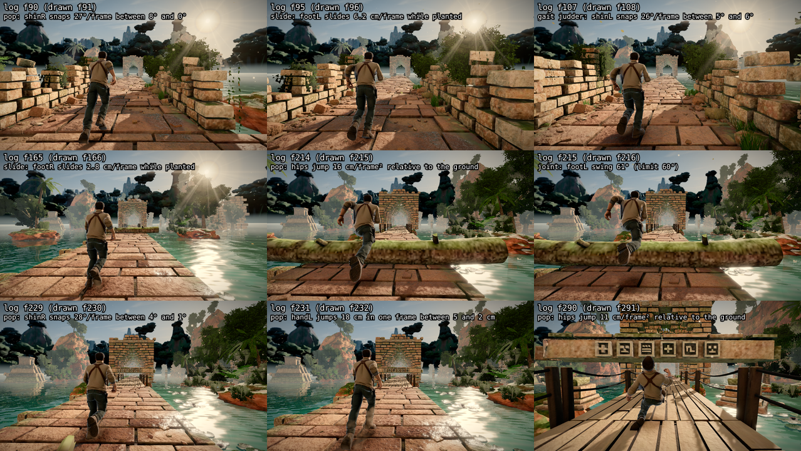

## beam

Timeline: 78–93 run/start · 94–221 run/run · 222–245 run/slide · 246–277 run/run · 278–301 run/slide · 302–363 run/run

Gait judder (J / J of the joint's curve low-passed at 4× stride / excess; stride 2.34 Hz): spine 0.18/0.16/+0.02, chest 0.18/0.17/+0.01, neck 0.17/0.23/-0.07, head 0.14/0.11/+0.03, shoulderL 0.26/0.21/+0.05, shoulderR 0.25/0.24/+0.01, upper_armL 0.25/0.22/+0.03, upper_armR 0.25/0.22/+0.03, forearmL 0.25/0.22/+0.03, forearmR 0.25/0.22/+0.03, handL 0.25/0.25/-0.01, handR 0.25/0.21/+0.04, thighL 0.50/0.33/+0.17, thighR 0.47/0.34/+0.13, shinL 0.50/0.49/+0.01, shinR 0.46/0.47/-0.01, footL 0.65/0.71/-0.07, footR 0.64/0.65/-0.01, toeL 0.94/0.74/+0.20, toeR 0.81/0.73/+0.08

| frames | check | peak | clip at peak |
|---|---|---|---|
| 90 | pop: shinR snaps | f90: 27°/frame between 8° and 0° | run/start |
| 97 | judder: thighL judders in the gait | f97: J 0.50 vs 0.33 for its own curve low-passed at 4× stride (2.34 Hz): excess 0.17 (limit 0.1); worst frames f97, f110, f213, f200, f123, f187 | run/run |
| 98 | judder: toeL judders in the gait | f98: J 0.94 vs 0.74 for its own curve low-passed at 4× stride (2.34 Hz): excess 0.20 (limit 0.1); worst frames f98, f201, f189, f202, f188, f99 | run/run |
| 135 | pop: head jumps | f135: 6 cm in one frame between 2 and 2 cm | run/run |
| 142 | judder: thighR judders in the gait | f142: J 0.47 vs 0.35 for its own curve low-passed at 4× stride (2.34 Hz): excess 0.13 (limit 0.1); worst frames f142, f155, f129, f168, f141, f218 | run/run |
| 167 | pop: head jumps | f167: 6 cm in one frame between 2 and 2 cm | run/run |
| 226 | pop: hips jump | f226: 11 cm/frame² relative to the ground | run/slide |
| 249 | pop: head jumps | f249: 7 cm in one frame between 2 and 1 cm | run/run |
| 260 | slide: footR slides | f260: 2.8 cm/frame while planted | run/run |
| 273 | slide: footR slides | f273: 3.6 cm/frame while planted | run/run |
| 282 | pop: hips jump | f282: 11 cm/frame² relative to the ground | run/slide |
| 305 | pop: head jumps | f305: 6 cm in one frame between 2 and 2 cm | run/run |
| 318 | pop: head jumps | f318: 7 cm in one frame between 2 and 2 cm | run/run |

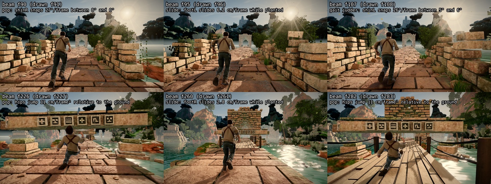

## pillar

Timeline: 78–93 run/start · 94–221 run/run · 222–244 run/vault · 245–289 run/run · 290–313 run/slide · 314–363 run/run

Gait judder (J / J of the joint's curve low-passed at 4× stride / excess; stride 2.34 Hz): spine 0.18/0.16/+0.02, chest 0.18/0.18/-0.01, neck 0.15/0.22/-0.07, head 0.14/0.11/+0.03, shoulderL 0.26/0.23/+0.03, shoulderR 0.25/0.21/+0.04, upper_armL 0.25/0.22/+0.03, upper_armR 0.25/0.22/+0.03, forearmL 0.25/0.22/+0.03, forearmR 0.25/0.22/+0.03, handL 0.25/0.25/-0.01, handR 0.25/0.21/+0.04, thighL 0.50/0.33/+0.17, thighR 0.47/0.34/+0.13, shinL 0.50/0.49/+0.01, shinR 0.46/0.47/-0.01, footL 0.65/0.71/-0.07, footR 0.64/0.65/-0.01, toeL 0.94/0.74/+0.20, toeR 0.81/0.73/+0.08

| frames | check | peak | clip at peak |
|---|---|---|---|
| 90 | pop: shinR snaps | f90: 27°/frame between 8° and 0° | run/start |
| 97 | judder: thighL judders in the gait | f97: J 0.50 vs 0.33 for its own curve low-passed at 4× stride (2.34 Hz): excess 0.17 (limit 0.1); worst frames f97, f110, f213, f200, f123, f187 | run/run |
| 98 | judder: toeL judders in the gait | f98: J 0.94 vs 0.74 for its own curve low-passed at 4× stride (2.34 Hz): excess 0.20 (limit 0.1); worst frames f98, f201, f189, f202, f188, f99 | run/run |
| 135 | pop: head jumps | f135: 6 cm in one frame between 2 and 2 cm | run/run |
| 142 | judder: thighR judders in the gait | f142: J 0.47 vs 0.35 for its own curve low-passed at 4× stride (2.34 Hz): excess 0.13 (limit 0.1); worst frames f142, f155, f129, f168, f141, f218 | run/run |
| 167 | pop: head jumps | f167: 6 cm in one frame between 2 and 2 cm | run/run |
| 228–235 | joint: thighR twist | f230: 99° (limit 55°) | run/vault |
| 228 | pop: shinL snaps | f228: 59°/frame between 12° and 6° | run/vault |
| 229–230 | joint: thighL twist | f230: 83° (limit 55°) | run/vault |
| 231–234 | joint: thighL swing | f232: 148° (limit 135°) | run/vault |
| 231 | joint: footL swing | f231: 72° (limit 60°) | run/vault |
| 286 | pop: head jumps | f286: 6 cm in one frame between 2 and 2 cm | run/run |
| 294 | pop: hips jump | f294: 11 cm/frame² relative to the ground | run/slide |
| 317 | pop: head jumps | f317: 6 cm in one frame between 2 and 2 cm | run/run |

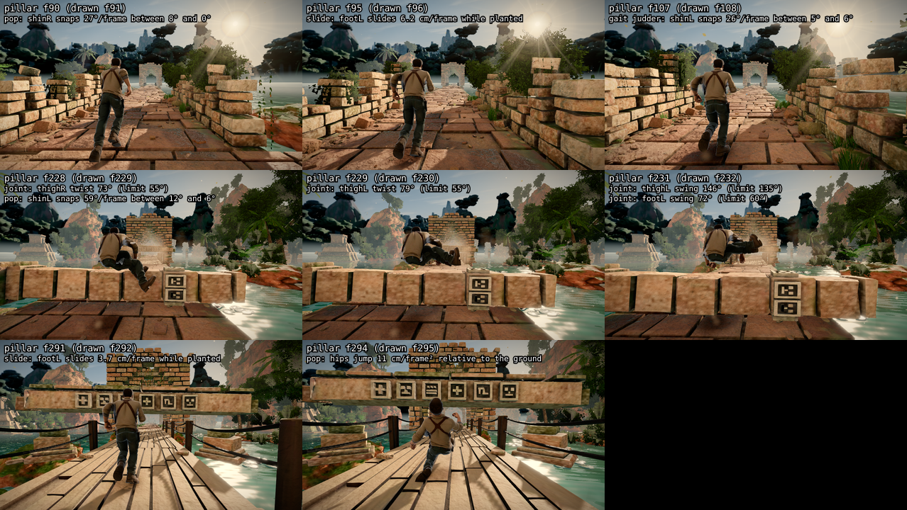

## blocks

Timeline: 78–93 run/start · 94–208 run/run · 209–247 run/leap_gap · 248–279 run/run · 280–318 run/leap_gap · 319–350 run/run · 351–363 run/leap_gap

Gait judder (J / J of the joint's curve low-passed at 4× stride / excess; stride 2.35 Hz): spine 0.18/0.18/-0.00, chest 0.17/0.16/+0.01, neck 0.17/0.14/+0.03, head 0.14/0.12/+0.03, shoulderL 0.26/0.21/+0.04, shoulderR 0.26/0.24/+0.02, upper_armL 0.25/0.23/+0.02, upper_armR 0.25/0.23/+0.03, forearmL 0.25/0.23/+0.03, forearmR 0.25/0.22/+0.03, handL 0.25/0.20/+0.05, handR 0.25/0.26/-0.01, thighL 0.50/0.33/+0.16, thighR 0.47/0.35/+0.12, shinL 0.50/0.50/+0.00, shinR 0.47/0.49/-0.03, footL 0.64/0.68/-0.04, footR 0.67/0.66/+0.01, toeL 0.90/0.74/+0.17, toeR 0.79/0.71/+0.08

| frames | check | peak | clip at peak |
|---|---|---|---|
| 90 | pop: shinR snaps | f90: 27°/frame between 8° and 0° | run/start |
| 95 | slide: footL slides | f95: 6.2 cm/frame while planted | run/run |
| 107 | slide: footL slides | f107: 3.6 cm/frame while planted | run/run |
| 135 | pop: head jumps | f135: 6 cm in one frame between 2 and 2 cm | run/run |
| 142 | judder: thighR judders in the gait | f142: J 0.47 vs 0.35 for its own curve low-passed at 4× stride (2.35 Hz): excess 0.12 (limit 0.1); worst frames f142, f155, f129, f168, f141, f128 | run/run |
| 167 | pop: head jumps | f167: 6 cm in one frame between 2 and 2 cm | run/run |
| 200 | judder: thighL judders in the gait | f200: J 0.50 vs 0.33 for its own curve low-passed at 4× stride (2.35 Hz): excess 0.16 (limit 0.1); worst frames f200, f97, f110, f123, f109, f187 | run/run |
| 201 | judder: toeL judders in the gait | f201: J 0.90 vs 0.74 for its own curve low-passed at 4× stride (2.35 Hz): excess 0.17 (limit 0.1); worst frames f201, f202, f188, f98, f99, f175 | run/run |
| 215 | pop: hips jump | f215: 16 cm/frame² relative to the ground | run/leap_gap |
| 261 | slide: footR slides | f261: 3.8 cm/frame while planted | run/run |
| 281 | slide: footL slides | f281: 3.4 cm/frame while planted | run/leap_gap |
| 286 | pop: hips jump | f286: 16 cm/frame² relative to the ground | run/leap_gap |
| 357 | pop: hips jump | f357: 15 cm/frame² relative to the ground | run/leap_gap |

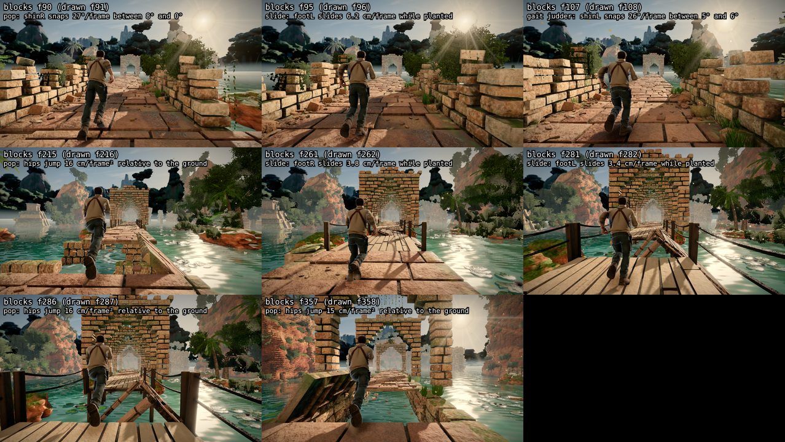

## corner

Timeline: 78–93 run/start · 94–285 run/run · 286–307 run/jump_log · 308–363 run/run

Gait judder (J / J of the joint's curve low-passed at 4× stride / excess; stride 2.34 Hz): spine 0.18/0.16/+0.02, chest 0.17/0.18/-0.01, neck 0.15/0.15/-0.00, head 0.14/0.11/+0.03, shoulderL 0.26/0.25/+0.01, shoulderR 0.25/0.20/+0.05, upper_armL 0.25/0.22/+0.03, upper_armR 0.25/0.22/+0.03, forearmL 0.26/0.22/+0.03, forearmR 0.25/0.21/+0.04, handL 0.24/0.22/+0.03, handR 0.24/0.20/+0.05, thighL 0.49/0.34/+0.14, thighR 0.48/0.34/+0.13, shinL 0.49/0.51/-0.02, shinR 0.47/0.48/-0.01, footL 0.67/0.69/-0.02, footR 0.67/0.70/-0.03, toeL 0.85/0.72/+0.13, toeR 0.84/0.74/+0.10

| frames | check | peak | clip at peak |
|---|---|---|---|
| 90 | pop: shinR snaps | f90: 27°/frame between 8° and 0° | run/start |
| 95 | slide: footL slides | f95: 6.2 cm/frame while planted | run/run |
| 107 | slide: footL slides | f107: 3.6 cm/frame while planted | run/run |
| 110 | judder: thighL judders in the gait | f110: J 0.49 vs 0.34 for its own curve low-passed at 4× stride (2.34 Hz): excess 0.14 (limit 0.1); worst frames f110, f97, f200, f123, f213, f277 | run/run |
| 135 | pop: head jumps | f135: 6 cm in one frame between 2 and 2 cm | run/run |
| 142 | judder: thighR judders in the gait | f142: J 0.48 vs 0.34 for its own curve low-passed at 4× stride (2.34 Hz): excess 0.13 (limit 0.1); worst frames f142, f155, f232, f245, f129, f258 | run/run |
| 167 | pop: head jumps | f167: 6 cm in one frame between 2 and 2 cm | run/run |
| 221 | judder: toeR judders in the gait | f221: J 0.84 vs 0.74 for its own curve low-passed at 4× stride (2.34 Hz): excess 0.10 (limit 0.1); worst frames f221, f130, f117, f220, f246, f257 | run/run |
| 225 | pop: head jumps | f225: 6 cm in one frame between 2 and 2 cm | run/run |
| 278 | judder: toeL judders in the gait | f278: J 0.85 vs 0.72 for its own curve low-passed at 4× stride (2.34 Hz): excess 0.13 (limit 0.1); worst frames f278, f265, f98, f99, f189, f225 | run/run |
| 291 | pop: hips jump | f291: 15 cm/frame² relative to the ground | run/jump_log |
| 306 | pop: shinR snaps | f306: 27°/frame between 4° and 3° | run/jump_log |

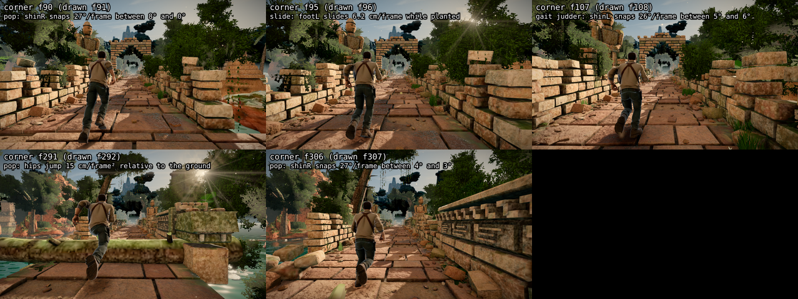

## cash1.5

Timeline: 166–255 run/run · 256–277 cashout/run · 278–496 cashout/win_salute

Gait judder (J / J of the joint's curve low-passed at 4× stride / excess; stride 2.33 Hz): spine 0.18/0.16/+0.02, chest 0.18/0.19/-0.01, neck 0.15/0.16/-0.00, head 0.13/0.14/-0.01, shoulderL 0.26/0.23/+0.02, shoulderR 0.25/0.25/+0.00, upper_armL 0.26/0.22/+0.03, upper_armR 0.26/0.23/+0.03, forearmL 0.26/0.21/+0.04, forearmR 0.25/0.22/+0.04, handL 0.23/0.23/+0.00, handR 0.23/0.20/+0.03, thighL 0.50/0.35/+0.15, thighR 0.48/0.35/+0.13, shinL 0.49/0.51/-0.01, shinR 0.45/0.47/-0.02, footL 0.68/0.68/+0.01, footR 0.62/0.68/-0.07, toeL 0.87/0.77/+0.10, toeR 0.88/0.76/+0.12

| frames | check | peak | clip at peak |
|---|---|---|---|
| 200 | judder: thighL judders in the gait | f200: J 0.50 vs 0.35 for its own curve low-passed at 4× stride (2.33 Hz): excess 0.15 (limit 0.1); worst frames f200, f213, f187, f226, f199, f186 | run/run |
| 221 | judder: toeR judders in the gait | f221: J 0.88 vs 0.76 for its own curve low-passed at 4× stride (2.33 Hz): excess 0.12 (limit 0.1); worst frames f221, f220, f233, f234, f207, f246 | run/run |
| 225 | pop: head jumps | f225: 6 cm in one frame between 2 and 2 cm | run/run |
| 225 | judder: toeL judders in the gait | f225: J 0.87 vs 0.77 for its own curve low-passed at 4× stride (2.33 Hz): excess 0.10 (limit 0.1); worst frames f225, f238, f212, f214, f189, f252 | run/run |
| 232 | judder: thighR judders in the gait | f232: J 0.48 vs 0.35 for its own curve low-passed at 4× stride (2.33 Hz): excess 0.13 (limit 0.1); worst frames f232, f245, f219, f168, f231, f218 | run/run |
| 270 | pop: head jumps | f270: 7 cm in one frame between 2 and 2 cm | cashout/run |
| 279 | camera: position jerk | f279: 57 cm/frame² | cashout/win_salute |
| 287–292 | slide: footR slides | f290: 61.3 cm/frame while planted | cashout/win_salute |
| 290 | pop: footR snaps | f290: 31°/frame between 7° and 0° | cashout/win_salute |
| 290 | pop: footR jumps | f290: 50 cm in one frame between 12 and 3 cm | cashout/win_salute |
| 298 | pop: footL jumps | f298: 41 cm in one frame between 10 and 4 cm | cashout/win_salute |
| 311 | pop: head jumps | f311: 10 cm in one frame between 2 and 1 cm | cashout/win_salute |
| 311 | pop: footR jumps | f311: 7 cm in one frame between 0 and 2 cm | cashout/win_salute |
| 311 | pop: footL jumps | f311: 9 cm in one frame between 1 and 2 cm | cashout/win_salute |
| 332 | pop: head jumps | f332: 6 cm in one frame between 0 and 1 cm | cashout/win_salute |
| 360 | pop: head jumps | f360: 22 cm in one frame between 1 and 0 cm | cashout/win_salute |
| 360 | pop: chest snaps | f360: 26°/frame between 1° and 0° | cashout/win_salute |
| 360 | pop: handL jumps | f360: 10 cm in one frame between 1 and 0 cm | cashout/win_salute |
| 360 | pop: handR jumps | f360: 20 cm in one frame between 3 and 3 cm | cashout/win_salute |
| 371 | pop: footL jumps | f371: 5 cm in one frame between 0 and 0 cm | cashout/win_salute |
| 371 | pop: thighL snaps | f371: 28°/frame between 0° and 0° | cashout/win_salute |

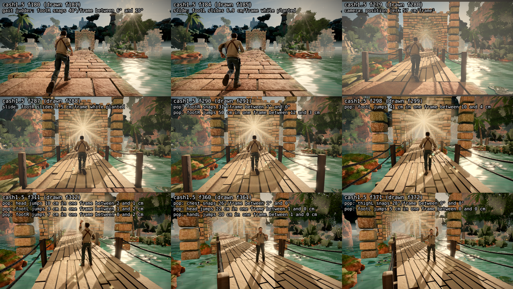

## cash5

Timeline: 739–798 run/run · 799–813 run/turn_cut_R · 814–828 run/run · 829–834 cashout/run · 835–1069 cashout/win_cheer

Gait judder (J / J of the joint's curve low-passed at 4× stride / excess; stride 2.5 Hz): spine 0.17/0.15/+0.01, chest 0.16/0.16/-0.00, neck 0.19/0.20/-0.00, head 0.19/0.18/+0.01, shoulderL 0.25/0.26/-0.01, shoulderR 0.25/0.21/+0.04, upper_armL 0.25/0.22/+0.03, upper_armR 0.25/0.22/+0.03, forearmL 0.25/0.21/+0.04, forearmR 0.25/0.21/+0.04, handL 0.22/0.20/+0.02, handR 0.22/0.22/-0.00, thighL 0.42/0.40/+0.02, thighR 0.43/0.42/+0.02, shinL 0.42/0.48/-0.06, shinR 0.35/0.42/-0.07, footL 0.65/0.80/-0.16, footR 0.68/0.78/-0.10, toeL 0.97/0.74/+0.23, toeR 0.94/0.73/+0.20

| frames | check | peak | clip at peak |
|---|---|---|---|
| 761 | judder: toeR judders in the gait | f761: J 0.94 vs 0.73 for its own curve low-passed at 4× stride (2.50 Hz): excess 0.20 (limit 0.1); worst frames f761, f762, f790, f775, f749, f777 | run/run |
| 781 | judder: toeL judders in the gait | f781: J 0.97 vs 0.74 for its own curve low-passed at 4× stride (2.50 Hz): excess 0.23 (limit 0.1); worst frames f781, f742, f782, f769, f768, f741 | run/run |
| 801 | pop: thighR snaps | f801: 36°/frame between 9° and 11° | run/turn_cut_R |
| 829–830 | camera: position jerk | f829: 88 cm/frame² | cashout/run |
| 850 | pop: thighL snaps | f850: 27°/frame between 6° and 4° | cashout/win_cheer |
| 852–856 | slide: footL slides | f854: 60.9 cm/frame while planted | cashout/win_cheer |
| 854 | pop: footL snaps | f854: 28°/frame between 5° and 0° | cashout/win_cheer |
| 854 | pop: footL jumps | f854: 51 cm in one frame between 10 and 3 cm | cashout/win_cheer |
| 864 | pop: footR snaps | f864: 30°/frame between 8° and 0° | cashout/win_cheer |
| 864 | pop: footR jumps | f864: 42 cm in one frame between 8 and 3 cm | cashout/win_cheer |
| 886–905 | frozen: airborne, limbs still | f886: 0.48°/frame mean limb motion, 4 frames in the air | cashout/win_cheer |
| 899 | camera: position jerk | f899: 81 cm/frame² | cashout/win_cheer |
| 899–901 | camera: fast turn | f900: 15.7°/frame | cashout/win_cheer |
| 899 | camera: snap | f899: angular velocity 2.3 → 15.3°/frame | cashout/win_cheer |
| 920 | pop: head jumps | f920: 10 cm in one frame between 1 and 1 cm | cashout/win_cheer |
| 924 | pop: thighL snaps | f924: 28°/frame between 1° and 4° | cashout/win_cheer |
| 925 | camera: position jerk | f925: 99 cm/frame² | cashout/win_cheer |
| 925–927 | camera: fast turn | f925: 20.5°/frame | cashout/win_cheer |
| 925 | camera: snap | f925: angular velocity 1.8 → 20.5°/frame | cashout/win_cheer |
| 926 | joint: upper_armL twist | f926: 110° (limit 110°) | cashout/win_cheer |
| 926 | joint: upper_armR twist | f926: -110° (limit 110°) | cashout/win_cheer |
| 935–936 | joint: upper_armL twist | f936: 113° (limit 110°) | cashout/win_cheer |
| 935–936 | joint: upper_armR twist | f936: -113° (limit 110°) | cashout/win_cheer |
| 945–946 | camera: position jerk | f946: 78 cm/frame² | cashout/win_cheer |
| 945–946 | camera: snap | f945: angular velocity 0.1 → 7.1°/frame | cashout/win_cheer |
| 948–949 | joint: upper_armL twist | f949: 114° (limit 110°) | cashout/win_cheer |
| 948–952 | joint: upper_armR twist | f950: -114° (limit 110°) | cashout/win_cheer |

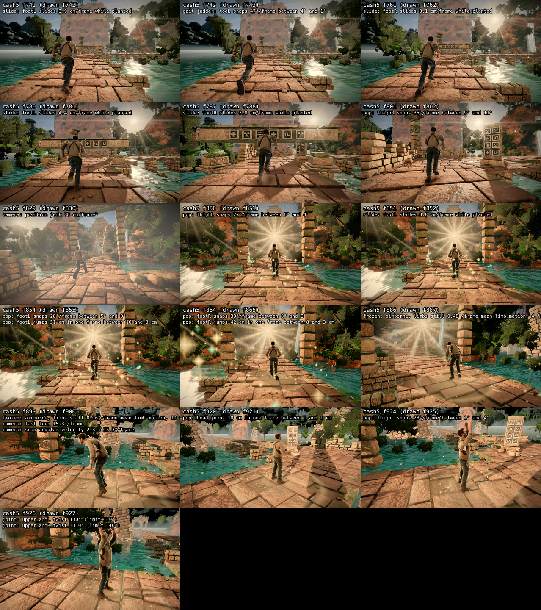

## cash20

Timeline: 1400–1404 run/leap_gap · 1405–1489 run/run · 1490–1530 cashout/run · 1531–1730 cashout/win_leap

Gait judder (J / J of the joint's curve low-passed at 4× stride / excess; stride 2.47 Hz): spine 0.19/0.19/+0.00, chest 0.19/0.19/-0.01, neck 0.22/0.24/-0.02, head 0.22/0.26/-0.04, shoulderL 0.26/0.23/+0.02, shoulderR 0.28/0.25/+0.03, upper_armL 0.27/0.24/+0.03, upper_armR 0.27/0.25/+0.02, forearmL 0.27/0.24/+0.04, forearmR 0.27/0.23/+0.04, handL 0.23/0.22/+0.01, handR 0.23/0.25/-0.02, thighL 0.40/0.48/-0.08, thighR 0.37/0.46/-0.09, shinL 0.42/0.54/-0.12, shinR 0.38/0.53/-0.15, footL 0.76/0.89/-0.13, footR 0.64/0.81/-0.17, toeL 0.90/0.78/+0.12, toeR 0.77/0.80/-0.02

| frames | check | peak | clip at peak |
|---|---|---|---|
| 1407 | joint: footR swing | f1407: 61° (limit 60°) | run/run |
| 1437 | judder: toeL judders in the gait | f1437: J 0.90 vs 0.78 for its own curve low-passed at 4× stride (2.47 Hz): excess 0.12 (limit 0.1); worst frames f1437, f1462, f1413, f1463, f1412, f1438 | run/run |
| 1455 | pop: head jumps | f1455: 5 cm in one frame between 1 and 1 cm | run/run |
| 1492 | pop: head jumps | f1492: 5 cm in one frame between 1 and 0 cm | cashout/run |
| 1503 | pop: head jumps | f1503: 6 cm in one frame between 1 and 1 cm | cashout/run |
| 1528–1530 | camera: position jerk | f1528: 127 cm/frame² | cashout/run |
| 1536 | slide: footR slides | f1536: 11.0 cm/frame while planted | cashout/win_leap |
| 1537 | pop: shinR snaps | f1537: 25°/frame between 3° and 0° | cashout/win_leap |
| 1556 | pop: footL jumps | f1556: 4 cm in one frame between 1 and 0 cm | cashout/win_leap |
| 1556–1557 | frozen: airborne, limbs still | f1556: 0.98°/frame mean limb motion, 4 frames in the air | cashout/win_leap |
| 1558–1564 | joint: upper_armR twist | f1564: -116° (limit 110°) | cashout/win_leap |
| 1565–1575 | joint: shoulderL swing | f1569: 42° (limit 40°) | cashout/win_leap |
| 1565–1575 | joint: shoulderR swing | f1569: 42° (limit 40°) | cashout/win_leap |
| 1565 | pop: footL snaps | f1565: 33°/frame between 0° and 0° | cashout/win_leap |
| 1586–1592 | frozen: airborne, limbs still | f1592: 0.66°/frame mean limb motion, 10 frames in the air | cashout/win_leap |
| 1592 | pop: head jumps | f1592: 13 cm in one frame between 1 and 3 cm | cashout/win_leap |
| 1592 | pop: handL jumps | f1592: 15 cm in one frame between 1 and 2 cm | cashout/win_leap |
| 1592 | pop: handR jumps | f1592: 13 cm in one frame between 1 and 3 cm | cashout/win_leap |
| 1609–1613 | joint: shoulderL swing | f1611: 41° (limit 40°) | cashout/win_leap |
| 1609–1613 | joint: shoulderR swing | f1611: 41° (limit 40°) | cashout/win_leap |
| 1616 | pop: thighL snaps | f1616: 25°/frame between 1° and 4° | cashout/win_leap |
| 1636–1649 | joint: shoulderL swing | f1641: 46° (limit 40°) | cashout/win_leap |
| 1636–1649 | joint: shoulderR swing | f1641: 46° (limit 40°) | cashout/win_leap |
| 1647 | pop: head jumps | f1647: 4 cm in one frame between 1 and 1 cm | cashout/win_leap |
| 1653–1655 | joint: upper_armR twist | f1653: -114° (limit 110°) | cashout/win_leap |
| 1664–1686 | joint: shoulderL swing | f1673: 52° (limit 40°) | cashout/win_leap |
| 1664–1686 | joint: shoulderR swing | f1673: 52° (limit 40°) | cashout/win_leap |
| 1692–1730 | joint: shoulderL swing | f1706: 57° (limit 40°) | cashout/win_leap |
| 1692–1730 | joint: shoulderR swing | f1706: 57° (limit 40°) | cashout/win_leap |

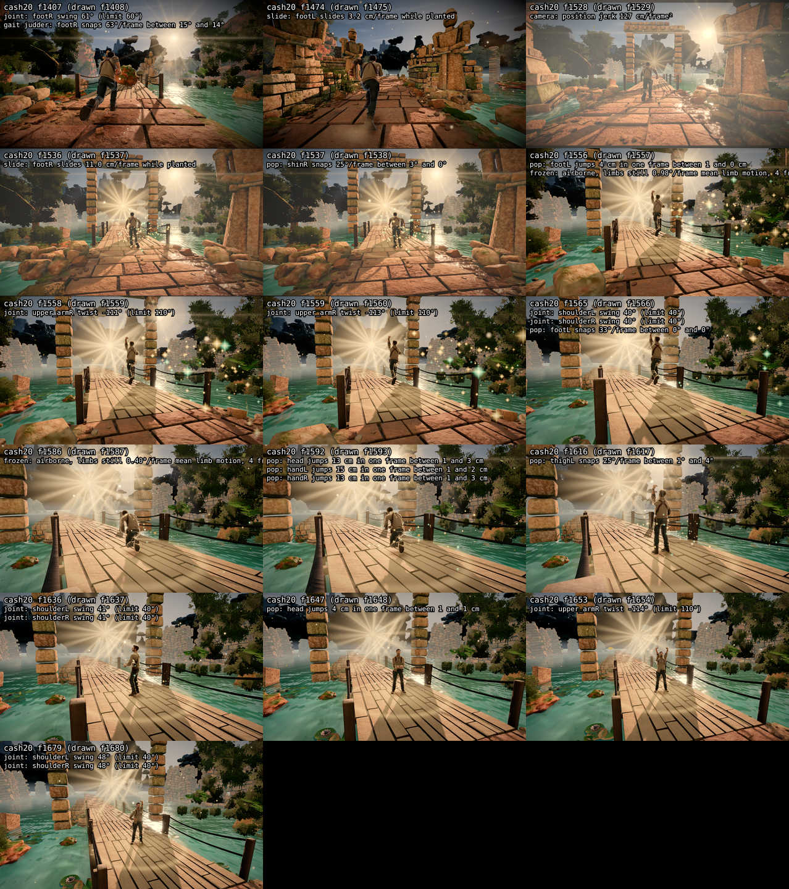

## cash60

Timeline: 1938–1990 run/run · 1991–2003 run/turn_cut_L · 2004–2027 run/run · 2028–2070 cashout/run · 2071–2268 cashout/win_slide

Gait judder (J / J of the joint's curve low-passed at 4× stride / excess; stride 2.83 Hz): spine 0.20/0.20/+0.00, chest 0.19/0.20/-0.00, neck 0.22/0.19/+0.03, head 0.23/0.25/-0.03, shoulderL 0.28/0.25/+0.03, shoulderR 0.28/0.28/+0.01, upper_armL 0.28/0.26/+0.01, upper_armR 0.28/0.26/+0.01, forearmL 0.28/0.25/+0.03, forearmR 0.28/0.25/+0.03, handL 0.26/0.27/-0.02, handR 0.26/0.23/+0.03, thighL 0.33/0.48/-0.16, thighR 0.38/0.54/-0.16, shinL 0.39/0.47/-0.08, shinR 0.37/0.52/-0.15, footL 0.60/0.90/-0.30, footR 0.64/0.84/-0.20, toeL 0.82/0.69/+0.14, toeR 0.97/0.69/+0.27

| frames | check | peak | clip at peak |
|---|---|---|---|
| 1938–1939 | joint: shinL reverse bend | f1939: -164° (limit -10°) | run/run |
| 1940 | joint: shinL over-flexed | f1940: 177° (limit 160°) | run/run |
| 1951 | pop: head jumps | f1951: 5 cm in one frame between 1 and 1 cm | run/run |
| 1970 | judder: toeL judders in the gait | f1970: J 0.82 vs 0.69 for its own curve low-passed at 4× stride (2.83 Hz): excess 0.14 (limit 0.1); worst frames f1970, f1957, f1969, f1971, f1949, f1972 | run/run |
| 1974 | pop: head jumps | f1974: 5 cm in one frame between 1 and 1 cm | run/run |
| 1986 | judder: toeR judders in the gait | f1986: J 0.97 vs 0.69 for its own curve low-passed at 4× stride (2.83 Hz): excess 0.27 (limit 0.1); worst frames f1986, f1963, f1964, f1941, f1987, f1942 | run/run |
| 2006 | joint: footL swing | f2006: 63° (limit 60°) | run/run |
| 2068–2070 | camera: position jerk | f2068: 129 cm/frame² | cashout/run |
| 2070 | pop: handL jumps | f2070: 14 cm in one frame between 2 and 3 cm | cashout/run |
| 2083–2117 | frozen: airborne, limbs still | f2117: 0.55°/frame mean limb motion, 38 frames in the air | cashout/win_slide |
| 2107–2124 | joint: shoulderL swing | f2115: 46° (limit 40°) | cashout/win_slide |
| 2107–2124 | joint: shoulderR swing | f2115: 46° (limit 40°) | cashout/win_slide |
| 2111 | camera: position jerk | f2111: 102 cm/frame² | cashout/win_slide |
| 2111 | camera: snap | f2111: angular velocity 0.7 → 9.1°/frame | cashout/win_slide |
| 2112–2116 | camera: fast turn | f2115: 21.4°/frame | cashout/win_slide |
| 2117–2118 | camera: position jerk | f2117: 27 cm/frame² | cashout/win_slide |
| 2117 | camera: snap | f2117: angular velocity 17.2 → 8.4°/frame | cashout/win_slide |
| 2123 | slide: footL slides | f2123: 19.6 cm/frame while planted | cashout/win_slide |
| 2123–2124 | slide: footR slides | f2124: 10.2 cm/frame while planted | cashout/win_slide |
| 2143 | pop: handL jumps | f2143: 18 cm in one frame between 3 and 0 cm | cashout/win_slide |
| 2143 | pop: shoulderL snaps | f2143: 26°/frame between 0° and 0° | cashout/win_slide |
| 2143 | pop: shoulderR snaps | f2143: 26°/frame between 1° and 0° | cashout/win_slide |
| 2143 | pop: handR jumps | f2143: 20 cm in one frame between 7 and 0 cm | cashout/win_slide |
| 2146–2155 | frozen: airborne, limbs still | f2149: 0.21°/frame mean limb motion, 7 frames in the air | cashout/win_slide |
| 2162–2166 | pop: hips jump | f2164: 12 cm/frame² relative to the ground | cashout/win_slide |
| 2166–2167 | camera: position jerk | f2166: 129 cm/frame² | cashout/win_slide |
| 2166–2167 | camera: snap | f2166: angular velocity 2.5 → 29.0°/frame | cashout/win_slide |
| 2166 | camera: fast turn | f2166: 29.0°/frame | cashout/win_slide |
| 2168–2169 | framing: runner clipped | f2168: handR at the frame edge | cashout/win_slide |
| 2171–2172 | pop: hips jump | f2172: 14 cm/frame² relative to the ground | cashout/win_slide |
| 2187–2191 | joint: upper_armL twist | f2188: 115° (limit 110°) | cashout/win_slide |
| 2187–2189 | joint: upper_armR twist | f2188: -114° (limit 110°) | cashout/win_slide |

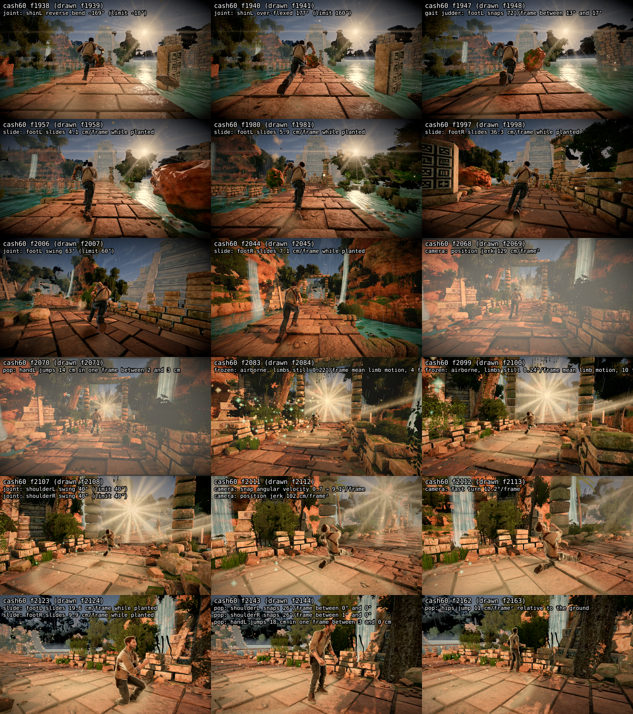

## fall_start

Timeline: 20–29 setup/idle · 30–44 lead/ready · 45–270 crash/fall_start

| frames | check | peak | clip at peak |
|---|---|---|---|
| 66 | camera: position jerk | f66: 28 cm/frame² | crash/fall_start |
| 80–270 | joint: footL swing | f87: 82° (limit 60°) | crash/fall_start |
| 80–270 | joint: footR swing | f94: 79° (limit 60°) | crash/fall_start |
| 81 | pop: thighL snaps | f81: 26°/frame between 4° and 3° | crash/fall_start |

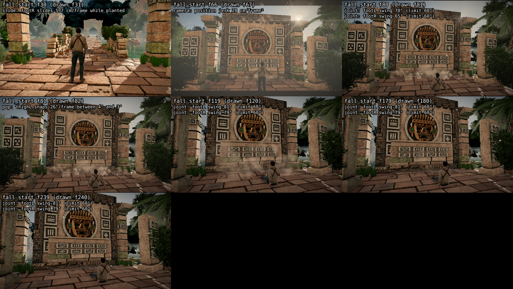

## chasm0

Timeline: 526–530 run/leap_gap · 531–563 run/run · 564–585 run/leap_gap · 586–796 crash/fall_chasm

| frames | check | peak | clip at peak |
|---|---|---|---|
| 570 | pop: hips jump | f570: 13 cm/frame² relative to the ground | run/leap_gap |
| 586–587 | pop: hips jump | f587: 10 cm/frame² relative to the ground | crash/fall_chasm |
| 586 | camera: position jerk | f586: 36 cm/frame² | crash/fall_chasm |
| 641–646 | pop: hips jump | f641: 18 cm/frame² relative to the ground | crash/fall_chasm |
| 649 | pop: footL jumps | f649: 19 cm in one frame between 5 and 5 cm | crash/fall_chasm |
| 651–659 | pop: hips jump | f655: 30 cm/frame² relative to the ground | crash/fall_chasm |
| 651 | pop: neck snaps | f651: 27°/frame between 2° and 4° | crash/fall_chasm |
| 651 | pop: head snaps | f651: 39°/frame between 3° and 6° | crash/fall_chasm |
| 658–796 | joint: head swing | f705: 98° (limit 55°) | crash/fall_chasm |
| 662 | pop: hips jump | f662: 11 cm/frame² relative to the ground | crash/fall_chasm |
| 663–668 | joint: neck swing | f666: 50° (limit 50°) | crash/fall_chasm |
| 665–673 | pop: hips jump | f669: 31 cm/frame² relative to the ground | crash/fall_chasm |
| 679–685 | pop: hips jump | f683: 32 cm/frame² relative to the ground | crash/fall_chasm |
| 685–694 | joint: shoulderL swing | f689: 43° (limit 40°) | crash/fall_chasm |
| 685–694 | joint: shoulderR swing | f689: 43° (limit 40°) | crash/fall_chasm |
| 686–752 | joint: neck swing | f705: 89° (limit 50°) | crash/fall_chasm |
| 714–731 | joint: shoulderL swing | f721: 49° (limit 40°) | crash/fall_chasm |
| 714–731 | joint: shoulderR swing | f721: 49° (limit 40°) | crash/fall_chasm |
| 744–796 | joint: shoulderL swing | f790: 59° (limit 40°) | crash/fall_chasm |
| 744–796 | joint: shoulderR swing | f790: 59° (limit 40°) | crash/fall_chasm |
| 759–782 | joint: neck swing | f772: 70° (limit 50°) | crash/fall_chasm |

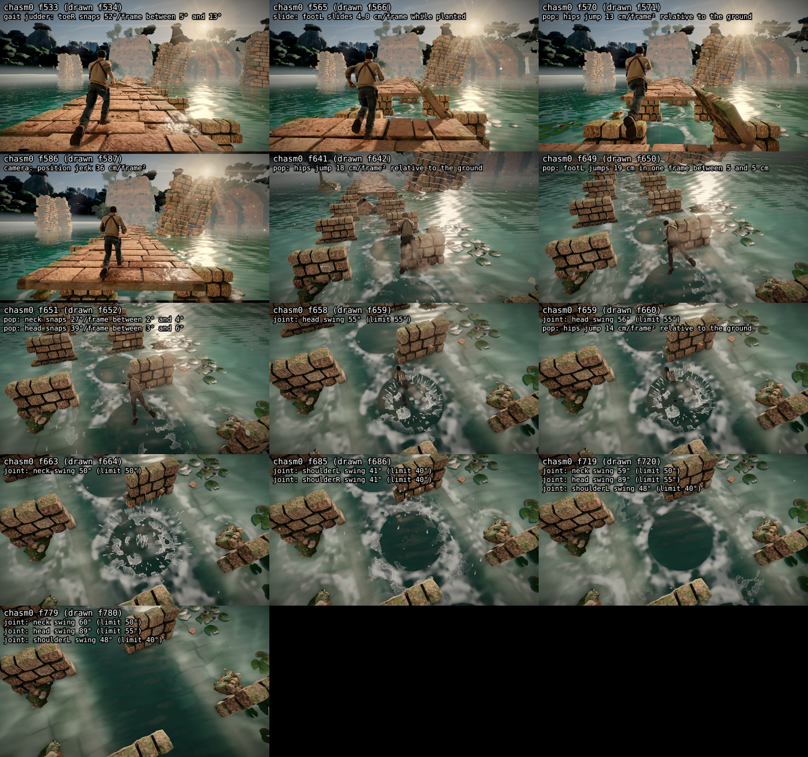

## chasm1

Timeline: 526–530 run/leap_gap · 531–563 run/run · 564–585 run/leap_gap · 586–796 crash/fall_chasm_b

| frames | check | peak | clip at peak |
|---|---|---|---|
| 570 | pop: hips jump | f570: 13 cm/frame² relative to the ground | run/leap_gap |
| 586–587 | pop: hips jump | f587: 10 cm/frame² relative to the ground | crash/fall_chasm_b |
| 586 | camera: position jerk | f586: 36 cm/frame² | crash/fall_chasm_b |
| 612 | pop: footL jumps | f612: 29 cm in one frame between 6 and 0 cm | crash/fall_chasm_b |
| 644 | pop: footL jumps | f644: 32 cm in one frame between 0 and 3 cm | crash/fall_chasm_b |
| 644 | pop: shinL snaps | f644: 47°/frame between 0° and 5° | crash/fall_chasm_b |
| 655–796 | joint: footL swing | f698: 80° (limit 60°) | crash/fall_chasm_b |
| 655–796 | joint: footR swing | f699: 80° (limit 60°) | crash/fall_chasm_b |
| 685–694 | joint: shoulderL swing | f689: 43° (limit 40°) | crash/fall_chasm_b |
| 685–694 | joint: shoulderR swing | f689: 43° (limit 40°) | crash/fall_chasm_b |
| 714–731 | joint: shoulderL swing | f721: 49° (limit 40°) | crash/fall_chasm_b |
| 714–731 | joint: shoulderR swing | f721: 49° (limit 40°) | crash/fall_chasm_b |
| 744–796 | joint: shoulderL swing | f790: 59° (limit 40°) | crash/fall_chasm_b |
| 744–796 | joint: shoulderR swing | f790: 59° (limit 40°) | crash/fall_chasm_b |

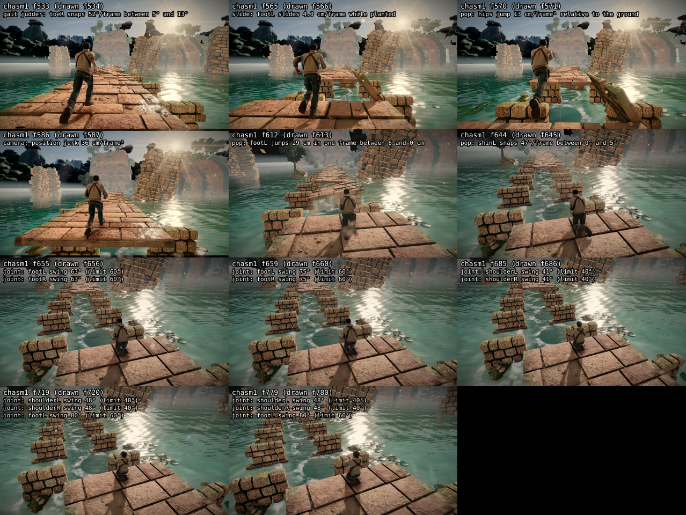

## gate0

Timeline: 526–530 run/leap_gap · 531–563 run/run · 564–585 run/leap_gap · 586–796 crash/fall_gate

| frames | check | peak | clip at peak |
|---|---|---|---|
| 565 | slide: footL slides | f565: 4.0 cm/frame while planted | run/leap_gap |
| 570 | pop: hips jump | f570: 13 cm/frame² relative to the ground | run/leap_gap |
| 586 | pop: hips jump | f586: 10 cm/frame² relative to the ground | crash/fall_gate |
| 586 | camera: position jerk | f586: 47 cm/frame² | crash/fall_gate |
| 605 | camera: snap | f605: angular velocity 0.4 → 6.6°/frame | crash/fall_gate |
| 618 | camera: position jerk | f618: 27 cm/frame² | crash/fall_gate |
| 630 | pop: handL jumps | f630: 13 cm in one frame between 4 and 3 cm | crash/fall_gate |
| 630 | pop: handR jumps | f630: 14 cm in one frame between 4 and 3 cm | crash/fall_gate |
| 640 | camera: position jerk | f640: 27 cm/frame² | crash/fall_gate |
| 660 | pop: handL jumps | f660: 7 cm in one frame between 1 and 0 cm | crash/fall_gate |
| 660 | pop: handR jumps | f660: 7 cm in one frame between 1 and 1 cm | crash/fall_gate |
| 660 | pop: head jumps | f660: 5 cm in one frame between 0 and 1 cm | crash/fall_gate |
| 673–796 | frozen: airborne, limbs still | f690: 0.18°/frame mean limb motion, 21 frames in the air | crash/fall_gate |
| 788–792 | joint: shoulderL swing | f790: 41° (limit 40°) | crash/fall_gate |

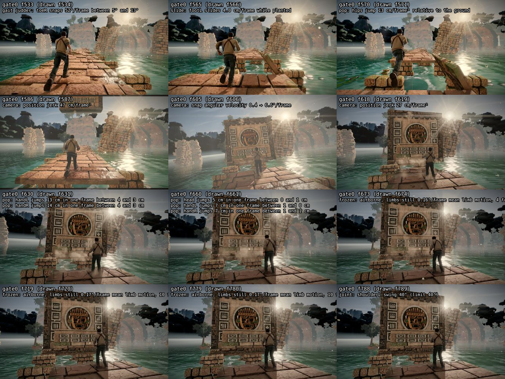

## gate1

Timeline: 526–530 run/leap_gap · 531–563 run/run · 564–585 run/leap_gap · 586–796 crash/fall_gate_b

| frames | check | peak | clip at peak |
|---|---|---|---|
| 565 | slide: footL slides | f565: 4.0 cm/frame while planted | run/leap_gap |
| 570 | pop: hips jump | f570: 13 cm/frame² relative to the ground | run/leap_gap |
| 586 | pop: hips jump | f586: 10 cm/frame² relative to the ground | crash/fall_gate_b |
| 586 | camera: position jerk | f586: 46 cm/frame² | crash/fall_gate_b |
| 605–606 | camera: snap | f605: angular velocity 0.1 → 6.7°/frame | crash/fall_gate_b |
| 618 | camera: position jerk | f618: 26 cm/frame² | crash/fall_gate_b |
| 629–796 | joint: footR swing | f794: 63° (limit 60°) | crash/fall_gate_b |
| 638–640 | camera: position jerk | f638: 36 cm/frame² | crash/fall_gate_b |
| 687–691 | joint: shoulderL swing | f689: 41° (limit 40°) | crash/fall_gate_b |
| 715–729 | joint: shoulderL swing | f721: 46° (limit 40°) | crash/fall_gate_b |
| 745–769 | joint: shoulderL swing | f755: 52° (limit 40°) | crash/fall_gate_b |
| 775–796 | joint: shoulderL swing | f790: 57° (limit 40°) | crash/fall_gate_b |

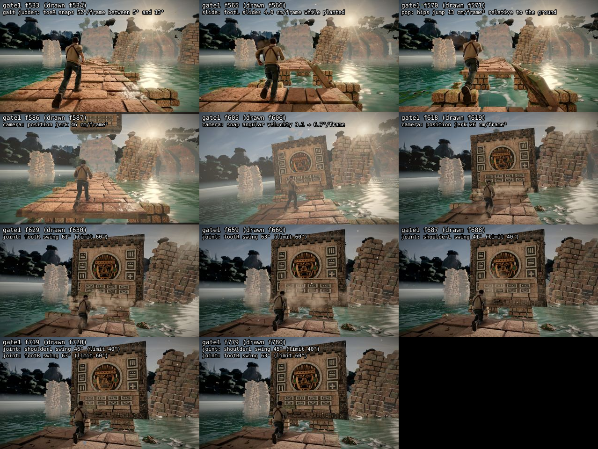

## rock0

Timeline: 526–530 run/leap_gap · 531–563 run/run · 564–585 run/leap_gap · 586–796 crash/fall_rock

| frames | check | peak | clip at peak |
|---|---|---|---|
| 565 | slide: footL slides | f565: 4.0 cm/frame while planted | run/leap_gap |
| 570 | pop: hips jump | f570: 13 cm/frame² relative to the ground | run/leap_gap |
| 586 | pop: hips jump | f586: 10 cm/frame² relative to the ground | crash/fall_rock |
| 586 | camera: position jerk | f586: 40 cm/frame² | crash/fall_rock |
| 608–610 | frozen: airborne, limbs still | f608: 0.84°/frame mean limb motion, 4 frames in the air | crash/fall_rock |
| 640–641 | camera: position jerk | f640: 33 cm/frame² | crash/fall_rock |
| 649 | camera: position jerk | f649: 34 cm/frame² | crash/fall_rock |
| 658 | camera: position jerk | f658: 27 cm/frame² | crash/fall_rock |
| 666 | camera: position jerk | f666: 31 cm/frame² | crash/fall_rock |
| 684 | camera: position jerk | f684: 27 cm/frame² | crash/fall_rock |

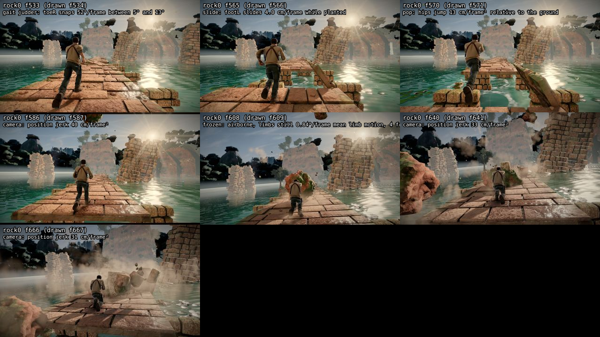

## rock1

Timeline: 526–530 run/leap_gap · 531–563 run/run · 564–585 run/leap_gap · 586–796 crash/fall_rock_b

| frames | check | peak | clip at peak |
|---|---|---|---|
| 565 | slide: footL slides | f565: 4.0 cm/frame while planted | run/leap_gap |
| 570 | pop: hips jump | f570: 13 cm/frame² relative to the ground | run/leap_gap |
| 586–587 | pop: hips jump | f587: 10 cm/frame² relative to the ground | crash/fall_rock_b |
| 586 | camera: position jerk | f586: 40 cm/frame² | crash/fall_rock_b |
| 601 | camera: position jerk | f601: 27 cm/frame² | crash/fall_rock_b |
| 617 | pop: handR jumps | f617: 21 cm in one frame between 4 and 6 cm | crash/fall_rock_b |
| 622–688 | joint: footL swing | f635: 81° (limit 60°) | crash/fall_rock_b |
| 622–796 | joint: footR swing | f624: 76° (limit 60°) | crash/fall_rock_b |
| 641 | camera: position jerk | f641: 47 cm/frame² | crash/fall_rock_b |
| 649 | camera: position jerk | f649: 42 cm/frame² | crash/fall_rock_b |
| 666 | camera: position jerk | f666: 36 cm/frame² | crash/fall_rock_b |
| 675 | camera: position jerk | f675: 35 cm/frame² | crash/fall_rock_b |
| 685–693 | joint: shoulderL swing | f689: 43° (limit 40°) | crash/fall_rock_b |
| 714–731 | joint: shoulderL swing | f721: 48° (limit 40°) | crash/fall_rock_b |
| 744–796 | joint: shoulderL swing | f790: 59° (limit 40°) | crash/fall_rock_b |

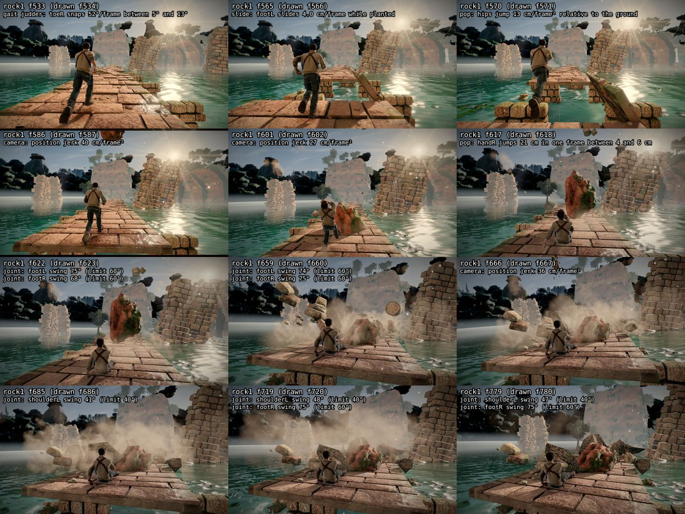
