# Motion audit — review/motion/run-72ac9ec

World 7, quality high, 1280×720, 30 fps time-stepped. Frame numbers count from the sequence start (frame 0 = the world built, setup shot).
Each row is a run of consecutive flagged frames (same check); the peak frame and value are given. Sheets show the frame each new kind of flag was first seen.

| sequence | frames | judder | joint | slide | pop | frozen | framing | camera | staged |
|---|---|---|---|---|---|---|---|---|---|
| start | 0–228 | 3 | 0 | 2 | 3 | 0 | 0 | 0 |  |
| log | 78–363 | 0 | 0 | 3 | 2 | 0 | 0 | 0 | placed true, fired {"log":1} |
| beam | 78–363 | 0 | 0 | 1 | 2 | 0 | 0 | 0 | placed true, fired {"beam":1} |
| pillar | 78–363 | 0 | 4 | 1 | 3 | 0 | 0 | 0 | placed true, fired {"pillar":1} |
| blocks | 78–363 | 0 | 0 | 8 | 3 | 0 | 0 | 0 | placed true, fired {"blocks":1} |
| corner | 78–363 | 0 | 0 | 10 | 1 | 0 | 0 | 0 |  |
| cash1.5 | 166–496 | 0 | 0 | 0 | 0 | 0 | 0 | 0 |  |
| cash5 | 739–1069 | 0 | 0 | 0 | 0 | 0 | 0 | 0 |  |
| cash20 | 1400–1730 | 1 | 11 | 3 | 4 | 1 | 0 | 1 | mult 20.01 |
| cash60 | 1938–2268 | 2 | 6 | 0 | 8 | 5 | 1 | 9 | mult 61.96 |
| fall_start | 20–270 | 0 | 2 | 0 | 0 | 0 | 0 | 0 | kind gate |
| chasm0 | 526–796 | 2 | 63 | 0 | 7 | 0 | 0 | 1 | kind chasm, clip run, mult 3 |
| chasm1 | 526–796 | 2 | 10 | 0 | 2 | 0 | 0 | 1 | kind chasm, clip run, mult 3 |
| gate0 | 526–796 | 2 | 1 | 0 | 0 | 1 | 0 | 2 | kind gate, clip run, mult 3 |
| gate1 | 526–796 | 2 | 3 | 0 | 0 | 0 | 0 | 2 | kind gate, clip run, mult 3 |
| rock0 | 526–796 | 2 | 1 | 0 | 0 | 1 | 0 | 5 | kind rockfall, clip run, mult 3 |
| rock1 | 526–796 | 0 | 0 | 0 | 0 | 0 | 0 | 0 |  |
| rock2 | 526–796 | 2 | 10 | 0 | 4 | 1 | 3 | 7 | kind rockfall, clip run, mult 3 |
| pillar0 | 526–796 | 2 | 3 | 0 | 3 | 1 | 0 | 1 | kind pillar, clip run, mult 3 |
| pillar1 | 526–796 | 2 | 0 | 0 | 3 | 0 | 0 | 1 | kind pillar, clip run, mult 3 |
| trip0 | 526–796 | 2 | 19 | 0 | 6 | 2 | 0 | 1 | kind trip, clip run, mult 3 |
| ledge0 | 526–796 | 2 | 8 | 0 | 5 | 0 | 0 | 1 | kind ledge, clip run, mult 3 |

## start

Timeline: 0–44 setup/idle · 45–76 lead/ready · 77–107 run/start · 108–228 run/run

Gait judder (J / J of the joint's curve low-passed at 4× stride / excess; stride 2.23 Hz): spine 0.18/0.16/+0.02, chest 0.17/0.16/+0.02, neck 0.16/0.20/-0.04, head 0.14/0.18/-0.04, shoulderL 0.26/0.20/+0.06, shoulderR 0.26/0.25/+0.00, upper_armL 0.25/0.22/+0.04, upper_armR 0.25/0.22/+0.04, forearmL 0.25/0.23/+0.03, forearmR 0.25/0.23/+0.03, handL 0.25/0.23/+0.02, handR 0.25/0.23/+0.02, thighL 0.51/0.34/+0.17, thighR 0.46/0.34/+0.12, shinL 0.52/0.56/-0.04, shinR 0.46/0.53/-0.08, footL 0.65/0.75/-0.10, footR 0.65/0.60/+0.06, toeL 0.93/0.73/+0.20, toeR 0.79/0.70/+0.09

| frames | check | peak | clip at peak |
|---|---|---|---|
| 104 | pop: shinR snaps | f104: 27°/frame between 8° and 0° | run/start |
| 109 | slide: footL slides | f109: 6.2 cm/frame while planted | run/run |
| 112 | judder: toeL judders in the gait | f112: J 0.93 vs 0.73 for its own curve low-passed at 4× stride (2.23 Hz): excess 0.20 (limit 0.1); worst frames f112, f202, f125, f215, f189, f136 | run/run |
| 121 | slide: footL slides | f121: 3.7 cm/frame while planted | run/run |
| 149 | pop: head jumps | f149: 6 cm in one frame between 2 and 2 cm | run/run |
| 169 | judder: thighR judders in the gait | f169: J 0.46 vs 0.34 for its own curve low-passed at 4× stride (2.23 Hz): excess 0.12 (limit 0.1); worst frames f169, f156, f182, f143, f195, f170 | run/run |
| 181 | pop: head jumps | f181: 6 cm in one frame between 2 and 2 cm | run/run |
| 227 | judder: thighL judders in the gait | f227: J 0.51 vs 0.34 for its own curve low-passed at 4× stride (2.23 Hz): excess 0.17 (limit 0.1); worst frames f227, f137, f214, f124, f150, f111 | run/run |

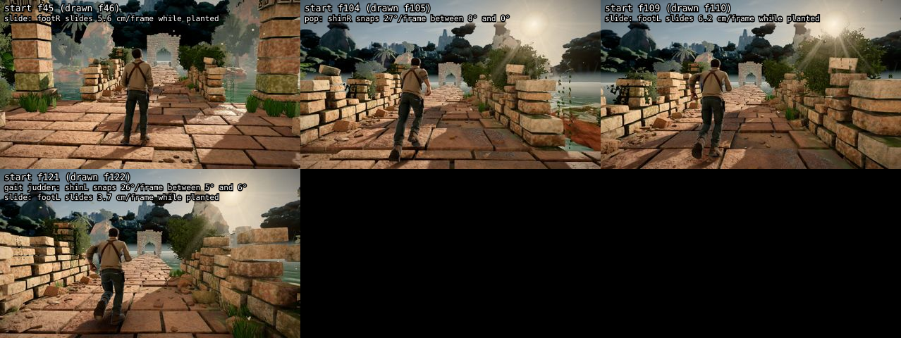

## log

Timeline: 78–93 run/start · 94–208 run/run · 209–230 run/jump_log · 231–285 run/run · 286–309 run/slide · 310–363 run/run

Gait judder (J / J of the joint's curve low-passed at 4× stride / excess; stride 2.35 Hz): spine 0.18/0.16/+0.02, chest 0.18/0.17/+0.01, neck 0.17/0.14/+0.03, head 0.15/0.13/+0.02, shoulderL 0.25/0.25/+0.01, shoulderR 0.25/0.21/+0.04, upper_armL 0.25/0.23/+0.02, upper_armR 0.25/0.23/+0.03, forearmL 0.25/0.22/+0.03, forearmR 0.25/0.22/+0.04, handL 0.23/0.23/+0.01, handR 0.24/0.26/-0.02, thighL 0.36/0.33/+0.03, thighR 0.36/0.34/+0.02, shinL 0.46/0.48/-0.02, shinR 0.48/0.50/-0.02, footL 0.50/0.51/-0.01, footR 0.44/0.47/-0.03, toeL 0.45/0.44/+0.00, toeR 0.47/0.45/+0.03

| frames | check | peak | clip at peak |
|---|---|---|---|
| 152 | slide: footR slides | f152: 3.9 cm/frame while planted | run/run |
| 214 | pop: hips jump | f214: 17 cm/frame² relative to the ground | run/jump_log |
| 229 | slide: footR slides | f229: 3.0 cm/frame while planted | run/jump_log |
| 280 | slide: footR slides | f280: 4.0 cm/frame while planted | run/run |
| 290 | pop: hips jump | f290: 12 cm/frame² relative to the ground | run/slide |

## beam

Timeline: 78–93 run/start · 94–221 run/run · 222–245 run/slide · 246–277 run/run · 278–301 run/slide · 302–363 run/run

Gait judder (J / J of the joint's curve low-passed at 4× stride / excess; stride 2.34 Hz): spine 0.18/0.18/-0.00, chest 0.18/0.17/+0.01, neck 0.16/0.16/+0.01, head 0.15/0.11/+0.04, shoulderL 0.25/0.22/+0.03, shoulderR 0.25/0.22/+0.04, upper_armL 0.25/0.22/+0.03, upper_armR 0.25/0.22/+0.03, forearmL 0.25/0.22/+0.03, forearmR 0.25/0.22/+0.03, handL 0.23/0.21/+0.03, handR 0.24/0.22/+0.02, thighL 0.36/0.33/+0.03, thighR 0.36/0.34/+0.02, shinL 0.46/0.48/-0.03, shinR 0.48/0.49/-0.01, footL 0.52/0.52/+0.00, footR 0.43/0.45/-0.02, toeL 0.45/0.45/-0.01, toeR 0.46/0.43/+0.03

| frames | check | peak | clip at peak |
|---|---|---|---|
| 152 | slide: footR slides | f152: 3.9 cm/frame while planted | run/run |
| 226 | pop: hips jump | f226: 12 cm/frame² relative to the ground | run/slide |
| 282 | pop: hips jump | f282: 12 cm/frame² relative to the ground | run/slide |

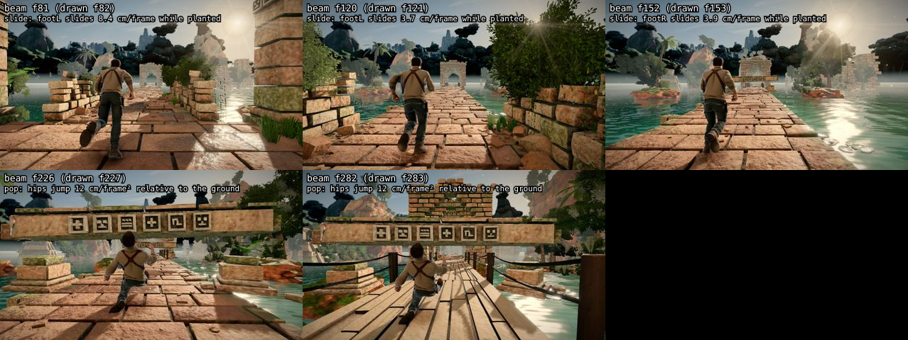

## pillar

Timeline: 78–93 run/start · 94–221 run/run · 222–244 run/vault · 245–289 run/run · 290–313 run/slide · 314–363 run/run

Gait judder (J / J of the joint's curve low-passed at 4× stride / excess; stride 2.34 Hz): spine 0.18/0.18/-0.00, chest 0.18/0.17/+0.01, neck 0.17/0.14/+0.03, head 0.15/0.11/+0.04, shoulderL 0.25/0.22/+0.03, shoulderR 0.25/0.22/+0.03, upper_armL 0.25/0.22/+0.03, upper_armR 0.25/0.22/+0.03, forearmL 0.25/0.22/+0.03, forearmR 0.25/0.22/+0.03, handL 0.23/0.21/+0.03, handR 0.24/0.22/+0.02, thighL 0.36/0.33/+0.03, thighR 0.36/0.34/+0.02, shinL 0.46/0.48/-0.03, shinR 0.48/0.49/-0.01, footL 0.52/0.52/+0.00, footR 0.43/0.45/-0.02, toeL 0.45/0.45/-0.01, toeR 0.46/0.43/+0.03

| frames | check | peak | clip at peak |
|---|---|---|---|
| 152 | slide: footR slides | f152: 3.9 cm/frame while planted | run/run |
| 227 | pop: hips jump | f227: 11 cm/frame² relative to the ground | run/vault |
| 228–235 | joint: thighR twist | f230: 99° (limit 55°) | run/vault |
| 228 | pop: shinL snaps | f228: 69°/frame between 0° and 5° | run/vault |
| 229–230 | joint: thighL twist | f230: 82° (limit 55°) | run/vault |
| 231–234 | joint: thighL swing | f232: 148° (limit 135°) | run/vault |
| 231 | joint: footL swing | f231: 73° (limit 60°) | run/vault |
| 294 | pop: hips jump | f294: 12 cm/frame² relative to the ground | run/slide |

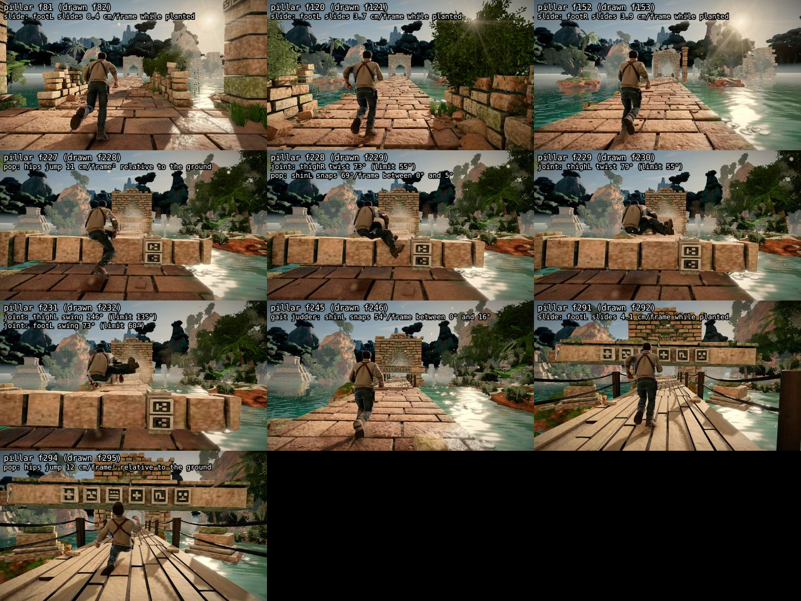

## blocks

Timeline: 78–93 run/start · 94–208 run/run · 209–247 run/leap_gap · 248–279 run/run · 280–318 run/leap_gap · 319–350 run/run · 351–363 run/leap_gap

Gait judder (J / J of the joint's curve low-passed at 4× stride / excess; stride 2.35 Hz): spine 0.18/0.16/+0.02, chest 0.18/0.17/+0.01, neck 0.18/0.12/+0.05, head 0.15/0.13/+0.02, shoulderL 0.25/0.24/+0.01, shoulderR 0.25/0.21/+0.04, upper_armL 0.25/0.23/+0.02, upper_armR 0.25/0.23/+0.03, forearmL 0.25/0.22/+0.03, forearmR 0.25/0.22/+0.04, handL 0.23/0.23/+0.01, handR 0.24/0.26/-0.02, thighL 0.36/0.33/+0.03, thighR 0.36/0.34/+0.02, shinL 0.46/0.48/-0.02, shinR 0.48/0.50/-0.02, footL 0.50/0.51/-0.01, footR 0.44/0.47/-0.03, toeL 0.45/0.44/+0.00, toeR 0.47/0.45/+0.03

| frames | check | peak | clip at peak |
|---|---|---|---|
| 95 | slide: footL slides | f95: 7.5 cm/frame while planted | run/run |
| 107 | slide: footL slides | f107: 6.2 cm/frame while planted | run/run |
| 120 | slide: footL slides | f120: 3.7 cm/frame while planted | run/run |
| 152 | slide: footR slides | f152: 3.9 cm/frame while planted | run/run |
| 215 | pop: hips jump | f215: 17 cm/frame² relative to the ground | run/leap_gap |
| 261 | slide: footR slides | f261: 6.4 cm/frame while planted | run/run |
| 281 | slide: footL slides | f281: 3.7 cm/frame while planted | run/leap_gap |
| 286 | pop: hips jump | f286: 16 cm/frame² relative to the ground | run/leap_gap |
| 345 | slide: footR slides | f345: 5.1 cm/frame while planted | run/run |
| 352 | slide: footL slides | f352: 3.4 cm/frame while planted | run/leap_gap |
| 357 | pop: hips jump | f357: 16 cm/frame² relative to the ground | run/leap_gap |

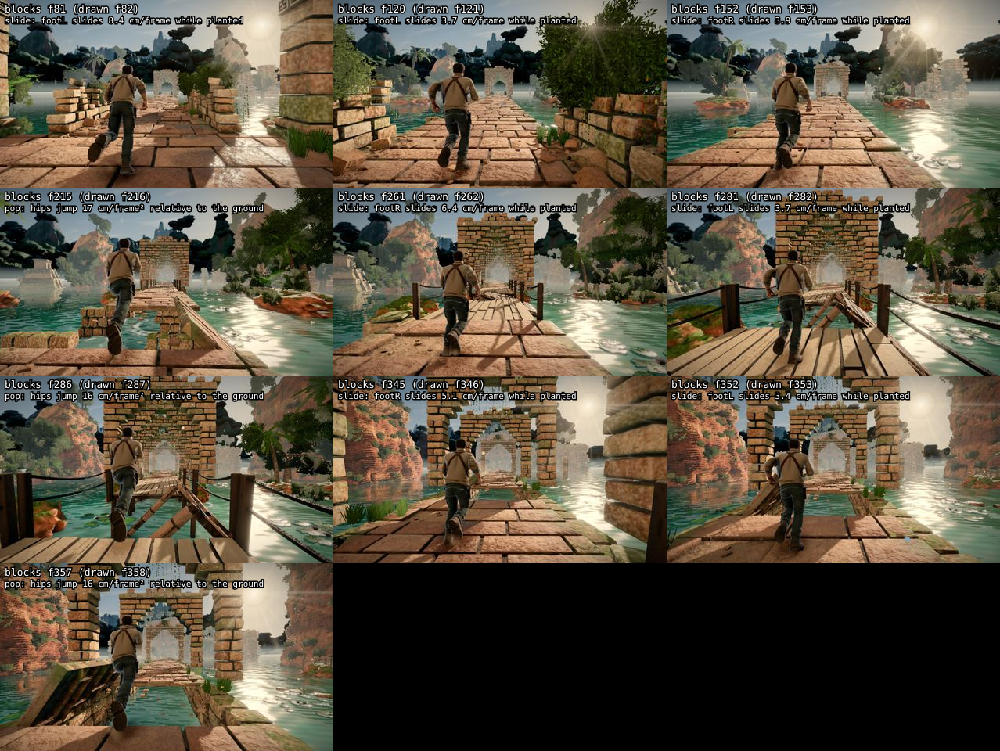

## corner

Timeline: 78–93 run/start · 94–285 run/run · 286–307 run/jump_log · 308–363 run/run

Gait judder (J / J of the joint's curve low-passed at 4× stride / excess; stride 2.34 Hz): spine 0.18/0.18/-0.00, chest 0.18/0.18/+0.01, neck 0.17/0.15/+0.02, head 0.15/0.17/-0.03, shoulderL 0.26/0.20/+0.06, shoulderR 0.25/0.24/+0.01, upper_armL 0.25/0.22/+0.03, upper_armR 0.25/0.22/+0.03, forearmL 0.25/0.21/+0.04, forearmR 0.25/0.22/+0.04, handL 0.23/0.24/-0.01, handR 0.24/0.23/+0.01, thighL 0.36/0.33/+0.03, thighR 0.36/0.34/+0.02, shinL 0.48/0.51/-0.03, shinR 0.47/0.49/-0.02, footL 0.50/0.51/-0.01, footR 0.47/0.50/-0.03, toeL 0.46/0.45/+0.00, toeR 0.49/0.46/+0.02

| frames | check | peak | clip at peak |
|---|---|---|---|
| 95 | slide: footL slides | f95: 7.5 cm/frame while planted | run/run |
| 107 | slide: footL slides | f107: 6.2 cm/frame while planted | run/run |
| 120 | slide: footL slides | f120: 3.7 cm/frame while planted | run/run |
| 152 | slide: footR slides | f152: 3.9 cm/frame while planted | run/run |
| 242 | slide: footR slides | f242: 2.9 cm/frame while planted | run/run |
| 291 | pop: hips jump | f291: 16 cm/frame² relative to the ground | run/jump_log |
| 306 | slide: footR slides | f306: 3.0 cm/frame while planted | run/jump_log |
| 312 | slide: footL slides | f312: 7.2 cm/frame while planted | run/run |
| 325 | slide: footL slides | f325: 6.8 cm/frame while planted | run/run |
| 338 | slide: footL slides | f338: 5.9 cm/frame while planted | run/run |
| 351 | slide: footL slides | f351: 4.7 cm/frame while planted | run/run |

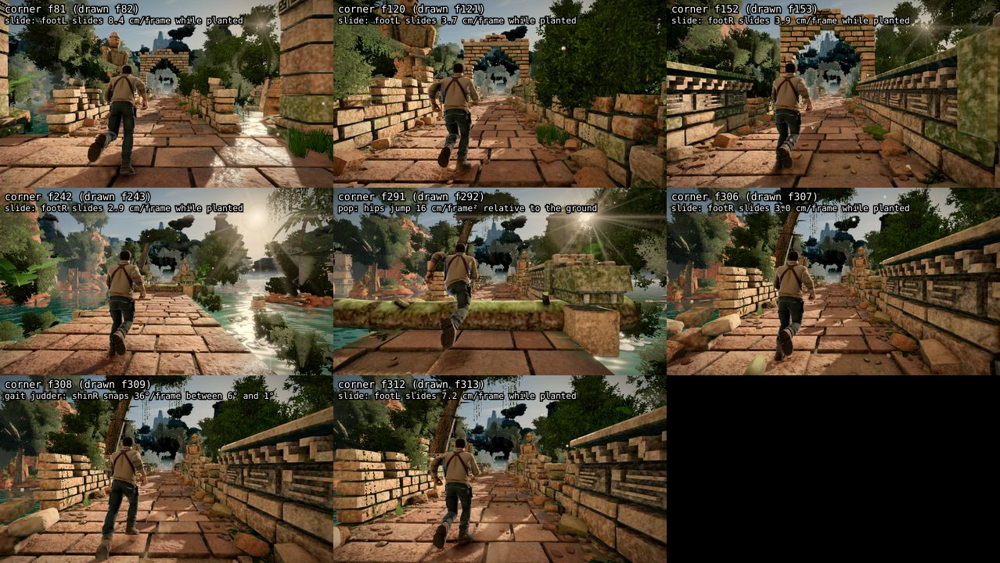

## cash1.5

Timeline: 

No flags.

Page errors: not filmed

## cash5

Timeline: 

No flags.

Page errors: not filmed

## cash20

Timeline: 1400–1407 run/run · 1408–1436 run/leap_gap · 1437–1489 run/run · 1490–1530 cashout/run · 1531–1730 cashout/win_leap

Gait judder (J / J of the joint's curve low-passed at 4× stride / excess; stride 2.26 Hz): spine 0.19/0.19/-0.00, chest 0.19/0.19/-0.00, neck 0.23/0.21/+0.02, head 0.25/0.26/-0.01, shoulderL 0.28/0.23/+0.05, shoulderR 0.27/0.22/+0.05, upper_armL 0.27/0.24/+0.04, upper_armR 0.27/0.24/+0.04, forearmL 0.29/0.23/+0.06, forearmR 0.29/0.24/+0.05, handL 0.24/0.22/+0.02, handR 0.24/0.26/-0.02, thighL 0.39/0.41/-0.02, thighR 0.43/0.47/-0.04, shinL 0.46/0.49/-0.03, shinR 0.38/0.51/-0.14, footL 0.72/0.77/-0.04, footR 0.67/0.76/-0.08, toeL 0.76/0.68/+0.07, toeR 0.86/0.70/+0.16

| frames | check | peak | clip at peak |
|---|---|---|---|
| 1403 | slide: footR slides | f1403: 3.0 cm/frame while planted | run/run |
| 1438 | slide: footR slides | f1438: 8.1 cm/frame while planted | run/run |
| 1439 | joint: footR swing | f1439: 61° (limit 60°) | run/run |
| 1488 | judder: toeR judders in the gait | f1488: J 0.86 vs 0.70 for its own curve low-passed at 4× stride (2.26 Hz): excess 0.16 (limit 0.1); worst frames f1488, f1451, f1463, f1450, f1477, f1440 | run/run |
| 1526 | slide: footL slides | f1526: 24.6 cm/frame while planted | cashout/run |
| 1528–1530 | camera: position jerk | f1528: 128 cm/frame² | cashout/run |
| 1544–1551 | joint: upper_armR twist | f1549: -162° (limit 110°) | cashout/win_leap |
| 1579–1587 | frozen: airborne, limbs still | f1587: 0.98°/frame mean limb motion, 12 frames in the air | cashout/win_leap |
| 1586 | pop: head jumps | f1586: 18 cm in one frame between 2 and 2 cm | cashout/win_leap |
| 1586 | pop: handL jumps | f1586: 22 cm in one frame between 2 and 2 cm | cashout/win_leap |
| 1586 | pop: handR jumps | f1586: 19 cm in one frame between 2 and 2 cm | cashout/win_leap |
| 1612 | pop: thighL snaps | f1612: 25°/frame between 1° and 4° | cashout/win_leap |
| 1638–1640 | joint: shoulderL swing | f1639: 40° (limit 40°) | cashout/win_leap |
| 1638–1640 | joint: shoulderR swing | f1639: 40° (limit 40°) | cashout/win_leap |
| 1659–1661 | joint: upper_armR twist | f1659: -114° (limit 110°) | cashout/win_leap |
| 1665–1678 | joint: shoulderL swing | f1670: 46° (limit 40°) | cashout/win_leap |
| 1665–1678 | joint: shoulderR swing | f1670: 46° (limit 40°) | cashout/win_leap |
| 1694–1716 | joint: shoulderL swing | f1703: 51° (limit 40°) | cashout/win_leap |
| 1694–1716 | joint: shoulderR swing | f1703: 51° (limit 40°) | cashout/win_leap |
| 1724–1730 | joint: shoulderL swing | f1730: 50° (limit 40°) | cashout/win_leap |
| 1724–1730 | joint: shoulderR swing | f1730: 50° (limit 40°) | cashout/win_leap |

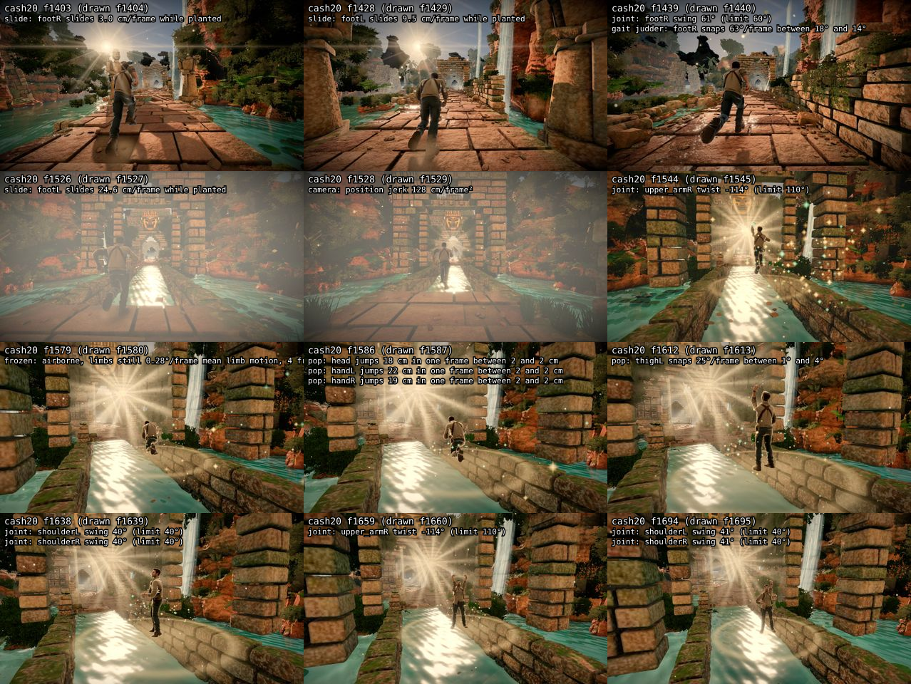

## cash60

Timeline: 1938–1988 run/run · 1989–2015 run/leap_gap · 2016–2027 run/run · 2028–2071 cashout/run · 2072–2268 cashout/win_slide

Gait judder (J / J of the joint's curve low-passed at 4× stride / excess; stride 2.35 Hz): spine 0.21/0.21/-0.01, chest 0.20/0.21/-0.00, neck 0.24/0.25/-0.01, head 0.23/0.22/+0.01, shoulderL 0.28/0.25/+0.04, shoulderR 0.29/0.24/+0.05, upper_armL 0.28/0.25/+0.03, upper_armR 0.28/0.25/+0.03, forearmL 0.29/0.27/+0.03, forearmR 0.29/0.26/+0.03, handL 0.25/0.26/-0.01, handR 0.25/0.23/+0.03, thighL 0.36/0.49/-0.13, thighR 0.39/0.50/-0.11, shinL 0.44/0.55/-0.11, shinR 0.38/0.53/-0.16, footL 0.62/0.81/-0.19, footR 0.71/0.88/-0.16, toeL 0.96/0.73/+0.23, toeR 0.98/0.79/+0.20

| frames | check | peak | clip at peak |
|---|---|---|---|
| 1951 | judder: toeR judders in the gait | f1951: J 0.98 vs 0.79 for its own curve low-passed at 4× stride (2.35 Hz): excess 0.19 (limit 0.1); worst frames f1951, f1974, f1987, f1950, f1964, f1973 | run/run |
| 1961 | pop: head jumps | f1961: 6 cm in one frame between 1 and 2 cm | run/run |
| 1980 | judder: toeL judders in the gait | f1980: J 0.96 vs 0.73 for its own curve low-passed at 4× stride (2.35 Hz): excess 0.23 (limit 0.1); worst frames f1980, f1968, f1944, f1945, f1967, f1957 | run/run |
| 1984 | pop: head jumps | f1984: 6 cm in one frame between 1 and 2 cm | run/run |
| 2006 | pop: footR jumps | f2006: 27 cm in one frame between 5 and 8 cm | run/leap_gap |
| 2018 | joint: footR swing | f2018: 66° (limit 60°) | run/run |
| 2024 | joint: footL swing | f2024: 61° (limit 60°) | run/run |
| 2033 | pop: head jumps | f2033: 4 cm in one frame between 1 and 1 cm | cashout/run |
| 2063 | pop: head jumps | f2063: 8 cm in one frame between 3 and 2 cm | cashout/run |
| 2068–2070 | camera: position jerk | f2068: 129 cm/frame² | cashout/run |
| 2081–2113 | frozen: airborne, limbs still | f2113: 0.88°/frame mean limb motion, 36 frames in the air | cashout/win_slide |
| 2104–2114 | joint: shoulderL swing | f2108: 42° (limit 40°) | cashout/win_slide |
| 2104–2114 | joint: shoulderR swing | f2108: 42° (limit 40°) | cashout/win_slide |
| 2125 | camera: position jerk | f2125: 107 cm/frame² | cashout/win_slide |
| 2125 | camera: snap | f2125: angular velocity 0.5 → 7.5°/frame | cashout/win_slide |
| 2127–2130 | camera: fast turn | f2129: 22.5°/frame | cashout/win_slide |
| 2131 | camera: position jerk | f2131: 33 cm/frame² | cashout/win_slide |
| 2131–2132 | camera: snap | f2131: angular velocity 19.2 → 8.5°/frame | cashout/win_slide |
| 2141 | pop: handL jumps | f2141: 15 cm in one frame between 2 and 0 cm | cashout/win_slide |
| 2141 | pop: handR jumps | f2141: 16 cm in one frame between 4 and 0 cm | cashout/win_slide |
| 2144–2153 | frozen: airborne, limbs still | f2147: 0.20°/frame mean limb motion, 7 frames in the air | cashout/win_slide |
| 2184 | pop: thighL snaps | f2184: 33°/frame between 1° and 1° | cashout/win_slide |
| 2185 | camera: position jerk | f2185: 113 cm/frame² | cashout/win_slide |
| 2185–2188 | camera: snap | f2185: angular velocity 0.6 → 33.1°/frame | cashout/win_slide |
| 2185–2187 | camera: fast turn | f2185: 33.1°/frame | cashout/win_slide |
| 2185 | framing: runner clipped | f2185: handR at the frame edge | cashout/win_slide |
| 2195–2199 | joint: upper_armL twist | f2196: 115° (limit 110°) | cashout/win_slide |
| 2195–2197 | joint: upper_armR twist | f2196: -114° (limit 110°) | cashout/win_slide |
| 2217–2221 | frozen: airborne, limbs still | f2218: 0.51°/frame mean limb motion, 5 frames in the air | cashout/win_slide |
| 2236–2250 | frozen: airborne, limbs still | f2247: 0.43°/frame mean limb motion, 15 frames in the air | cashout/win_slide |
| 2264–2268 | frozen: airborne, limbs still | f2264: 0.36°/frame mean limb motion, 4 frames in the air | cashout/win_slide |

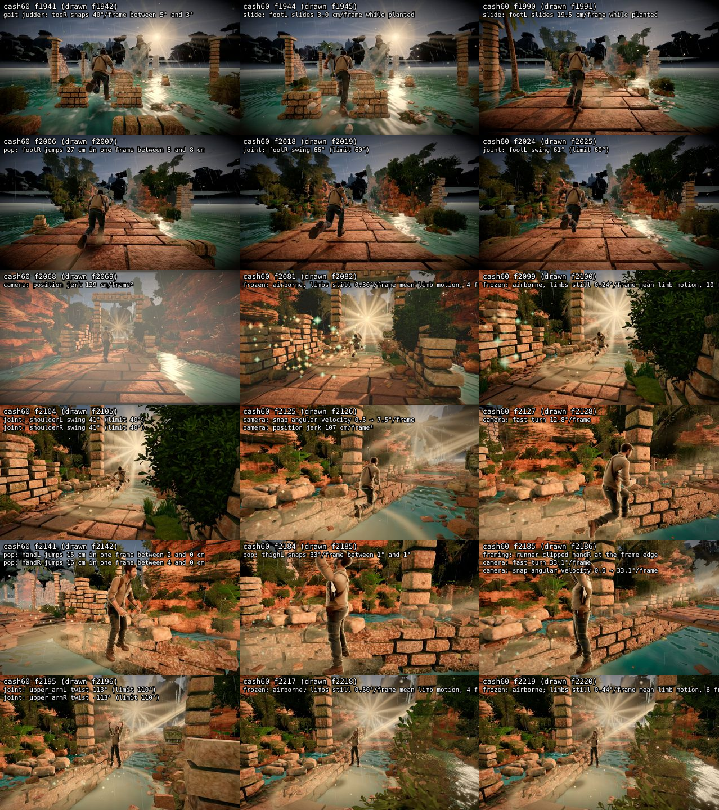

## fall_start

Timeline: 20–29 setup/idle · 30–44 lead/ready · 45–270 crash/fall_start

| frames | check | peak | clip at peak |
|---|---|---|---|
| 80–270 | joint: footL swing | f85: 82° (limit 60°) | crash/fall_start |
| 80–270 | joint: footR swing | f86: 88° (limit 60°) | crash/fall_start |

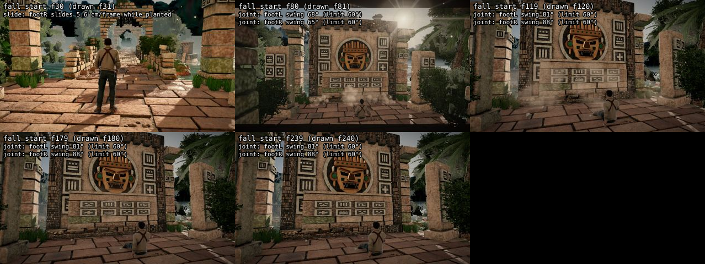

## chasm0

Timeline: 526–585 run/run · 586–586 crash/run · 587–796 crash/fall_chasm

Gait judder (J / J of the joint's curve low-passed at 4× stride / excess; stride 2.5 Hz): spine 0.16/0.15/+0.01, chest 0.16/0.16/-0.00, neck 0.16/0.15/+0.01, head 0.18/0.20/-0.02, shoulderL 0.24/0.21/+0.03, shoulderR 0.26/0.25/+0.00, upper_armL 0.25/0.22/+0.03, upper_armR 0.25/0.22/+0.03, forearmL 0.24/0.21/+0.03, forearmR 0.24/0.21/+0.03, handL 0.22/0.19/+0.03, handR 0.22/0.19/+0.04, thighL 0.41/0.35/+0.06, thighR 0.48/0.38/+0.10, shinL 0.43/0.44/-0.01, shinR 0.37/0.42/-0.04, footL 0.68/0.75/-0.07, footR 0.73/0.76/-0.03, toeL 0.93/0.76/+0.17, toeR 0.87/0.75/+0.12

| frames | check | peak | clip at peak |
|---|---|---|---|
| 568 | judder: toeR judders in the gait | f568: J 0.87 vs 0.75 for its own curve low-passed at 4× stride (2.50 Hz): excess 0.12 (limit 0.1); worst frames f568, f569, f584, f556, f531, f555 | run/run |
| 575 | judder: toeL judders in the gait | f575: J 0.93 vs 0.76 for its own curve low-passed at 4× stride (2.50 Hz): excess 0.17 (limit 0.1); worst frames f575, f576, f536, f535, f551, f563 | run/run |
| 586 | camera: position jerk | f586: 36 cm/frame² | crash/run |
| 642–647 | pop: hips jump | f642: 18 cm/frame² relative to the ground | crash/fall_chasm |
| 649 | joint: upper_armL twist | f649: -117° (limit 110°) | crash/fall_chasm |
| 652–660 | pop: hips jump | f656: 30 cm/frame² relative to the ground | crash/fall_chasm |
| 652 | pop: neck snaps | f652: 27°/frame between 2° and 5° | crash/fall_chasm |
| 652 | pop: head snaps | f652: 41°/frame between 1° and 8° | crash/fall_chasm |
| 656–660 | joint: head swing | f658: 56° (limit 55°) | crash/fall_chasm |
| 661 | joint: upper_armR twist | f661: 110° (limit 110°) | crash/fall_chasm |
| 663 | pop: hips jump | f663: 11 cm/frame² relative to the ground | crash/fall_chasm |
| 663–670 | joint: neck swing | f666: 53° (limit 50°) | crash/fall_chasm |
| 666–674 | pop: hips jump | f670: 31 cm/frame² relative to the ground | crash/fall_chasm |
| 667–674 | joint: head swing | f671: 60° (limit 55°) | crash/fall_chasm |
| 675 | joint: upper_armL twist | f675: -121° (limit 110°) | crash/fall_chasm |
| 680–686 | pop: hips jump | f684: 32 cm/frame² relative to the ground | crash/fall_chasm |
| 681–691 | joint: head swing | f688: 72° (limit 55°) | crash/fall_chasm |
| 681–692 | joint: shoulderL swing | f686: 45° (limit 40°) | crash/fall_chasm |
| 681–692 | joint: shoulderR swing | f686: 45° (limit 40°) | crash/fall_chasm |
| 686–713 | joint: neck swing | f707: 86° (limit 50°) | crash/fall_chasm |
| 692–695 | joint: forearmL over-flexed | f695: 178° (limit 160°) | crash/fall_chasm |
| 692 | joint: shinR over-flexed | f692: 177° (limit 160°) | crash/fall_chasm |
| 693–709 | joint: shinR reverse bend | f709: -13° (limit -10°) | crash/fall_chasm |
| 694–796 | joint: head swing | f701: 110° (limit 55°) | crash/fall_chasm |
| 694 | joint: forearmR over-flexed | f694: 165° (limit 160°) | crash/fall_chasm |
| 695 | joint: upper_armL twist | f695: 140° (limit 110°) | crash/fall_chasm |
| 695 | joint: upper_armL swing | f695: 180° (limit 178°) | crash/fall_chasm |
| 695–704 | joint: forearmR reverse bend | f704: -29° (limit -12°) | crash/fall_chasm |
| 695–707 | joint: shinL reverse bend | f707: -20° (limit -10°) | crash/fall_chasm |
| 696–704 | joint: forearmL reverse bend | f704: -18° (limit -12°) | crash/fall_chasm |
| 701–703 | joint: upper_armL twist | f702: -172° (limit 110°) | crash/fall_chasm |
| 707 | joint: upper_armL twist | f707: 150° (limit 110°) | crash/fall_chasm |
| 710–728 | joint: shoulderL swing | f718: 50° (limit 40°) | crash/fall_chasm |
| 710–728 | joint: shoulderR swing | f718: 50° (limit 40°) | crash/fall_chasm |
| 715–716 | joint: upper_armL twist | f715: -172° (limit 110°) | crash/fall_chasm |
| 715–716 | joint: forearmL over-flexed | f716: 179° (limit 160°) | crash/fall_chasm |
| 715 | joint: forearmR over-flexed | f715: 171° (limit 160°) | crash/fall_chasm |
| 716–725 | joint: forearmR reverse bend | f725: -23° (limit -12°) | crash/fall_chasm |
| 717–725 | joint: forearmL reverse bend | f725: -20° (limit -12°) | crash/fall_chasm |
| 721 | joint: upper_armL twist | f721: 155° (limit 110°) | crash/fall_chasm |
| 721–722 | joint: shinL over-flexed | f722: 178° (limit 160°) | crash/fall_chasm |
| 722–782 | joint: neck swing | f765: 87° (limit 50°) | crash/fall_chasm |
| 723 | joint: shinR over-flexed | f723: 172° (limit 160°) | crash/fall_chasm |
| 723–738 | joint: shinL reverse bend | f738: -21° (limit -10°) | crash/fall_chasm |
| 724–735 | joint: shinR reverse bend | f735: -31° (limit -10°) | crash/fall_chasm |
| 728 | joint: upper_armL twist | f728: -177° (limit 110°) | crash/fall_chasm |
| 732–736 | joint: upper_armL twist | f734: -174° (limit 110°) | crash/fall_chasm |
| 736 | joint: forearmL over-flexed | f736: 164° (limit 160°) | crash/fall_chasm |
| 736 | joint: forearmR over-flexed | f736: 177° (limit 160°) | crash/fall_chasm |
| 737–746 | joint: forearmR reverse bend | f746: -17° (limit -12°) | crash/fall_chasm |
| 737–746 | joint: forearmL reverse bend | f746: -22° (limit -12°) | crash/fall_chasm |
| 739–796 | joint: shoulderL swing | f784: 61° (limit 40°) | crash/fall_chasm |
| 739–796 | joint: shoulderR swing | f784: 61° (limit 40°) | crash/fall_chasm |
| 741 | joint: upper_armL twist | f741: 119° (limit 110°) | crash/fall_chasm |
| 749 | joint: shinR over-flexed | f749: 173° (limit 160°) | crash/fall_chasm |
| 750–766 | joint: shinR reverse bend | f766: -10° (limit -10°) | crash/fall_chasm |
| 751–755 | joint: upper_armL twist | f754: -170° (limit 110°) | crash/fall_chasm |
| 752 | joint: shinL over-flexed | f752: 173° (limit 160°) | crash/fall_chasm |
| 753–764 | joint: shinL reverse bend | f764: -30° (limit -10°) | crash/fall_chasm |
| 757 | joint: forearmL over-flexed | f757: 164° (limit 160°) | crash/fall_chasm |
| 757–766 | joint: forearmR reverse bend | f766: -44° (limit -12°) | crash/fall_chasm |
| 758–767 | joint: forearmL reverse bend | f767: -23° (limit -12°) | crash/fall_chasm |
| 767–774 | joint: upper_armL twist | f767: -177° (limit 110°) | crash/fall_chasm |
| 778 | joint: forearmL over-flexed | f778: 165° (limit 160°) | crash/fall_chasm |
| 778–787 | joint: forearmR reverse bend | f787: -38° (limit -12°) | crash/fall_chasm |
| 778 | joint: shinL over-flexed | f778: 169° (limit 160°) | crash/fall_chasm |
| 779–796 | joint: shinL reverse bend | f796: -10° (limit -10°) | crash/fall_chasm |
| 779–788 | joint: forearmL reverse bend | f788: -23° (limit -12°) | crash/fall_chasm |
| 780 | joint: shinR over-flexed | f780: 165° (limit 160°) | crash/fall_chasm |
| 780 | joint: upper_armL swing | f780: 178° (limit 178°) | crash/fall_chasm |
| 781–793 | joint: shinR reverse bend | f793: -16° (limit -10°) | crash/fall_chasm |
| 785–794 | joint: upper_armL twist | f785: 160° (limit 110°) | crash/fall_chasm |
| 787–796 | joint: neck swing | f793: 63° (limit 50°) | crash/fall_chasm |

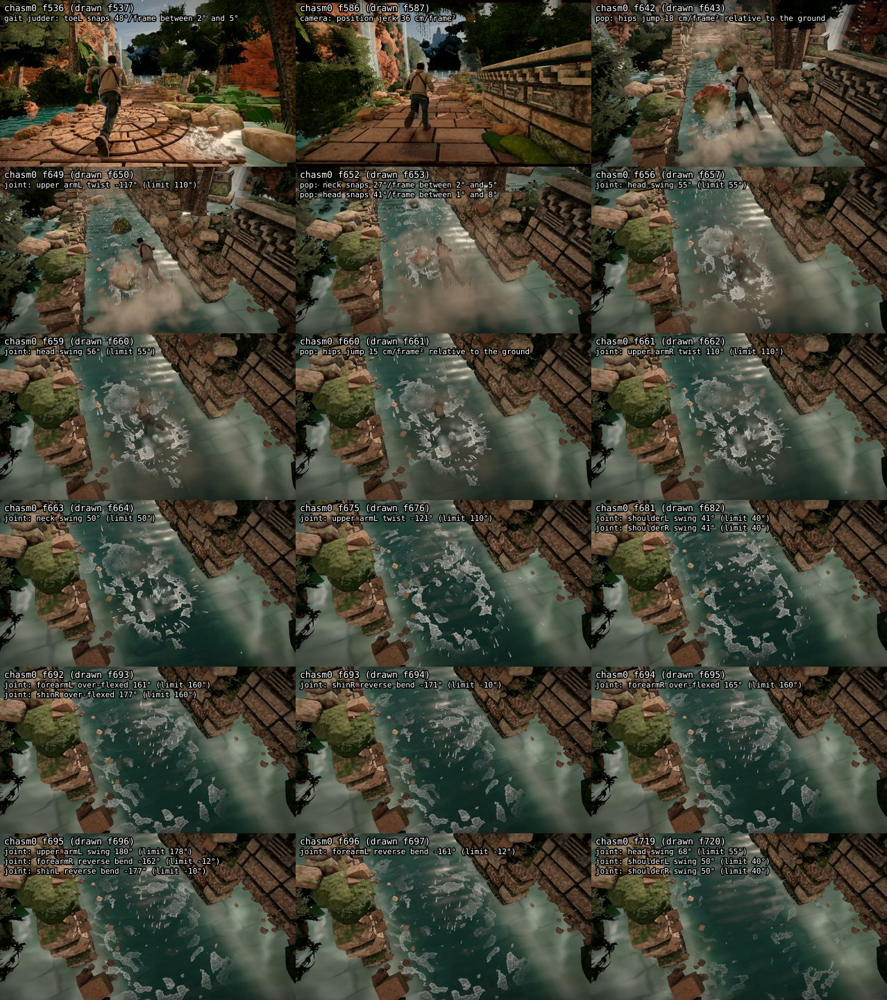

## chasm1

Timeline: 526–585 run/run · 586–586 crash/run · 587–796 crash/fall_chasm_b

Gait judder (J / J of the joint's curve low-passed at 4× stride / excess; stride 2.5 Hz): spine 0.16/0.15/+0.01, chest 0.16/0.16/-0.00, neck 0.16/0.15/+0.01, head 0.18/0.20/-0.02, shoulderL 0.24/0.21/+0.03, shoulderR 0.26/0.25/+0.01, upper_armL 0.25/0.22/+0.03, upper_armR 0.25/0.22/+0.03, forearmL 0.24/0.21/+0.03, forearmR 0.24/0.21/+0.03, handL 0.22/0.19/+0.03, handR 0.22/0.19/+0.04, thighL 0.41/0.35/+0.06, thighR 0.48/0.38/+0.10, shinL 0.43/0.44/-0.01, shinR 0.37/0.42/-0.04, footL 0.68/0.75/-0.07, footR 0.73/0.76/-0.03, toeL 0.93/0.76/+0.17, toeR 0.87/0.75/+0.12

| frames | check | peak | clip at peak |
|---|---|---|---|
| 568 | judder: toeR judders in the gait | f568: J 0.87 vs 0.75 for its own curve low-passed at 4× stride (2.50 Hz): excess 0.12 (limit 0.1); worst frames f568, f569, f584, f556, f531, f555 | run/run |
| 575 | judder: toeL judders in the gait | f575: J 0.93 vs 0.76 for its own curve low-passed at 4× stride (2.50 Hz): excess 0.17 (limit 0.1); worst frames f575, f576, f536, f535, f551, f563 | run/run |
| 586 | camera: position jerk | f586: 36 cm/frame² | crash/run |
| 616–644 | joint: footL swing | f629: 163° (limit 60°) | crash/fall_chasm_b |
| 645 | pop: footL flips | f645: 142°/frame | crash/fall_chasm_b |
| 645 | pop: footL jumps | f645: 10 cm in one frame between 0 and 3 cm | crash/fall_chasm_b |
| 656–796 | joint: footL swing | f699: 80° (limit 60°) | crash/fall_chasm_b |
| 656–796 | joint: footR swing | f700: 80° (limit 60°) | crash/fall_chasm_b |
| 681–692 | joint: shoulderL swing | f686: 45° (limit 40°) | crash/fall_chasm_b |
| 681–692 | joint: shoulderR swing | f686: 45° (limit 40°) | crash/fall_chasm_b |
| 710–728 | joint: shoulderL swing | f718: 50° (limit 40°) | crash/fall_chasm_b |
| 710–728 | joint: shoulderR swing | f718: 50° (limit 40°) | crash/fall_chasm_b |
| 739–796 | joint: shoulderL swing | f784: 61° (limit 40°) | crash/fall_chasm_b |
| 739–796 | joint: shoulderR swing | f784: 61° (limit 40°) | crash/fall_chasm_b |
| 783–787 | joint: neck swing | f784: 51° (limit 50°) | crash/fall_chasm_b |

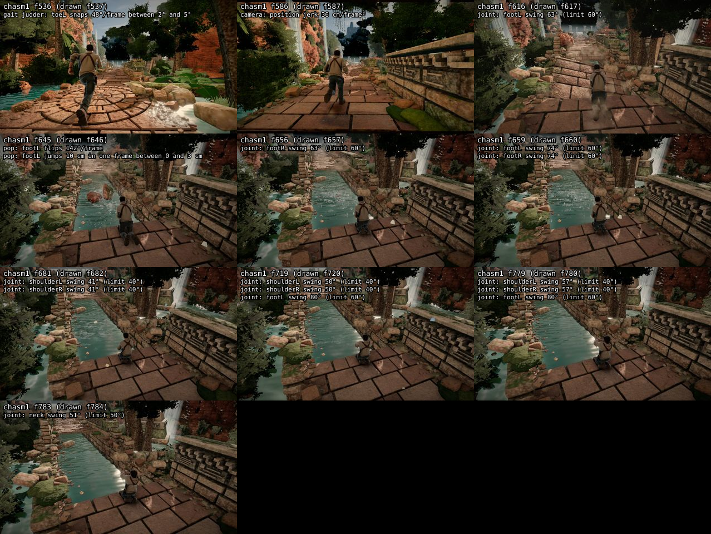

## gate0

Timeline: 526–585 run/run · 586–586 crash/run · 587–796 crash/fall_gate

Gait judder (J / J of the joint's curve low-passed at 4× stride / excess; stride 2.5 Hz): spine 0.16/0.15/+0.01, chest 0.16/0.16/+0.00, neck 0.19/0.15/+0.04, head 0.18/0.20/-0.02, shoulderL 0.24/0.21/+0.03, shoulderR 0.26/0.25/+0.01, upper_armL 0.25/0.22/+0.03, upper_armR 0.25/0.22/+0.03, forearmL 0.24/0.21/+0.03, forearmR 0.24/0.21/+0.03, handL 0.22/0.19/+0.03, handR 0.22/0.19/+0.04, thighL 0.41/0.35/+0.06, thighR 0.48/0.38/+0.10, shinL 0.43/0.44/-0.01, shinR 0.37/0.42/-0.04, footL 0.68/0.75/-0.07, footR 0.73/0.76/-0.03, toeL 0.93/0.76/+0.17, toeR 0.87/0.75/+0.12

| frames | check | peak | clip at peak |
|---|---|---|---|
| 568 | judder: toeR judders in the gait | f568: J 0.87 vs 0.75 for its own curve low-passed at 4× stride (2.50 Hz): excess 0.12 (limit 0.1); worst frames f568, f569, f584, f556, f531, f555 | run/run |
| 575 | judder: toeL judders in the gait | f575: J 0.93 vs 0.76 for its own curve low-passed at 4× stride (2.50 Hz): excess 0.17 (limit 0.1); worst frames f575, f576, f536, f535, f551, f563 | run/run |
| 586 | camera: position jerk | f586: 47 cm/frame² | crash/run |
| 606 | camera: position jerk | f606: 27 cm/frame² | crash/fall_gate |
| 674–796 | frozen: airborne, limbs still | f691: 0.18°/frame mean limb motion, 21 frames in the air | crash/fall_gate |
| 783–786 | joint: shoulderL swing | f784: 41° (limit 40°) | crash/fall_gate |

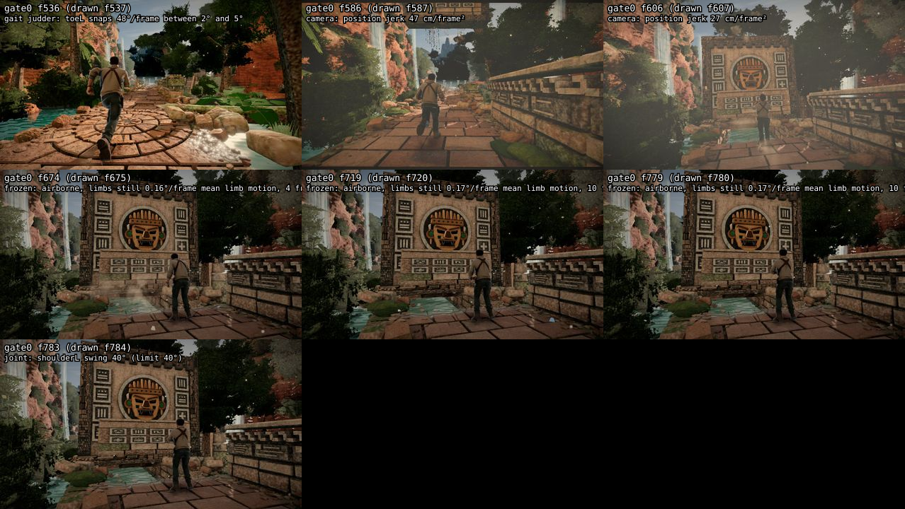

## gate1

Timeline: 526–585 run/run · 586–586 crash/run · 587–796 crash/fall_gate_b

Gait judder (J / J of the joint's curve low-passed at 4× stride / excess; stride 2.5 Hz): spine 0.16/0.15/+0.01, chest 0.16/0.16/-0.01, neck 0.17/0.15/+0.03, head 0.18/0.20/-0.02, shoulderL 0.25/0.21/+0.04, shoulderR 0.24/0.25/-0.01, upper_armL 0.25/0.22/+0.03, upper_armR 0.25/0.22/+0.03, forearmL 0.24/0.21/+0.03, forearmR 0.24/0.21/+0.03, handL 0.22/0.19/+0.03, handR 0.22/0.19/+0.04, thighL 0.41/0.35/+0.06, thighR 0.48/0.38/+0.10, shinL 0.43/0.44/-0.01, shinR 0.37/0.42/-0.04, footL 0.68/0.75/-0.07, footR 0.73/0.76/-0.03, toeL 0.93/0.76/+0.17, toeR 0.87/0.75/+0.12

| frames | check | peak | clip at peak |
|---|---|---|---|
| 568 | judder: toeR judders in the gait | f568: J 0.87 vs 0.75 for its own curve low-passed at 4× stride (2.50 Hz): excess 0.12 (limit 0.1); worst frames f568, f569, f584, f556, f531, f555 | run/run |
| 575 | judder: toeL judders in the gait | f575: J 0.93 vs 0.76 for its own curve low-passed at 4× stride (2.50 Hz): excess 0.17 (limit 0.1); worst frames f575, f576, f536, f535, f551, f563 | run/run |
| 586 | camera: position jerk | f586: 46 cm/frame² | crash/run |
| 605 | camera: snap | f605: angular velocity 0.4 → 6.7°/frame | crash/fall_gate_b |
| 681–691 | joint: shoulderL swing | f686: 44° (limit 40°) | crash/fall_gate_b |
| 710–728 | joint: shoulderL swing | f718: 50° (limit 40°) | crash/fall_gate_b |
| 739–796 | joint: shoulderL swing | f784: 60° (limit 40°) | crash/fall_gate_b |

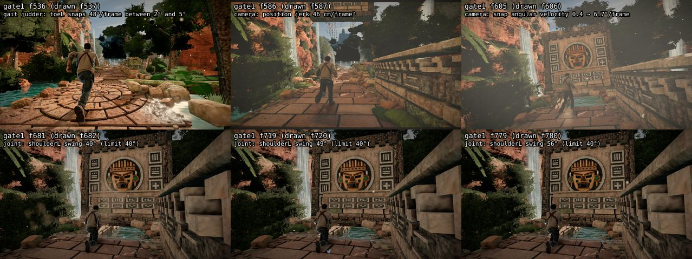

## rock0

Timeline: 526–585 run/run · 586–586 crash/run · 587–796 crash/fall_rock

Gait judder (J / J of the joint's curve low-passed at 4× stride / excess; stride 2.5 Hz): spine 0.16/0.15/+0.01, chest 0.17/0.16/+0.00, neck 0.18/0.15/+0.04, head 0.18/0.20/-0.02, shoulderL 0.24/0.21/+0.03, shoulderR 0.25/0.25/+0.01, upper_armL 0.25/0.22/+0.03, upper_armR 0.25/0.22/+0.03, forearmL 0.24/0.21/+0.03, forearmR 0.24/0.21/+0.03, handL 0.22/0.19/+0.03, handR 0.22/0.19/+0.04, thighL 0.41/0.35/+0.06, thighR 0.48/0.38/+0.10, shinL 0.43/0.44/-0.01, shinR 0.37/0.42/-0.04, footL 0.68/0.75/-0.07, footR 0.73/0.76/-0.03, toeL 0.93/0.76/+0.17, toeR 0.87/0.75/+0.12

| frames | check | peak | clip at peak |
|---|---|---|---|
| 568 | judder: toeR judders in the gait | f568: J 0.87 vs 0.75 for its own curve low-passed at 4× stride (2.50 Hz): excess 0.12 (limit 0.1); worst frames f568, f569, f584, f556, f531, f555 | run/run |
| 575 | judder: toeL judders in the gait | f575: J 0.93 vs 0.76 for its own curve low-passed at 4× stride (2.50 Hz): excess 0.17 (limit 0.1); worst frames f575, f576, f536, f535, f551, f563 | run/run |
| 586 | camera: position jerk | f586: 40 cm/frame² | crash/run |
| 611–612 | frozen: airborne, limbs still | f611: 0.82°/frame mean limb motion, 4 frames in the air | crash/fall_rock |
| 624–796 | joint: footR swing | f629: 69° (limit 60°) | crash/fall_rock |
| 632 | camera: position jerk | f632: 36 cm/frame² | crash/fall_rock |
| 649 | camera: position jerk | f649: 32 cm/frame² | crash/fall_rock |
| 681 | camera: position jerk | f681: 37 cm/frame² | crash/fall_rock |
| 684 | camera: position jerk | f684: 30 cm/frame² | crash/fall_rock |

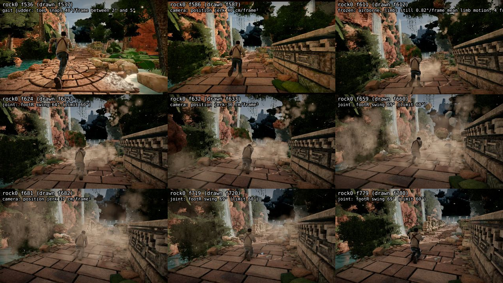

## rock1

Timeline: 

No flags.

Page errors: not filmed

## rock2

Timeline: 526–585 run/run · 586–586 crash/run · 587–796 crash/fall_side_hit

Gait judder (J / J of the joint's curve low-passed at 4× stride / excess; stride 2.5 Hz): spine 0.16/0.15/+0.01, chest 0.16/0.16/-0.00, neck 0.17/0.15/+0.02, head 0.18/0.20/-0.02, shoulderL 0.24/0.21/+0.03, shoulderR 0.25/0.25/-0.00, upper_armL 0.25/0.22/+0.03, upper_armR 0.25/0.22/+0.03, forearmL 0.24/0.21/+0.03, forearmR 0.24/0.21/+0.03, handL 0.22/0.19/+0.03, handR 0.22/0.19/+0.04, thighL 0.41/0.35/+0.06, thighR 0.48/0.38/+0.10, shinL 0.43/0.44/-0.01, shinR 0.37/0.42/-0.04, footL 0.68/0.75/-0.07, footR 0.73/0.76/-0.03, toeL 0.93/0.76/+0.17, toeR 0.87/0.75/+0.12

| frames | check | peak | clip at peak |
|---|---|---|---|
| 568 | judder: toeR judders in the gait | f568: J 0.87 vs 0.75 for its own curve low-passed at 4× stride (2.50 Hz): excess 0.12 (limit 0.1); worst frames f568, f569, f584, f556, f531, f555 | run/run |
| 575 | judder: toeL judders in the gait | f575: J 0.93 vs 0.76 for its own curve low-passed at 4× stride (2.50 Hz): excess 0.17 (limit 0.1); worst frames f575, f576, f536, f535, f551, f563 | run/run |
| 586 | pop: runner ground jumps | f586: 25 cm/frame² | crash/run |
| 586 | camera: position jerk | f586: 46 cm/frame² | crash/run |
| 589–591 | pop: hips jump | f589: 14 cm/frame² relative to the ground | crash/fall_side_hit |
| 597 | camera: position jerk | f597: 29 cm/frame² | crash/fall_side_hit |
| 600–602 | pop: hips jump | f602: 18 cm/frame² relative to the ground | crash/fall_side_hit |
| 610 | pop: shinR snaps | f610: 33°/frame between 10° and 1° | crash/fall_side_hit |
| 614–647 | framing: runner clipped | f618: head, hips, handL, handR, footL, footR at the frame edge | crash/fall_side_hit |
| 625–627 | frozen: airborne, limbs still | f627: 1.05°/frame mean limb motion, 6 frames in the air | crash/fall_side_hit |
| 638–640 | camera: position jerk | f638: 40 cm/frame² | crash/fall_side_hit |
| 650 | camera: position jerk | f650: 28 cm/frame² | crash/fall_side_hit |
| 655–657 | camera: position jerk | f657: 28 cm/frame² | crash/fall_side_hit |
| 665 | framing: runner clipped | f665: handL at the frame edge | crash/fall_side_hit |
| 666 | camera: position jerk | f666: 38 cm/frame² | crash/fall_side_hit |
| 675 | camera: position jerk | f675: 28 cm/frame² | crash/fall_side_hit |
| 681–691 | joint: shoulderR swing | f686: 44° (limit 40°) | crash/fall_side_hit |
| 682–691 | joint: shoulderL swing | f686: 43° (limit 40°) | crash/fall_side_hit |
| 690–796 | joint: head swing | f785: 91° (limit 55°) | crash/fall_side_hit |
| 692 | joint: neck swing | f692: 50° (limit 50°) | crash/fall_side_hit |
| 709–730 | joint: neck swing | f718: 68° (limit 50°) | crash/fall_side_hit |
| 710–728 | joint: shoulderR swing | f718: 49° (limit 40°) | crash/fall_side_hit |
| 710–727 | joint: shoulderL swing | f718: 49° (limit 40°) | crash/fall_side_hit |
| 738–796 | joint: neck swing | f785: 87° (limit 50°) | crash/fall_side_hit |
| 739–796 | joint: shoulderR swing | f784: 60° (limit 40°) | crash/fall_side_hit |
| 740–796 | joint: shoulderL swing | f784: 59° (limit 40°) | crash/fall_side_hit |
| 745–796 | framing: runner clipped | f767: handL, handR at the frame edge | crash/fall_side_hit |

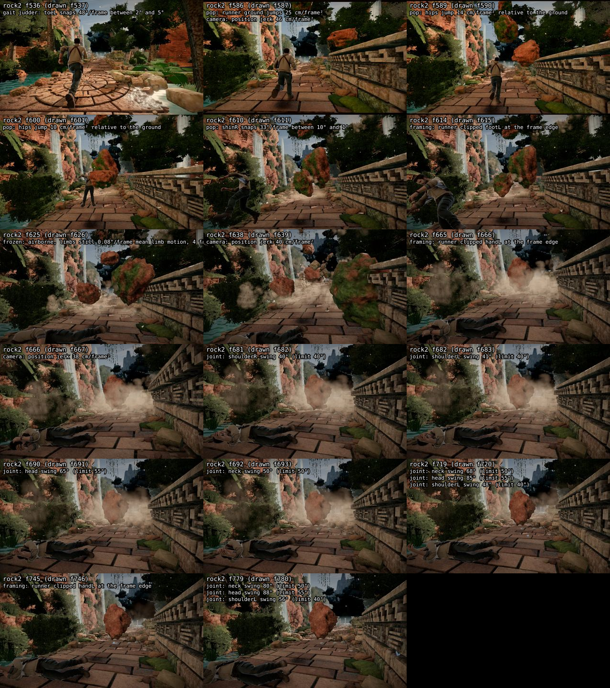

## pillar0

Timeline: 526–585 run/run · 586–611 crash/run · 612–796 crash/fall_pillar

Gait judder (J / J of the joint's curve low-passed at 4× stride / excess; stride 2.5 Hz): spine 0.16/0.15/+0.01, chest 0.17/0.16/+0.01, neck 0.18/0.14/+0.04, head 0.18/0.20/-0.02, shoulderL 0.24/0.21/+0.03, shoulderR 0.25/0.25/+0.00, upper_armL 0.25/0.22/+0.03, upper_armR 0.25/0.22/+0.03, forearmL 0.24/0.21/+0.03, forearmR 0.24/0.21/+0.03, handL 0.22/0.19/+0.03, handR 0.22/0.19/+0.04, thighL 0.41/0.35/+0.06, thighR 0.48/0.38/+0.10, shinL 0.43/0.44/-0.01, shinR 0.37/0.42/-0.04, footL 0.68/0.75/-0.07, footR 0.73/0.76/-0.03, toeL 0.93/0.76/+0.17, toeR 0.87/0.75/+0.12

| frames | check | peak | clip at peak |
|---|---|---|---|
| 568 | judder: toeR judders in the gait | f568: J 0.87 vs 0.75 for its own curve low-passed at 4× stride (2.50 Hz): excess 0.12 (limit 0.1); worst frames f568, f569, f584, f556, f531, f555 | run/run |
| 575 | judder: toeL judders in the gait | f575: J 0.93 vs 0.76 for its own curve low-passed at 4× stride (2.50 Hz): excess 0.17 (limit 0.1); worst frames f575, f576, f536, f535, f551, f563 | run/run |
| 586 | camera: position jerk | f586: 43 cm/frame² | crash/run |
| 609 | pop: runner ground jumps | f609: 24 cm/frame² | crash/run |
| 613–614 | pop: hips jump | f613: 14 cm/frame² relative to the ground | crash/fall_pillar |
| 639 | pop: hips jump | f639: 12 cm/frame² relative to the ground | crash/fall_pillar |
| 643–796 | joint: thighL swing | f644: 155° (limit 135°) | crash/fall_pillar |
| 643–796 | joint: thighL twist | f644: -144° (limit 55°) | crash/fall_pillar |
| 645–796 | joint: thighR swing | f646: 142° (limit 135°) | crash/fall_pillar |
| 654–796 | frozen: airborne, limbs still | f657: 0.27°/frame mean limb motion, 7 frames in the air | crash/fall_pillar |

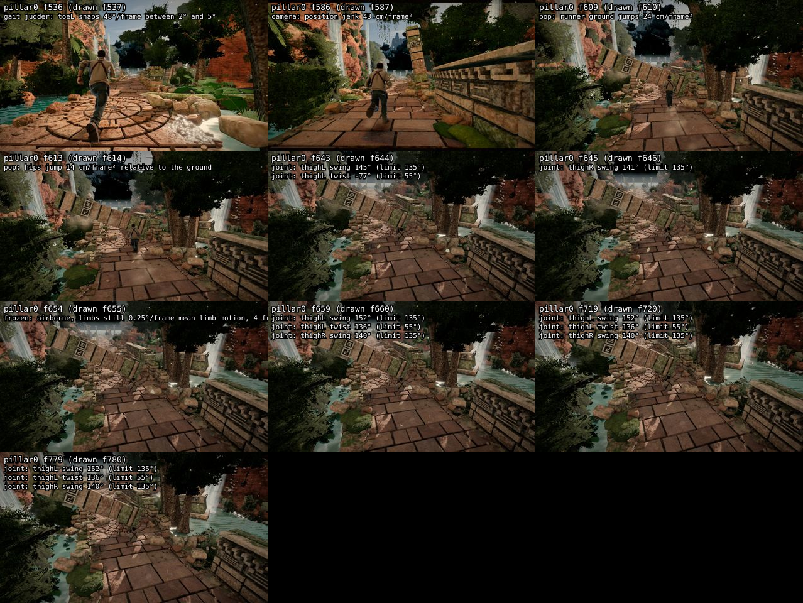

## pillar1

Timeline: 526–585 run/run · 586–605 crash/run · 606–796 crash/fall_pillar_b

Gait judder (J / J of the joint's curve low-passed at 4× stride / excess; stride 2.5 Hz): spine 0.17/0.15/+0.01, chest 0.16/0.16/-0.00, neck 0.19/0.14/+0.06, head 0.18/0.20/-0.02, shoulderL 0.24/0.21/+0.03, shoulderR 0.25/0.25/+0.00, upper_armL 0.25/0.22/+0.03, upper_armR 0.25/0.22/+0.03, forearmL 0.24/0.21/+0.03, forearmR 0.24/0.21/+0.03, handL 0.22/0.19/+0.03, handR 0.22/0.19/+0.04, thighL 0.41/0.35/+0.06, thighR 0.48/0.38/+0.10, shinL 0.43/0.44/-0.01, shinR 0.37/0.42/-0.04, footL 0.68/0.75/-0.07, footR 0.73/0.76/-0.03, toeL 0.93/0.76/+0.17, toeR 0.87/0.75/+0.12

| frames | check | peak | clip at peak |
|---|---|---|---|
| 568 | judder: toeR judders in the gait | f568: J 0.87 vs 0.75 for its own curve low-passed at 4× stride (2.50 Hz): excess 0.12 (limit 0.1); worst frames f568, f569, f584, f556, f531, f555 | run/run |
| 575 | judder: toeL judders in the gait | f575: J 0.93 vs 0.76 for its own curve low-passed at 4× stride (2.50 Hz): excess 0.17 (limit 0.1); worst frames f575, f576, f536, f535, f551, f563 | run/run |
| 586 | camera: position jerk | f586: 42 cm/frame² | crash/run |
| 607 | pop: runner ground jumps | f607: 24 cm/frame² | crash/fall_pillar_b |
| 609 | pop: hips jump | f609: 11 cm/frame² relative to the ground | crash/fall_pillar_b |
| 613 | pop: hips jump | f613: 14 cm/frame² relative to the ground | crash/fall_pillar_b |

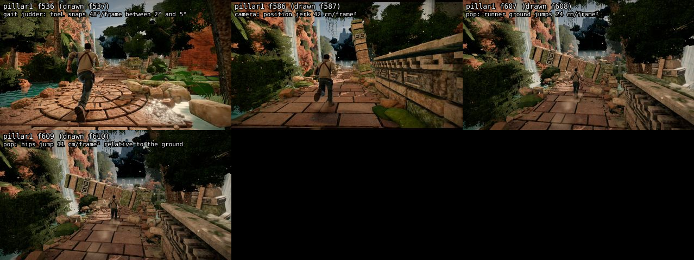

## trip0

Timeline: 526–585 run/run · 586–611 crash/run · 612–796 crash/fall_trip

Gait judder (J / J of the joint's curve low-passed at 4× stride / excess; stride 2.5 Hz): spine 0.16/0.15/+0.01, chest 0.16/0.16/-0.00, neck 0.19/0.14/+0.05, head 0.18/0.20/-0.02, shoulderL 0.24/0.21/+0.03, shoulderR 0.24/0.25/-0.01, upper_armL 0.25/0.22/+0.03, upper_armR 0.25/0.22/+0.03, forearmL 0.24/0.21/+0.03, forearmR 0.24/0.21/+0.03, handL 0.22/0.19/+0.03, handR 0.22/0.19/+0.04, thighL 0.41/0.35/+0.06, thighR 0.48/0.38/+0.10, shinL 0.43/0.44/-0.01, shinR 0.37/0.42/-0.04, footL 0.68/0.75/-0.07, footR 0.73/0.76/-0.03, toeL 0.93/0.76/+0.17, toeR 0.87/0.75/+0.12

| frames | check | peak | clip at peak |
|---|---|---|---|
| 568 | judder: toeR judders in the gait | f568: J 0.87 vs 0.75 for its own curve low-passed at 4× stride (2.50 Hz): excess 0.12 (limit 0.1); worst frames f568, f569, f584, f556, f531, f555 | run/run |
| 575 | judder: toeL judders in the gait | f575: J 0.93 vs 0.76 for its own curve low-passed at 4× stride (2.50 Hz): excess 0.17 (limit 0.1); worst frames f575, f576, f536, f535, f551, f563 | run/run |
| 586 | camera: position jerk | f586: 39 cm/frame² | crash/run |
| 613 | pop: runner ground jumps | f613: 24 cm/frame² | crash/fall_trip |
| 615 | pop: hips jump | f615: 11 cm/frame² relative to the ground | crash/fall_trip |
| 619 | pop: hips jump | f619: 15 cm/frame² relative to the ground | crash/fall_trip |
| 625–628 | pop: hips jump | f625: 12 cm/frame² relative to the ground | crash/fall_trip |
| 626 | pop: shinL snaps | f626: 27°/frame between 4° and 2° | crash/fall_trip |
| 647–651 | frozen: airborne, limbs still | f651: 0.43°/frame mean limb motion, 8 frames in the air | crash/fall_trip |
| 648–650 | joint: neck swing | f650: 52° (limit 50°) | crash/fall_trip |
| 648–650 | joint: head swing | f650: 60° (limit 55°) | crash/fall_trip |
| 651 | pop: head jumps | f651: 15 cm in one frame between 3 and 2 cm | crash/fall_trip |
| 657–659 | joint: neck+head twist | f657: 106° (limit 100°) | crash/fall_trip |
| 661–796 | frozen: airborne, limbs still | f702: 0.47°/frame mean limb motion, 45 frames in the air | crash/fall_trip |
| 679–690 | joint: neck+head twist | f682: 105° (limit 100°) | crash/fall_trip |
| 702–792 | joint: neck+head twist | f715: 149° (limit 100°) | crash/fall_trip |
| 704–727 | joint: head twist | f715: 85° (limit 70°) | crash/fall_trip |
| 705–722 | joint: neck swing | f715: 65° (limit 50°) | crash/fall_trip |
| 706–722 | joint: neck twist | f715: 64° (limit 60°) | crash/fall_trip |
| 737–756 | joint: head twist | f748: 80° (limit 70°) | crash/fall_trip |
| 742–752 | joint: neck swing | f747: 56° (limit 50°) | crash/fall_trip |
| 743–750 | joint: neck twist | f747: 61° (limit 60°) | crash/fall_trip |
| 760–767 | joint: head swing | f765: 65° (limit 55°) | crash/fall_trip |
| 760–761 | joint: neck twist | f761: 63° (limit 60°) | crash/fall_trip |
| 765–767 | joint: neck twist | f765: 61° (limit 60°) | crash/fall_trip |
| 775–786 | joint: head twist | f781: 74° (limit 70°) | crash/fall_trip |
| 790–796 | joint: head swing | f793: 75° (limit 55°) | crash/fall_trip |
| 793–795 | joint: neck twist | f793: 62° (limit 60°) | crash/fall_trip |
| 793–796 | joint: shoulderL swing | f796: 43° (limit 40°) | crash/fall_trip |
| 793–796 | joint: shoulderR swing | f796: 43° (limit 40°) | crash/fall_trip |

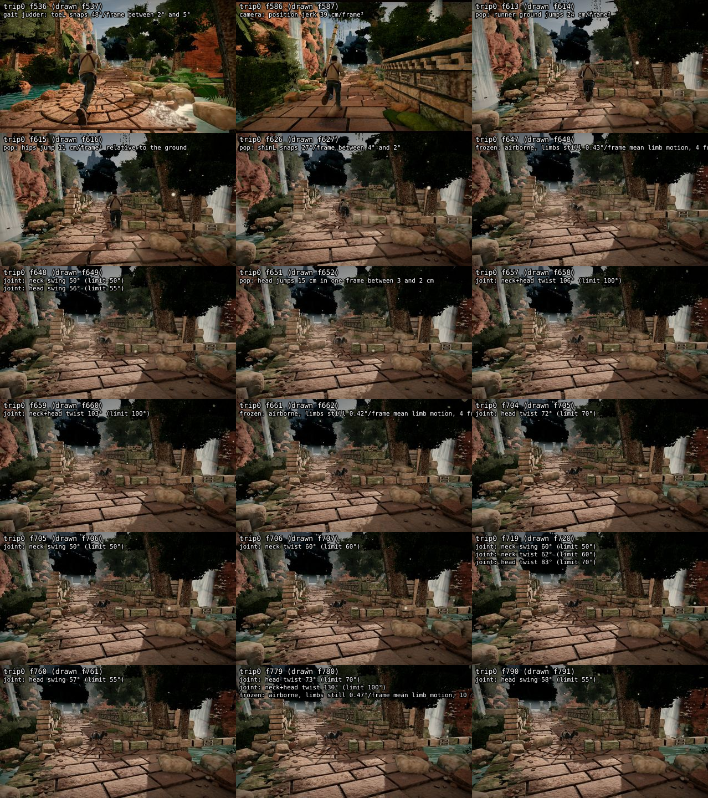

## ledge0

Timeline: 526–585 run/run · 586–586 crash/run · 587–796 crash/fall_drop

Gait judder (J / J of the joint's curve low-passed at 4× stride / excess; stride 2.5 Hz): spine 0.16/0.15/+0.01, chest 0.17/0.16/+0.00, neck 0.17/0.14/+0.04, head 0.18/0.20/-0.02, shoulderL 0.23/0.21/+0.02, shoulderR 0.25/0.25/+0.01, upper_armL 0.25/0.22/+0.03, upper_armR 0.25/0.22/+0.03, forearmL 0.24/0.21/+0.03, forearmR 0.24/0.21/+0.03, handL 0.22/0.19/+0.03, handR 0.22/0.19/+0.04, thighL 0.41/0.35/+0.06, thighR 0.48/0.38/+0.10, shinL 0.43/0.44/-0.01, shinR 0.37/0.42/-0.04, footL 0.68/0.75/-0.07, footR 0.73/0.76/-0.03, toeL 0.93/0.76/+0.17, toeR 0.87/0.75/+0.12

| frames | check | peak | clip at peak |
|---|---|---|---|
| 568 | judder: toeR judders in the gait | f568: J 0.87 vs 0.75 for its own curve low-passed at 4× stride (2.50 Hz): excess 0.12 (limit 0.1); worst frames f568, f569, f584, f556, f531, f555 | run/run |
| 575 | judder: toeL judders in the gait | f575: J 0.93 vs 0.76 for its own curve low-passed at 4× stride (2.50 Hz): excess 0.17 (limit 0.1); worst frames f575, f576, f536, f535, f551, f563 | run/run |
| 586 | pop: runner ground jumps | f586: 25 cm/frame² | crash/run |
| 586 | camera: position jerk | f586: 42 cm/frame² | crash/run |
| 589–591 | pop: hips jump | f589: 18 cm/frame² relative to the ground | crash/fall_drop |
| 600–601 | joint: upper_armR twist | f601: 146° (limit 110°) | crash/fall_drop |
| 607 | joint: upper_armR twist | f607: 114° (limit 110°) | crash/fall_drop |
| 635 | pop: head jumps | f635: 20 cm in one frame between 1 and 1 cm | crash/fall_drop |
| 635 | pop: handL jumps | f635: 19 cm in one frame between 2 and 6 cm | crash/fall_drop |
| 635 | pop: handR jumps | f635: 20 cm in one frame between 2 and 3 cm | crash/fall_drop |
| 760–773 | joint: shoulderL swing | f766: 45° (limit 40°) | crash/fall_drop |
| 760–773 | joint: shoulderR swing | f766: 45° (limit 40°) | crash/fall_drop |
| 763–770 | joint: chest swing | f766: 48° (limit 45°) | crash/fall_drop |
| 792–796 | joint: shoulderL swing | f796: 47° (limit 40°) | crash/fall_drop |
| 792–796 | joint: shoulderR swing | f796: 47° (limit 40°) | crash/fall_drop |
| 794–796 | joint: chest swing | f796: 51° (limit 45°) | crash/fall_drop |

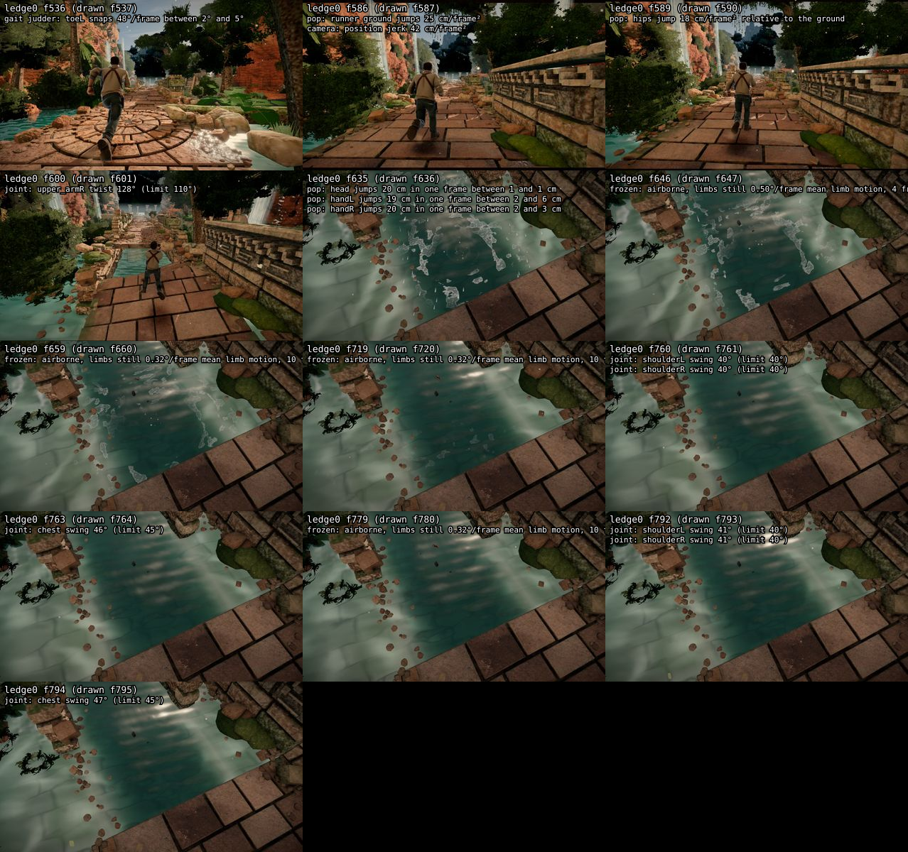
