# Motion audit — review/motion/run-b5f0d5c

World 7, quality high, 1280×720, 30 fps time-stepped. Frame numbers count from the sequence start (frame 0 = the world built, setup shot).
Each row is a run of consecutive flagged frames (same check); the peak frame and value are given. Sheets show the frame each new kind of flag was first seen.

| sequence | frames | judder | joint | slide | pop | frozen | framing | camera | staged |
|---|---|---|---|---|---|---|---|---|---|
| cash1.5 | 166–496 | 4 | 0 | 0 | 11 | 0 | 0 | 0 | mult 1.49 |
| cash5 | 739–1069 | 2 | 6 | 2 | 8 | 1 | 0 | 0 | mult 4.99 |
| cash20 | 1400–1730 | 1 | 11 | 3 | 4 | 1 | 0 | 0 | mult 20.01 |
| cash60 | 1938–2268 | 2 | 6 | 0 | 8 | 5 | 0 | 0 | mult 61.96 |
| fall_start | 20–270 | 0 | 2 | 0 | 0 | 0 | 1 | 0 | kind gate |
| chasm0 | 526–796 | 2 | 63 | 0 | 7 | 0 | 0 | 0 | kind chasm, clip run, mult 3 |
| chasm1 | 526–796 | 2 | 10 | 0 | 2 | 0 | 0 | 0 | kind chasm, clip run, mult 3 |
| gate0 | 526–796 | 2 | 1 | 0 | 0 | 1 | 0 | 1 | kind gate, clip run, mult 3 |
| gate1 | 526–796 | 2 | 3 | 0 | 0 | 0 | 0 | 0 | kind gate, clip run, mult 3 |
| rock0 | 526–796 | 2 | 1 | 0 | 0 | 1 | 0 | 0 | kind rockfall, clip run, mult 3 |
| rock1 | 526–796 | 0 | 0 | 0 | 0 | 0 | 0 | 0 |  |
| rock2 | 526–796 | 2 | 10 | 0 | 4 | 1 | 1 | 0 | kind rockfall, clip run, mult 3 |
| pillar0 | 526–796 | 2 | 3 | 0 | 3 | 1 | 0 | 0 | kind pillar, clip run, mult 3 |
| pillar1 | 526–796 | 2 | 0 | 0 | 3 | 1 | 0 | 0 | kind pillar, clip run, mult 3 |
| trip0 | 526–796 | 2 | 14 | 0 | 9 | 2 | 0 | 0 | kind trip, clip run, mult 3 |
| ledge0 | 526–796 | 2 | 8 | 0 | 5 | 0 | 0 | 0 | kind ledge, clip run, mult 3 |

## cash1.5

Timeline: 166–255 run/run · 256–279 cashout/run · 280–496 cashout/win_salute

Gait judder (J / J of the joint's curve low-passed at 4× stride / excess; stride 2.33 Hz): spine 0.18/0.16/+0.02, chest 0.17/0.16/+0.01, neck 0.15/0.22/-0.07, head 0.13/0.14/-0.01, shoulderL 0.26/0.21/+0.05, shoulderR 0.26/0.24/+0.02, upper_armL 0.26/0.22/+0.03, upper_armR 0.26/0.23/+0.03, forearmL 0.26/0.21/+0.04, forearmR 0.25/0.22/+0.04, handL 0.23/0.23/+0.00, handR 0.23/0.20/+0.03, thighL 0.50/0.35/+0.15, thighR 0.48/0.35/+0.13, shinL 0.49/0.51/-0.01, shinR 0.45/0.47/-0.02, footL 0.68/0.68/+0.01, footR 0.62/0.68/-0.07, toeL 0.87/0.77/+0.10, toeR 0.88/0.76/+0.12

| frames | check | peak | clip at peak |
|---|---|---|---|
| 200 | judder: thighL judders in the gait | f200: J 0.50 vs 0.35 for its own curve low-passed at 4× stride (2.33 Hz): excess 0.15 (limit 0.1); worst frames f200, f213, f187, f226, f199, f186 | run/run |
| 221 | judder: toeR judders in the gait | f221: J 0.88 vs 0.76 for its own curve low-passed at 4× stride (2.33 Hz): excess 0.12 (limit 0.1); worst frames f221, f220, f233, f234, f207, f246 | run/run |
| 225 | pop: head jumps | f225: 6 cm in one frame between 2 and 2 cm | run/run |
| 225 | judder: toeL judders in the gait | f225: J 0.87 vs 0.77 for its own curve low-passed at 4× stride (2.33 Hz): excess 0.10 (limit 0.1); worst frames f225, f238, f212, f214, f189, f252 | run/run |
| 232 | judder: thighR judders in the gait | f232: J 0.48 vs 0.35 for its own curve low-passed at 4× stride (2.33 Hz): excess 0.13 (limit 0.1); worst frames f232, f245, f219, f168, f231, f218 | run/run |
| 270 | pop: head jumps | f270: 7 cm in one frame between 2 and 2 cm | cashout/run |
| 290 | pop: footL jumps | f290: 41 cm in one frame between 10 and 3 cm | cashout/win_salute |
| 304 | pop: footL jumps | f304: 18 cm in one frame between 2 and 1 cm | cashout/win_salute |
| 304 | pop: footR jumps | f304: 14 cm in one frame between 0 and 1 cm | cashout/win_salute |
| 353 | pop: head jumps | f353: 23 cm in one frame between 1 and 0 cm | cashout/win_salute |
| 353 | pop: chest snaps | f353: 26°/frame between 1° and 0° | cashout/win_salute |
| 353 | pop: handL jumps | f353: 10 cm in one frame between 0 and 0 cm | cashout/win_salute |
| 353 | pop: handR jumps | f353: 22 cm in one frame between 3 and 1 cm | cashout/win_salute |
| 364 | pop: footL jumps | f364: 5 cm in one frame between 0 and 0 cm | cashout/win_salute |
| 364 | pop: thighL snaps | f364: 28°/frame between 0° and 0° | cashout/win_salute |

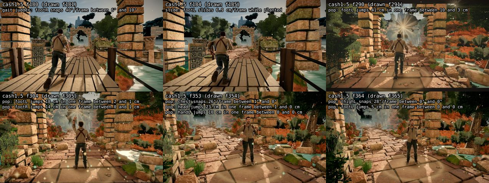

## cash5

Timeline: 739–825 run/run · 826–828 run/slide · 829–849 cashout/slide · 850–861 cashout/run · 862–1069 cashout/win_cheer

Gait judder (J / J of the joint's curve low-passed at 4× stride / excess; stride 2.41 Hz): spine 0.17/0.17/+0.00, chest 0.17/0.16/+0.01, neck 0.19/0.21/-0.02, head 0.18/0.16/+0.02, shoulderL 0.24/0.21/+0.03, shoulderR 0.25/0.25/+0.00, upper_armL 0.24/0.22/+0.02, upper_armR 0.24/0.22/+0.02, forearmL 0.24/0.21/+0.03, forearmR 0.24/0.22/+0.02, handL 0.21/0.21/-0.00, handR 0.21/0.18/+0.03, thighL 0.39/0.39/+0.01, thighR 0.44/0.43/+0.01, shinL 0.41/0.46/-0.05, shinR 0.36/0.44/-0.08, footL 0.72/0.85/-0.12, footR 0.61/0.73/-0.12, toeL 0.84/0.71/+0.13, toeR 1.06/0.77/+0.29

| frames | check | peak | clip at peak |
|---|---|---|---|
| 767 | pop: head jumps | f767: 5 cm in one frame between 1 and 2 cm | run/run |
| 781 | judder: toeR judders in the gait | f781: J 1.06 vs 0.77 for its own curve low-passed at 4× stride (2.41 Hz): excess 0.30 (limit 0.1); worst frames f781, f782, f742, f769, f823, f741 | run/run |
| 814 | judder: toeL judders in the gait | f814: J 0.84 vs 0.71 for its own curve low-passed at 4× stride (2.41 Hz): excess 0.13 (limit 0.1); worst frames f814, f815, f801, f748, f802, f777 | run/run |
| 830 | pop: hips jump | f830: 11 cm/frame² relative to the ground | cashout/slide |
| 874 | pop: footL snaps | f874: 33°/frame between 5° and 1° | cashout/win_cheer |
| 874 | pop: footL jumps | f874: 52 cm in one frame between 12 and 2 cm | cashout/win_cheer |
| 883 | slide: footR slides | f883: 2.8 cm/frame while planted | cashout/win_cheer |
| 885 | pop: footR jumps | f885: 46 cm in one frame between 9 and 1 cm | cashout/win_cheer |
| 888 | slide: footR slides | f888: 3.8 cm/frame while planted | cashout/win_cheer |
| 896 | pop: footL jumps | f896: 41 cm in one frame between 6 and 2 cm | cashout/win_cheer |
| 896 | pop: thighL snaps | f896: 29°/frame between 9° and 2° | cashout/win_cheer |
| 910–929 | frozen: airborne, limbs still | f910: 0.50°/frame mean limb motion, 4 frames in the air | cashout/win_cheer |
| 958 | pop: thighL snaps | f958: 33°/frame between 0° and 1° | cashout/win_cheer |
| 960 | joint: upper_armL twist | f960: 111° (limit 110°) | cashout/win_cheer |
| 960 | joint: upper_armR twist | f960: -111° (limit 110°) | cashout/win_cheer |
| 969–970 | joint: upper_armL twist | f970: 113° (limit 110°) | cashout/win_cheer |
| 969–970 | joint: upper_armR twist | f970: -113° (limit 110°) | cashout/win_cheer |
| 983 | joint: upper_armL twist | f983: 113° (limit 110°) | cashout/win_cheer |
| 983–986 | joint: upper_armR twist | f984: -114° (limit 110°) | cashout/win_cheer |

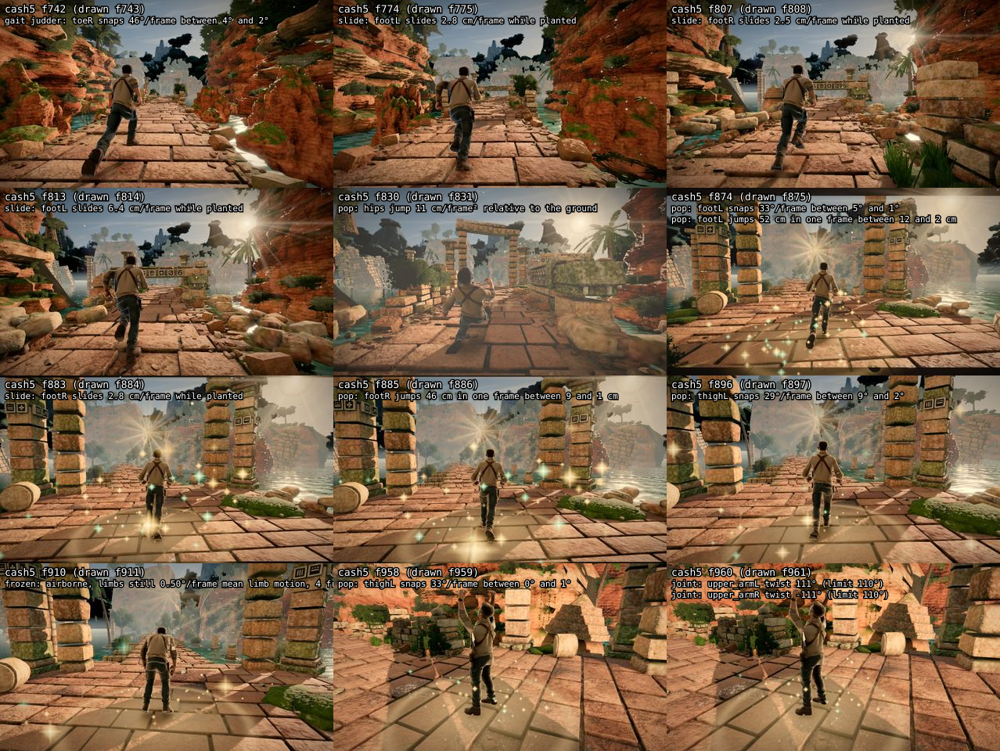

## cash20

Timeline: 1400–1407 run/run · 1408–1436 run/leap_gap · 1437–1489 run/run · 1490–1530 cashout/run · 1531–1730 cashout/win_leap

Gait judder (J / J of the joint's curve low-passed at 4× stride / excess; stride 2.26 Hz): spine 0.19/0.20/-0.01, chest 0.19/0.20/-0.01, neck 0.23/0.20/+0.04, head 0.25/0.26/-0.01, shoulderL 0.27/0.21/+0.06, shoulderR 0.27/0.24/+0.03, upper_armL 0.27/0.24/+0.04, upper_armR 0.27/0.24/+0.04, forearmL 0.29/0.23/+0.06, forearmR 0.29/0.24/+0.05, handL 0.24/0.22/+0.02, handR 0.24/0.26/-0.02, thighL 0.39/0.41/-0.02, thighR 0.43/0.47/-0.04, shinL 0.46/0.49/-0.03, shinR 0.38/0.51/-0.14, footL 0.72/0.77/-0.04, footR 0.67/0.76/-0.08, toeL 0.76/0.68/+0.07, toeR 0.86/0.70/+0.16

| frames | check | peak | clip at peak |
|---|---|---|---|
| 1403 | slide: footR slides | f1403: 3.0 cm/frame while planted | run/run |
| 1438 | slide: footR slides | f1438: 8.1 cm/frame while planted | run/run |
| 1439 | joint: footR swing | f1439: 61° (limit 60°) | run/run |
| 1488 | judder: toeR judders in the gait | f1488: J 0.86 vs 0.70 for its own curve low-passed at 4× stride (2.26 Hz): excess 0.16 (limit 0.1); worst frames f1488, f1451, f1463, f1450, f1477, f1440 | run/run |
| 1526 | slide: footL slides | f1526: 24.6 cm/frame while planted | cashout/run |
| 1544–1551 | joint: upper_armR twist | f1549: -162° (limit 110°) | cashout/win_leap |
| 1579–1587 | frozen: airborne, limbs still | f1587: 0.98°/frame mean limb motion, 12 frames in the air | cashout/win_leap |
| 1586 | pop: head jumps | f1586: 18 cm in one frame between 2 and 2 cm | cashout/win_leap |
| 1586 | pop: handL jumps | f1586: 22 cm in one frame between 2 and 2 cm | cashout/win_leap |
| 1586 | pop: handR jumps | f1586: 20 cm in one frame between 2 and 2 cm | cashout/win_leap |
| 1612 | pop: thighL snaps | f1612: 25°/frame between 1° and 4° | cashout/win_leap |
| 1637–1641 | joint: shoulderL swing | f1639: 41° (limit 40°) | cashout/win_leap |
| 1637–1641 | joint: shoulderR swing | f1639: 41° (limit 40°) | cashout/win_leap |
| 1659–1661 | joint: upper_armR twist | f1659: -114° (limit 110°) | cashout/win_leap |
| 1665–1678 | joint: shoulderL swing | f1671: 46° (limit 40°) | cashout/win_leap |
| 1665–1678 | joint: shoulderR swing | f1671: 46° (limit 40°) | cashout/win_leap |
| 1694–1716 | joint: shoulderL swing | f1703: 52° (limit 40°) | cashout/win_leap |
| 1694–1716 | joint: shoulderR swing | f1703: 52° (limit 40°) | cashout/win_leap |
| 1723–1730 | joint: shoulderL swing | f1730: 50° (limit 40°) | cashout/win_leap |
| 1723–1730 | joint: shoulderR swing | f1730: 50° (limit 40°) | cashout/win_leap |

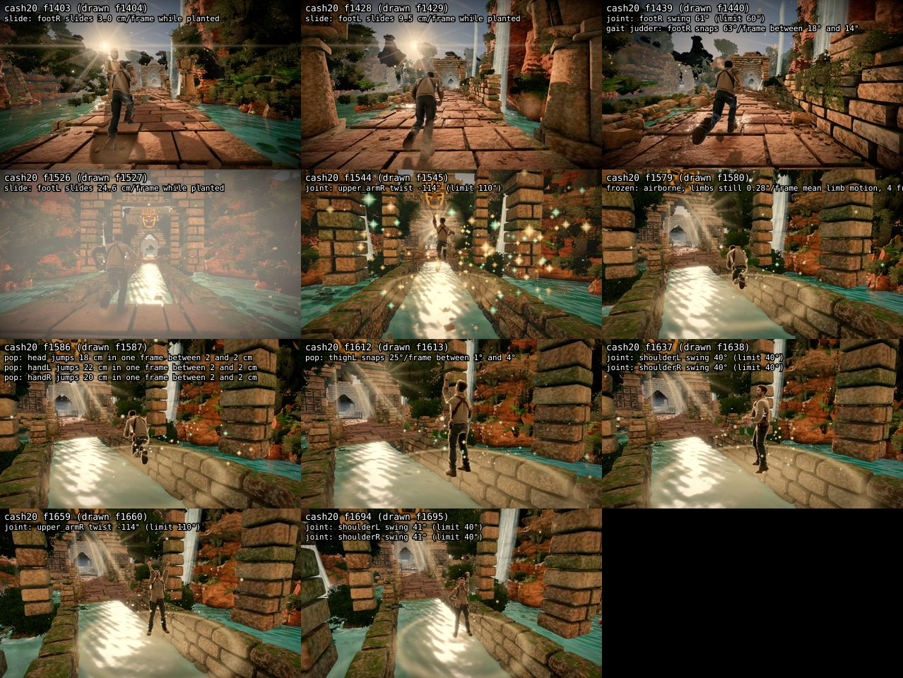

## cash60

Timeline: 1938–1988 run/run · 1989–2015 run/leap_gap · 2016–2027 run/run · 2028–2071 cashout/run · 2072–2268 cashout/win_slide

Gait judder (J / J of the joint's curve low-passed at 4× stride / excess; stride 2.35 Hz): spine 0.20/0.21/-0.00, chest 0.20/0.21/-0.01, neck 0.25/0.22/+0.03, head 0.23/0.22/+0.01, shoulderL 0.28/0.27/+0.02, shoulderR 0.29/0.25/+0.04, upper_armL 0.28/0.25/+0.03, upper_armR 0.28/0.25/+0.03, forearmL 0.29/0.27/+0.03, forearmR 0.29/0.26/+0.03, handL 0.25/0.26/-0.01, handR 0.25/0.23/+0.03, thighL 0.36/0.49/-0.13, thighR 0.39/0.50/-0.11, shinL 0.44/0.55/-0.11, shinR 0.38/0.53/-0.16, footL 0.62/0.81/-0.19, footR 0.71/0.88/-0.16, toeL 0.96/0.73/+0.23, toeR 0.98/0.79/+0.20

| frames | check | peak | clip at peak |
|---|---|---|---|
| 1951 | judder: toeR judders in the gait | f1951: J 0.98 vs 0.79 for its own curve low-passed at 4× stride (2.35 Hz): excess 0.19 (limit 0.1); worst frames f1951, f1974, f1987, f1950, f1964, f1973 | run/run |
| 1961 | pop: head jumps | f1961: 6 cm in one frame between 1 and 2 cm | run/run |
| 1980 | judder: toeL judders in the gait | f1980: J 0.96 vs 0.73 for its own curve low-passed at 4× stride (2.35 Hz): excess 0.23 (limit 0.1); worst frames f1980, f1968, f1944, f1945, f1967, f1957 | run/run |
| 1984 | pop: head jumps | f1984: 6 cm in one frame between 1 and 2 cm | run/run |
| 2006 | pop: footR jumps | f2006: 27 cm in one frame between 5 and 8 cm | run/leap_gap |
| 2018 | joint: footR swing | f2018: 66° (limit 60°) | run/run |
| 2024 | joint: footL swing | f2024: 61° (limit 60°) | run/run |
| 2033 | pop: head jumps | f2033: 4 cm in one frame between 1 and 1 cm | cashout/run |
| 2063 | pop: head jumps | f2063: 8 cm in one frame between 3 and 2 cm | cashout/run |
| 2081–2113 | frozen: airborne, limbs still | f2113: 0.88°/frame mean limb motion, 36 frames in the air | cashout/win_slide |
| 2104–2114 | joint: shoulderL swing | f2108: 42° (limit 40°) | cashout/win_slide |
| 2104–2114 | joint: shoulderR swing | f2108: 42° (limit 40°) | cashout/win_slide |
| 2141 | pop: handL jumps | f2141: 15 cm in one frame between 2 and 0 cm | cashout/win_slide |
| 2141 | pop: handR jumps | f2141: 16 cm in one frame between 4 and 0 cm | cashout/win_slide |
| 2144–2153 | frozen: airborne, limbs still | f2147: 0.20°/frame mean limb motion, 7 frames in the air | cashout/win_slide |
| 2184 | pop: thighL snaps | f2184: 33°/frame between 1° and 1° | cashout/win_slide |
| 2195–2199 | joint: upper_armL twist | f2196: 115° (limit 110°) | cashout/win_slide |
| 2195–2197 | joint: upper_armR twist | f2196: -114° (limit 110°) | cashout/win_slide |
| 2217–2221 | frozen: airborne, limbs still | f2218: 0.51°/frame mean limb motion, 5 frames in the air | cashout/win_slide |
| 2236–2250 | frozen: airborne, limbs still | f2247: 0.43°/frame mean limb motion, 15 frames in the air | cashout/win_slide |
| 2264–2268 | frozen: airborne, limbs still | f2264: 0.36°/frame mean limb motion, 4 frames in the air | cashout/win_slide |

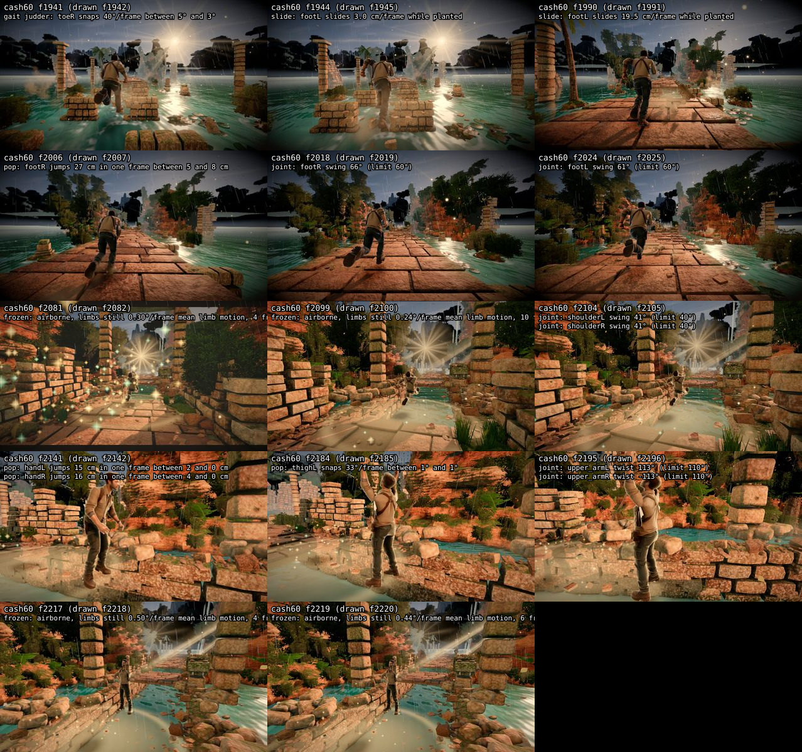

## fall_start

Timeline: 20–29 setup/idle · 30–44 lead/ready · 45–270 crash/fall_start

| frames | check | peak | clip at peak |
|---|---|---|---|
| 65 | framing: runner clipped | f65: footL at the frame edge | crash/fall_start |
| 80–270 | joint: footL swing | f85: 82° (limit 60°) | crash/fall_start |
| 80–270 | joint: footR swing | f86: 88° (limit 60°) | crash/fall_start |

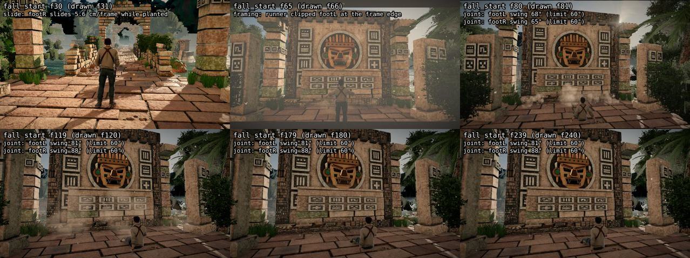

## chasm0

Timeline: 526–585 run/run · 586–586 crash/run · 587–796 crash/fall_chasm

Gait judder (J / J of the joint's curve low-passed at 4× stride / excess; stride 2.5 Hz): spine 0.16/0.15/+0.01, chest 0.16/0.16/-0.00, neck 0.19/0.14/+0.05, head 0.18/0.20/-0.02, shoulderL 0.24/0.21/+0.03, shoulderR 0.24/0.25/-0.00, upper_armL 0.25/0.22/+0.03, upper_armR 0.25/0.22/+0.03, forearmL 0.24/0.21/+0.03, forearmR 0.24/0.21/+0.03, handL 0.22/0.19/+0.03, handR 0.22/0.19/+0.04, thighL 0.41/0.35/+0.06, thighR 0.48/0.38/+0.10, shinL 0.43/0.44/-0.01, shinR 0.37/0.42/-0.04, footL 0.68/0.75/-0.07, footR 0.73/0.76/-0.03, toeL 0.93/0.76/+0.17, toeR 0.87/0.75/+0.12

| frames | check | peak | clip at peak |
|---|---|---|---|
| 568 | judder: toeR judders in the gait | f568: J 0.87 vs 0.75 for its own curve low-passed at 4× stride (2.50 Hz): excess 0.12 (limit 0.1); worst frames f568, f569, f584, f556, f531, f555 | run/run |
| 575 | judder: toeL judders in the gait | f575: J 0.93 vs 0.76 for its own curve low-passed at 4× stride (2.50 Hz): excess 0.17 (limit 0.1); worst frames f575, f576, f536, f535, f551, f563 | run/run |
| 642–647 | pop: hips jump | f642: 18 cm/frame² relative to the ground | crash/fall_chasm |
| 649 | joint: upper_armL twist | f649: -117° (limit 110°) | crash/fall_chasm |
| 652–660 | pop: hips jump | f656: 30 cm/frame² relative to the ground | crash/fall_chasm |
| 652 | pop: neck snaps | f652: 27°/frame between 2° and 5° | crash/fall_chasm |
| 652 | pop: head snaps | f652: 41°/frame between 1° and 8° | crash/fall_chasm |
| 656–660 | joint: head swing | f658: 56° (limit 55°) | crash/fall_chasm |
| 661 | joint: upper_armR twist | f661: 110° (limit 110°) | crash/fall_chasm |
| 663 | pop: hips jump | f663: 11 cm/frame² relative to the ground | crash/fall_chasm |
| 663–670 | joint: neck swing | f666: 53° (limit 50°) | crash/fall_chasm |
| 666–674 | pop: hips jump | f670: 31 cm/frame² relative to the ground | crash/fall_chasm |
| 667–674 | joint: head swing | f671: 60° (limit 55°) | crash/fall_chasm |
| 675 | joint: upper_armL twist | f675: -121° (limit 110°) | crash/fall_chasm |
| 680–686 | pop: hips jump | f684: 32 cm/frame² relative to the ground | crash/fall_chasm |
| 681–691 | joint: head swing | f688: 72° (limit 55°) | crash/fall_chasm |
| 681–692 | joint: shoulderL swing | f686: 45° (limit 40°) | crash/fall_chasm |
| 681–692 | joint: shoulderR swing | f686: 45° (limit 40°) | crash/fall_chasm |
| 686–713 | joint: neck swing | f707: 86° (limit 50°) | crash/fall_chasm |
| 692–695 | joint: forearmL over-flexed | f695: 178° (limit 160°) | crash/fall_chasm |
| 692 | joint: shinR over-flexed | f692: 177° (limit 160°) | crash/fall_chasm |
| 693–709 | joint: shinR reverse bend | f709: -13° (limit -10°) | crash/fall_chasm |
| 694–796 | joint: head swing | f701: 110° (limit 55°) | crash/fall_chasm |
| 694 | joint: forearmR over-flexed | f694: 165° (limit 160°) | crash/fall_chasm |
| 695 | joint: upper_armL twist | f695: 140° (limit 110°) | crash/fall_chasm |
| 695 | joint: upper_armL swing | f695: 180° (limit 178°) | crash/fall_chasm |
| 695–704 | joint: forearmR reverse bend | f704: -29° (limit -12°) | crash/fall_chasm |
| 695–707 | joint: shinL reverse bend | f707: -20° (limit -10°) | crash/fall_chasm |
| 696–704 | joint: forearmL reverse bend | f704: -18° (limit -12°) | crash/fall_chasm |
| 701–703 | joint: upper_armL twist | f702: -172° (limit 110°) | crash/fall_chasm |
| 707 | joint: upper_armL twist | f707: 150° (limit 110°) | crash/fall_chasm |
| 710–728 | joint: shoulderL swing | f718: 50° (limit 40°) | crash/fall_chasm |
| 710–728 | joint: shoulderR swing | f718: 50° (limit 40°) | crash/fall_chasm |
| 715–716 | joint: upper_armL twist | f715: -172° (limit 110°) | crash/fall_chasm |
| 715–716 | joint: forearmL over-flexed | f716: 179° (limit 160°) | crash/fall_chasm |
| 715 | joint: forearmR over-flexed | f715: 171° (limit 160°) | crash/fall_chasm |
| 716–725 | joint: forearmR reverse bend | f725: -23° (limit -12°) | crash/fall_chasm |
| 717–725 | joint: forearmL reverse bend | f725: -20° (limit -12°) | crash/fall_chasm |
| 721 | joint: upper_armL twist | f721: 155° (limit 110°) | crash/fall_chasm |
| 721–722 | joint: shinL over-flexed | f722: 178° (limit 160°) | crash/fall_chasm |
| 722–782 | joint: neck swing | f765: 87° (limit 50°) | crash/fall_chasm |
| 723 | joint: shinR over-flexed | f723: 172° (limit 160°) | crash/fall_chasm |
| 723–738 | joint: shinL reverse bend | f738: -21° (limit -10°) | crash/fall_chasm |
| 724–735 | joint: shinR reverse bend | f735: -31° (limit -10°) | crash/fall_chasm |
| 728 | joint: upper_armL twist | f728: -177° (limit 110°) | crash/fall_chasm |
| 732–736 | joint: upper_armL twist | f734: -174° (limit 110°) | crash/fall_chasm |
| 736 | joint: forearmL over-flexed | f736: 164° (limit 160°) | crash/fall_chasm |
| 736 | joint: forearmR over-flexed | f736: 177° (limit 160°) | crash/fall_chasm |
| 737–746 | joint: forearmR reverse bend | f746: -17° (limit -12°) | crash/fall_chasm |
| 737–746 | joint: forearmL reverse bend | f746: -22° (limit -12°) | crash/fall_chasm |
| 739–796 | joint: shoulderL swing | f784: 61° (limit 40°) | crash/fall_chasm |
| 739–796 | joint: shoulderR swing | f784: 61° (limit 40°) | crash/fall_chasm |
| 741 | joint: upper_armL twist | f741: 119° (limit 110°) | crash/fall_chasm |
| 749 | joint: shinR over-flexed | f749: 173° (limit 160°) | crash/fall_chasm |
| 750–766 | joint: shinR reverse bend | f766: -10° (limit -10°) | crash/fall_chasm |
| 751–755 | joint: upper_armL twist | f754: -170° (limit 110°) | crash/fall_chasm |
| 752 | joint: shinL over-flexed | f752: 173° (limit 160°) | crash/fall_chasm |
| 753–764 | joint: shinL reverse bend | f764: -30° (limit -10°) | crash/fall_chasm |
| 757 | joint: forearmL over-flexed | f757: 164° (limit 160°) | crash/fall_chasm |
| 757–766 | joint: forearmR reverse bend | f766: -44° (limit -12°) | crash/fall_chasm |
| 758–767 | joint: forearmL reverse bend | f767: -23° (limit -12°) | crash/fall_chasm |
| 767–774 | joint: upper_armL twist | f767: -177° (limit 110°) | crash/fall_chasm |
| 778 | joint: forearmL over-flexed | f778: 165° (limit 160°) | crash/fall_chasm |
| 778–787 | joint: forearmR reverse bend | f787: -38° (limit -12°) | crash/fall_chasm |
| 778 | joint: shinL over-flexed | f778: 169° (limit 160°) | crash/fall_chasm |
| 779–796 | joint: shinL reverse bend | f796: -10° (limit -10°) | crash/fall_chasm |
| 779–788 | joint: forearmL reverse bend | f788: -23° (limit -12°) | crash/fall_chasm |
| 780 | joint: shinR over-flexed | f780: 165° (limit 160°) | crash/fall_chasm |
| 780 | joint: upper_armL swing | f780: 178° (limit 178°) | crash/fall_chasm |
| 781–793 | joint: shinR reverse bend | f793: -16° (limit -10°) | crash/fall_chasm |
| 785–794 | joint: upper_armL twist | f785: 160° (limit 110°) | crash/fall_chasm |
| 787–796 | joint: neck swing | f793: 63° (limit 50°) | crash/fall_chasm |

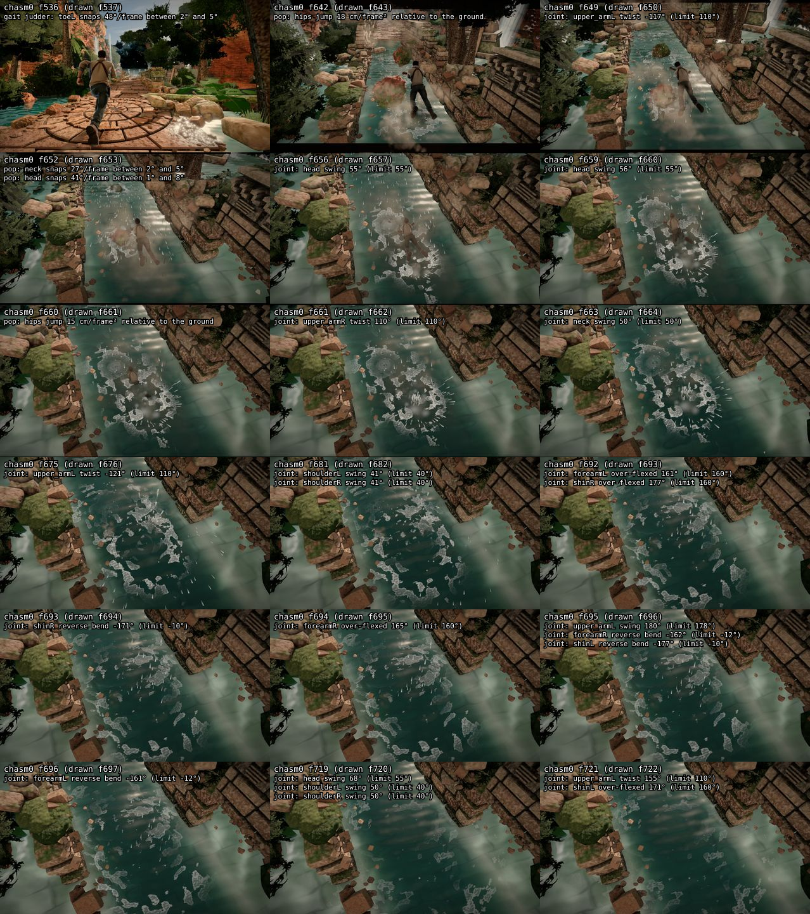

## chasm1

Timeline: 526–585 run/run · 586–586 crash/run · 587–796 crash/fall_chasm_b

Gait judder (J / J of the joint's curve low-passed at 4× stride / excess; stride 2.5 Hz): spine 0.16/0.15/+0.01, chest 0.17/0.16/+0.00, neck 0.18/0.15/+0.04, head 0.18/0.20/-0.02, shoulderL 0.24/0.21/+0.03, shoulderR 0.25/0.25/+0.00, upper_armL 0.25/0.22/+0.03, upper_armR 0.25/0.22/+0.03, forearmL 0.24/0.21/+0.03, forearmR 0.24/0.21/+0.03, handL 0.22/0.19/+0.03, handR 0.22/0.19/+0.04, thighL 0.41/0.35/+0.06, thighR 0.48/0.38/+0.10, shinL 0.43/0.44/-0.01, shinR 0.37/0.42/-0.04, footL 0.68/0.75/-0.07, footR 0.73/0.76/-0.03, toeL 0.93/0.76/+0.17, toeR 0.87/0.75/+0.12

| frames | check | peak | clip at peak |
|---|---|---|---|
| 568 | judder: toeR judders in the gait | f568: J 0.87 vs 0.75 for its own curve low-passed at 4× stride (2.50 Hz): excess 0.12 (limit 0.1); worst frames f568, f569, f584, f556, f531, f555 | run/run |
| 575 | judder: toeL judders in the gait | f575: J 0.93 vs 0.76 for its own curve low-passed at 4× stride (2.50 Hz): excess 0.17 (limit 0.1); worst frames f575, f576, f536, f535, f551, f563 | run/run |
| 616–644 | joint: footL swing | f629: 163° (limit 60°) | crash/fall_chasm_b |
| 645 | pop: footL flips | f645: 142°/frame | crash/fall_chasm_b |
| 645 | pop: footL jumps | f645: 10 cm in one frame between 0 and 3 cm | crash/fall_chasm_b |
| 656–796 | joint: footL swing | f699: 80° (limit 60°) | crash/fall_chasm_b |
| 656–796 | joint: footR swing | f700: 80° (limit 60°) | crash/fall_chasm_b |
| 681–692 | joint: shoulderL swing | f686: 45° (limit 40°) | crash/fall_chasm_b |
| 681–692 | joint: shoulderR swing | f686: 45° (limit 40°) | crash/fall_chasm_b |
| 710–728 | joint: shoulderL swing | f718: 50° (limit 40°) | crash/fall_chasm_b |
| 710–728 | joint: shoulderR swing | f718: 50° (limit 40°) | crash/fall_chasm_b |
| 739–796 | joint: shoulderL swing | f784: 61° (limit 40°) | crash/fall_chasm_b |
| 739–796 | joint: shoulderR swing | f784: 61° (limit 40°) | crash/fall_chasm_b |
| 783–787 | joint: neck swing | f785: 51° (limit 50°) | crash/fall_chasm_b |

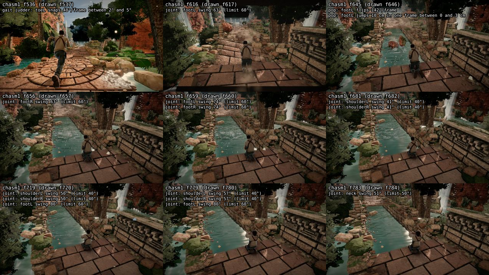

## gate0

Timeline: 526–585 run/run · 586–586 crash/run · 587–796 crash/fall_gate

Gait judder (J / J of the joint's curve low-passed at 4× stride / excess; stride 2.5 Hz): spine 0.16/0.15/+0.01, chest 0.16/0.16/+0.00, neck 0.19/0.15/+0.04, head 0.18/0.20/-0.02, shoulderL 0.24/0.21/+0.03, shoulderR 0.25/0.25/+0.00, upper_armL 0.25/0.22/+0.03, upper_armR 0.25/0.22/+0.03, forearmL 0.24/0.21/+0.03, forearmR 0.24/0.21/+0.03, handL 0.22/0.19/+0.03, handR 0.22/0.19/+0.04, thighL 0.41/0.35/+0.06, thighR 0.48/0.38/+0.10, shinL 0.43/0.44/-0.01, shinR 0.37/0.42/-0.04, footL 0.68/0.75/-0.07, footR 0.73/0.76/-0.03, toeL 0.93/0.76/+0.17, toeR 0.87/0.75/+0.12

| frames | check | peak | clip at peak |
|---|---|---|---|
| 568 | judder: toeR judders in the gait | f568: J 0.87 vs 0.75 for its own curve low-passed at 4× stride (2.50 Hz): excess 0.12 (limit 0.1); worst frames f568, f569, f584, f556, f531, f555 | run/run |
| 575 | judder: toeL judders in the gait | f575: J 0.93 vs 0.76 for its own curve low-passed at 4× stride (2.50 Hz): excess 0.17 (limit 0.1); worst frames f575, f576, f536, f535, f551, f563 | run/run |
| 606 | camera: position jerk | f606: 25 cm/frame² | crash/fall_gate |
| 674–796 | frozen: airborne, limbs still | f691: 0.18°/frame mean limb motion, 21 frames in the air | crash/fall_gate |
| 783–786 | joint: shoulderL swing | f784: 41° (limit 40°) | crash/fall_gate |

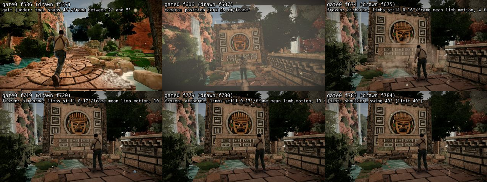

## gate1

Timeline: 526–585 run/run · 586–586 crash/run · 587–796 crash/fall_gate_b

Gait judder (J / J of the joint's curve low-passed at 4× stride / excess; stride 2.5 Hz): spine 0.16/0.15/+0.01, chest 0.16/0.16/-0.01, neck 0.18/0.14/+0.04, head 0.18/0.20/-0.02, shoulderL 0.25/0.21/+0.03, shoulderR 0.24/0.25/-0.00, upper_armL 0.25/0.22/+0.03, upper_armR 0.25/0.22/+0.03, forearmL 0.24/0.21/+0.03, forearmR 0.24/0.21/+0.03, handL 0.22/0.19/+0.03, handR 0.22/0.19/+0.04, thighL 0.41/0.35/+0.06, thighR 0.48/0.38/+0.10, shinL 0.43/0.44/-0.01, shinR 0.37/0.42/-0.04, footL 0.68/0.75/-0.07, footR 0.73/0.76/-0.03, toeL 0.93/0.76/+0.17, toeR 0.87/0.75/+0.12

| frames | check | peak | clip at peak |
|---|---|---|---|
| 568 | judder: toeR judders in the gait | f568: J 0.87 vs 0.75 for its own curve low-passed at 4× stride (2.50 Hz): excess 0.12 (limit 0.1); worst frames f568, f569, f584, f556, f531, f555 | run/run |
| 575 | judder: toeL judders in the gait | f575: J 0.93 vs 0.76 for its own curve low-passed at 4× stride (2.50 Hz): excess 0.17 (limit 0.1); worst frames f575, f576, f536, f535, f551, f563 | run/run |
| 681–691 | joint: shoulderL swing | f686: 44° (limit 40°) | crash/fall_gate_b |
| 710–728 | joint: shoulderL swing | f717: 50° (limit 40°) | crash/fall_gate_b |
| 739–796 | joint: shoulderL swing | f784: 60° (limit 40°) | crash/fall_gate_b |

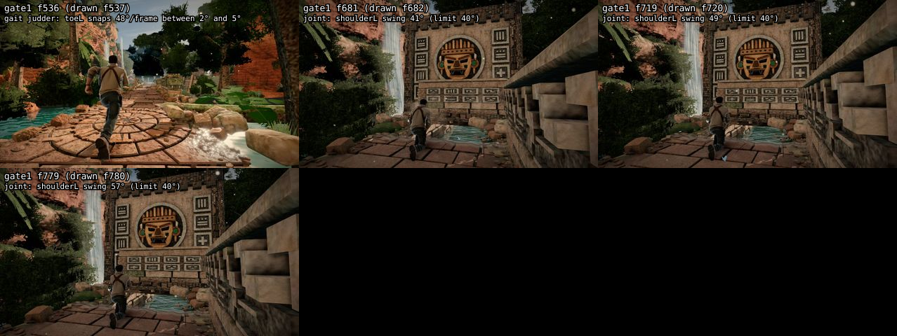

## rock0

Timeline: 526–585 run/run · 586–586 crash/run · 587–796 crash/fall_rock

Gait judder (J / J of the joint's curve low-passed at 4× stride / excess; stride 2.5 Hz): spine 0.16/0.15/+0.01, chest 0.17/0.16/+0.01, neck 0.19/0.14/+0.05, head 0.18/0.20/-0.02, shoulderL 0.24/0.21/+0.03, shoulderR 0.25/0.25/-0.00, upper_armL 0.25/0.22/+0.03, upper_armR 0.25/0.22/+0.03, forearmL 0.24/0.21/+0.03, forearmR 0.24/0.21/+0.03, handL 0.22/0.19/+0.03, handR 0.22/0.19/+0.04, thighL 0.41/0.35/+0.06, thighR 0.48/0.38/+0.10, shinL 0.43/0.44/-0.01, shinR 0.37/0.42/-0.04, footL 0.68/0.75/-0.07, footR 0.73/0.76/-0.03, toeL 0.93/0.76/+0.17, toeR 0.87/0.75/+0.12

| frames | check | peak | clip at peak |
|---|---|---|---|
| 568 | judder: toeR judders in the gait | f568: J 0.87 vs 0.75 for its own curve low-passed at 4× stride (2.50 Hz): excess 0.12 (limit 0.1); worst frames f568, f569, f584, f556, f531, f555 | run/run |
| 575 | judder: toeL judders in the gait | f575: J 0.93 vs 0.76 for its own curve low-passed at 4× stride (2.50 Hz): excess 0.17 (limit 0.1); worst frames f575, f576, f536, f535, f551, f563 | run/run |
| 611–612 | frozen: airborne, limbs still | f611: 0.82°/frame mean limb motion, 4 frames in the air | crash/fall_rock |
| 624–796 | joint: footR swing | f629: 69° (limit 60°) | crash/fall_rock |

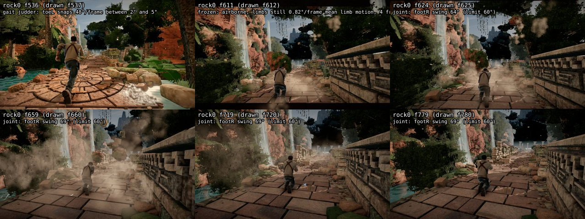

## rock1

Timeline: 

No flags.

Page errors: not filmed

## rock2

Timeline: 526–585 run/run · 586–586 crash/run · 587–796 crash/fall_side_hit

Gait judder (J / J of the joint's curve low-passed at 4× stride / excess; stride 2.5 Hz): spine 0.16/0.15/+0.01, chest 0.16/0.16/-0.01, neck 0.17/0.15/+0.03, head 0.18/0.20/-0.02, shoulderL 0.24/0.21/+0.03, shoulderR 0.25/0.25/-0.00, upper_armL 0.25/0.22/+0.03, upper_armR 0.25/0.22/+0.03, forearmL 0.24/0.21/+0.03, forearmR 0.24/0.21/+0.03, handL 0.22/0.19/+0.03, handR 0.22/0.19/+0.04, thighL 0.41/0.35/+0.06, thighR 0.48/0.38/+0.10, shinL 0.43/0.44/-0.01, shinR 0.37/0.42/-0.04, footL 0.68/0.75/-0.07, footR 0.73/0.76/-0.03, toeL 0.93/0.76/+0.17, toeR 0.87/0.75/+0.12

| frames | check | peak | clip at peak |
|---|---|---|---|
| 568 | judder: toeR judders in the gait | f568: J 0.87 vs 0.75 for its own curve low-passed at 4× stride (2.50 Hz): excess 0.12 (limit 0.1); worst frames f568, f569, f584, f556, f531, f555 | run/run |
| 575 | judder: toeL judders in the gait | f575: J 0.93 vs 0.76 for its own curve low-passed at 4× stride (2.50 Hz): excess 0.17 (limit 0.1); worst frames f575, f576, f536, f535, f551, f563 | run/run |
| 588 | pop: runner ground jumps | f588: 14 cm/frame² | crash/fall_side_hit |
| 589–591 | pop: hips jump | f589: 14 cm/frame² relative to the ground | crash/fall_side_hit |
| 600–602 | pop: hips jump | f602: 18 cm/frame² relative to the ground | crash/fall_side_hit |
| 610 | pop: shinR snaps | f610: 33°/frame between 10° and 1° | crash/fall_side_hit |
| 610–620 | framing: runner clipped | f615: head, handL, handR, footL, footR at the frame edge | crash/fall_side_hit |
| 625–627 | frozen: airborne, limbs still | f627: 1.05°/frame mean limb motion, 6 frames in the air | crash/fall_side_hit |
| 681–691 | joint: shoulderR swing | f686: 44° (limit 40°) | crash/fall_side_hit |
| 682–691 | joint: shoulderL swing | f686: 43° (limit 40°) | crash/fall_side_hit |
| 690–796 | joint: head swing | f785: 90° (limit 55°) | crash/fall_side_hit |
| 692 | joint: neck swing | f692: 50° (limit 50°) | crash/fall_side_hit |
| 709–729 | joint: neck swing | f718: 68° (limit 50°) | crash/fall_side_hit |
| 710–728 | joint: shoulderR swing | f718: 49° (limit 40°) | crash/fall_side_hit |
| 710–727 | joint: shoulderL swing | f718: 49° (limit 40°) | crash/fall_side_hit |
| 738–796 | joint: neck swing | f785: 86° (limit 50°) | crash/fall_side_hit |
| 739–796 | joint: shoulderR swing | f784: 60° (limit 40°) | crash/fall_side_hit |
| 740–796 | joint: shoulderL swing | f784: 59° (limit 40°) | crash/fall_side_hit |

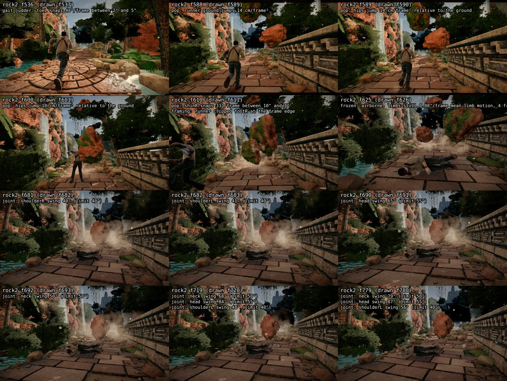

## pillar0

Timeline: 526–585 run/run · 586–611 crash/run · 612–796 crash/fall_pillar

Gait judder (J / J of the joint's curve low-passed at 4× stride / excess; stride 2.5 Hz): spine 0.16/0.15/+0.01, chest 0.16/0.16/+0.00, neck 0.19/0.14/+0.05, head 0.18/0.20/-0.02, shoulderL 0.25/0.21/+0.04, shoulderR 0.25/0.25/+0.00, upper_armL 0.25/0.22/+0.03, upper_armR 0.25/0.22/+0.03, forearmL 0.24/0.21/+0.03, forearmR 0.24/0.21/+0.03, handL 0.22/0.19/+0.03, handR 0.22/0.19/+0.04, thighL 0.41/0.35/+0.06, thighR 0.48/0.38/+0.10, shinL 0.43/0.44/-0.01, shinR 0.37/0.42/-0.04, footL 0.68/0.75/-0.07, footR 0.73/0.76/-0.03, toeL 0.93/0.76/+0.17, toeR 0.87/0.75/+0.12

| frames | check | peak | clip at peak |
|---|---|---|---|
| 568 | judder: toeR judders in the gait | f568: J 0.87 vs 0.75 for its own curve low-passed at 4× stride (2.50 Hz): excess 0.12 (limit 0.1); worst frames f568, f569, f584, f556, f531, f555 | run/run |
| 575 | judder: toeL judders in the gait | f575: J 0.93 vs 0.76 for its own curve low-passed at 4× stride (2.50 Hz): excess 0.17 (limit 0.1); worst frames f575, f576, f536, f535, f551, f563 | run/run |
| 611 | pop: runner ground jumps | f611: 12 cm/frame² | crash/run |
| 613–614 | pop: hips jump | f613: 14 cm/frame² relative to the ground | crash/fall_pillar |
| 639 | pop: hips jump | f639: 12 cm/frame² relative to the ground | crash/fall_pillar |
| 643–796 | joint: thighL swing | f644: 155° (limit 135°) | crash/fall_pillar |
| 643–796 | joint: thighL twist | f644: -144° (limit 55°) | crash/fall_pillar |
| 645–796 | joint: thighR swing | f646: 142° (limit 135°) | crash/fall_pillar |
| 654–796 | frozen: airborne, limbs still | f657: 0.28°/frame mean limb motion, 7 frames in the air | crash/fall_pillar |

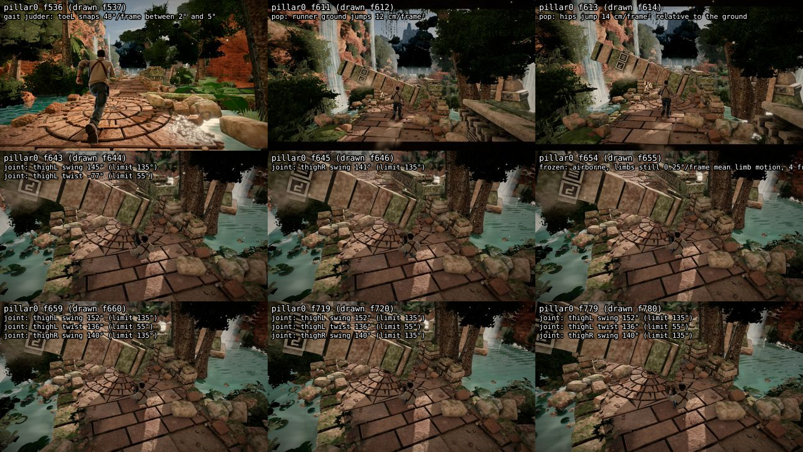

## pillar1

Timeline: 526–585 run/run · 586–605 crash/run · 606–796 crash/fall_pillar_b

Gait judder (J / J of the joint's curve low-passed at 4× stride / excess; stride 2.5 Hz): spine 0.16/0.15/+0.01, chest 0.17/0.16/+0.00, neck 0.18/0.15/+0.04, head 0.18/0.20/-0.02, shoulderL 0.24/0.21/+0.03, shoulderR 0.24/0.25/-0.00, upper_armL 0.25/0.22/+0.03, upper_armR 0.25/0.22/+0.03, forearmL 0.24/0.21/+0.03, forearmR 0.24/0.21/+0.03, handL 0.22/0.19/+0.03, handR 0.22/0.19/+0.04, thighL 0.41/0.35/+0.06, thighR 0.48/0.38/+0.10, shinL 0.43/0.44/-0.01, shinR 0.37/0.42/-0.04, footL 0.68/0.75/-0.07, footR 0.73/0.76/-0.03, toeL 0.93/0.76/+0.17, toeR 0.87/0.75/+0.12

| frames | check | peak | clip at peak |
|---|---|---|---|
| 568 | judder: toeR judders in the gait | f568: J 0.87 vs 0.75 for its own curve low-passed at 4× stride (2.50 Hz): excess 0.12 (limit 0.1); worst frames f568, f569, f584, f556, f531, f555 | run/run |
| 575 | judder: toeL judders in the gait | f575: J 0.93 vs 0.76 for its own curve low-passed at 4× stride (2.50 Hz): excess 0.17 (limit 0.1); worst frames f575, f576, f536, f535, f551, f563 | run/run |
| 609 | pop: hips jump | f609: 11 cm/frame² relative to the ground | crash/fall_pillar_b |
| 609 | pop: runner ground jumps | f609: 13 cm/frame² | crash/fall_pillar_b |
| 613 | pop: hips jump | f613: 14 cm/frame² relative to the ground | crash/fall_pillar_b |
| 623 | frozen: airborne, limbs still | f623: 0.90°/frame mean limb motion, 4 frames in the air | crash/fall_pillar_b |

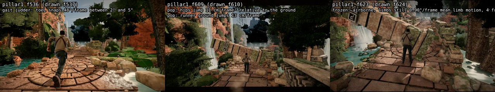

## trip0

Timeline: 526–585 run/run · 586–606 crash/run · 607–796 crash/fall_trip

Gait judder (J / J of the joint's curve low-passed at 4× stride / excess; stride 2.5 Hz): spine 0.16/0.15/+0.01, chest 0.17/0.16/+0.00, neck 0.16/0.14/+0.03, head 0.18/0.20/-0.02, shoulderL 0.24/0.21/+0.03, shoulderR 0.24/0.24/+0.00, upper_armL 0.25/0.22/+0.03, upper_armR 0.25/0.22/+0.03, forearmL 0.24/0.21/+0.03, forearmR 0.24/0.21/+0.03, handL 0.22/0.19/+0.03, handR 0.22/0.19/+0.04, thighL 0.41/0.35/+0.06, thighR 0.48/0.38/+0.10, shinL 0.43/0.44/-0.01, shinR 0.37/0.42/-0.04, footL 0.68/0.75/-0.07, footR 0.73/0.76/-0.03, toeL 0.93/0.76/+0.17, toeR 0.87/0.75/+0.12

| frames | check | peak | clip at peak |
|---|---|---|---|
| 568 | judder: toeR judders in the gait | f568: J 0.87 vs 0.75 for its own curve low-passed at 4× stride (2.50 Hz): excess 0.12 (limit 0.1); worst frames f568, f569, f584, f556, f531, f555 | run/run |
| 575 | judder: toeL judders in the gait | f575: J 0.93 vs 0.76 for its own curve low-passed at 4× stride (2.50 Hz): excess 0.17 (limit 0.1); worst frames f575, f576, f536, f535, f551, f563 | run/run |
| 607 | pop: toeL snaps | f607: 42°/frame between 9° and 0° | crash/fall_trip |
| 607 | pop: handL jumps | f607: 10 cm in one frame between 2 and 3 cm | crash/fall_trip |
| 610 | pop: hips jump | f610: 11 cm/frame² relative to the ground | crash/fall_trip |
| 610 | pop: runner ground jumps | f610: 13 cm/frame² | crash/fall_trip |
| 614 | pop: hips jump | f614: 15 cm/frame² relative to the ground | crash/fall_trip |
| 620–623 | pop: hips jump | f620: 12 cm/frame² relative to the ground | crash/fall_trip |
| 621 | pop: shinL snaps | f621: 27°/frame between 4° and 2° | crash/fall_trip |
| 642–646 | frozen: airborne, limbs still | f646: 0.42°/frame mean limb motion, 8 frames in the air | crash/fall_trip |
| 646 | pop: neck snaps | f646: 29°/frame between 7° and 4° | crash/fall_trip |
| 646 | pop: head snaps | f646: 43°/frame between 10° and 5° | crash/fall_trip |
| 651–656 | joint: neck+head twist | f653: 108° (limit 100°) | crash/fall_trip |
| 656–796 | frozen: airborne, limbs still | f697: 0.45°/frame mean limb motion, 45 frames in the air | crash/fall_trip |
| 676–692 | joint: neck+head twist | f684: 104° (limit 100°) | crash/fall_trip |
| 697–796 | joint: neck+head twist | f718: 144° (limit 100°) | crash/fall_trip |
| 702–724 | joint: neck twist | f718: 62° (limit 60°) | crash/fall_trip |
| 706–728 | joint: head twist | f719: 82° (limit 70°) | crash/fall_trip |
| 714–722 | joint: neck swing | f718: 54° (limit 50°) | crash/fall_trip |
| 730–741 | joint: neck twist | f733: 63° (limit 60°) | crash/fall_trip |
| 731–738 | joint: head swing | f734: 59° (limit 55°) | crash/fall_trip |
| 743–758 | joint: head twist | f751: 76° (limit 70°) | crash/fall_trip |
| 748–752 | joint: neck twist | f750: 60° (limit 60°) | crash/fall_trip |
| 760–796 | joint: neck twist | f795: 82° (limit 60°) | crash/fall_trip |
| 760–777 | joint: head swing | f770: 94° (limit 55°) | crash/fall_trip |
| 782–788 | joint: head twist | f785: 71° (limit 70°) | crash/fall_trip |
| 791–796 | joint: head swing | f796: 105° (limit 55°) | crash/fall_trip |

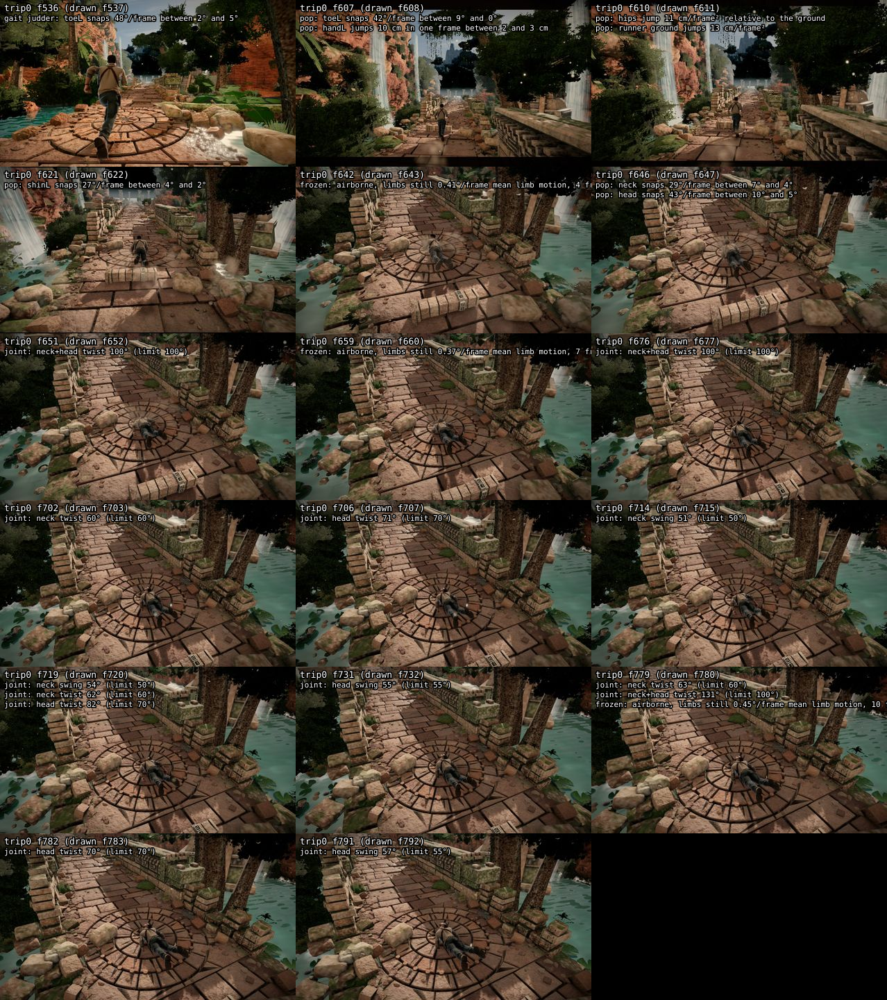

## ledge0

Timeline: 526–585 run/run · 586–586 crash/run · 587–796 crash/fall_drop

Gait judder (J / J of the joint's curve low-passed at 4× stride / excess; stride 2.5 Hz): spine 0.16/0.15/+0.01, chest 0.16/0.16/-0.01, neck 0.19/0.14/+0.05, head 0.18/0.20/-0.02, shoulderL 0.25/0.21/+0.03, shoulderR 0.25/0.25/-0.00, upper_armL 0.25/0.22/+0.03, upper_armR 0.25/0.22/+0.03, forearmL 0.24/0.21/+0.03, forearmR 0.24/0.21/+0.03, handL 0.22/0.19/+0.03, handR 0.22/0.19/+0.04, thighL 0.41/0.35/+0.06, thighR 0.48/0.38/+0.10, shinL 0.43/0.44/-0.01, shinR 0.37/0.42/-0.04, footL 0.68/0.75/-0.07, footR 0.73/0.76/-0.03, toeL 0.93/0.76/+0.17, toeR 0.87/0.75/+0.12

| frames | check | peak | clip at peak |
|---|---|---|---|
| 568 | judder: toeR judders in the gait | f568: J 0.87 vs 0.75 for its own curve low-passed at 4× stride (2.50 Hz): excess 0.12 (limit 0.1); worst frames f568, f569, f584, f556, f531, f555 | run/run |
| 575 | judder: toeL judders in the gait | f575: J 0.93 vs 0.76 for its own curve low-passed at 4× stride (2.50 Hz): excess 0.17 (limit 0.1); worst frames f575, f576, f536, f535, f551, f563 | run/run |
| 588 | pop: runner ground jumps | f588: 14 cm/frame² | crash/fall_drop |
| 589–591 | pop: hips jump | f589: 18 cm/frame² relative to the ground | crash/fall_drop |
| 600–601 | joint: upper_armR twist | f601: 146° (limit 110°) | crash/fall_drop |
| 607 | joint: upper_armR twist | f607: 114° (limit 110°) | crash/fall_drop |
| 635 | pop: head jumps | f635: 20 cm in one frame between 1 and 1 cm | crash/fall_drop |
| 635 | pop: handL jumps | f635: 19 cm in one frame between 2 and 6 cm | crash/fall_drop |
| 635 | pop: handR jumps | f635: 20 cm in one frame between 2 and 3 cm | crash/fall_drop |
| 760–773 | joint: shoulderL swing | f766: 45° (limit 40°) | crash/fall_drop |
| 760–773 | joint: shoulderR swing | f766: 45° (limit 40°) | crash/fall_drop |
| 763–770 | joint: chest swing | f766: 48° (limit 45°) | crash/fall_drop |
| 792–796 | joint: shoulderL swing | f796: 47° (limit 40°) | crash/fall_drop |
| 792–796 | joint: shoulderR swing | f796: 47° (limit 40°) | crash/fall_drop |
| 794–796 | joint: chest swing | f796: 51° (limit 45°) | crash/fall_drop |

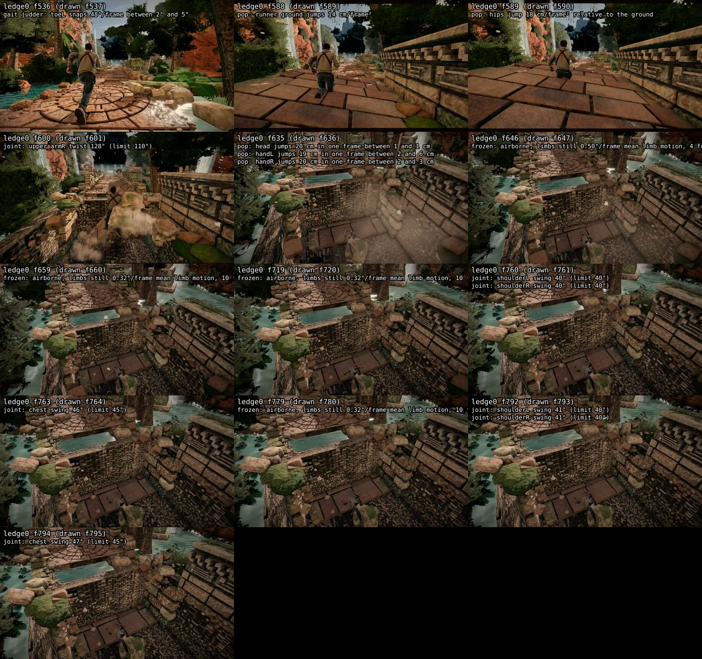
